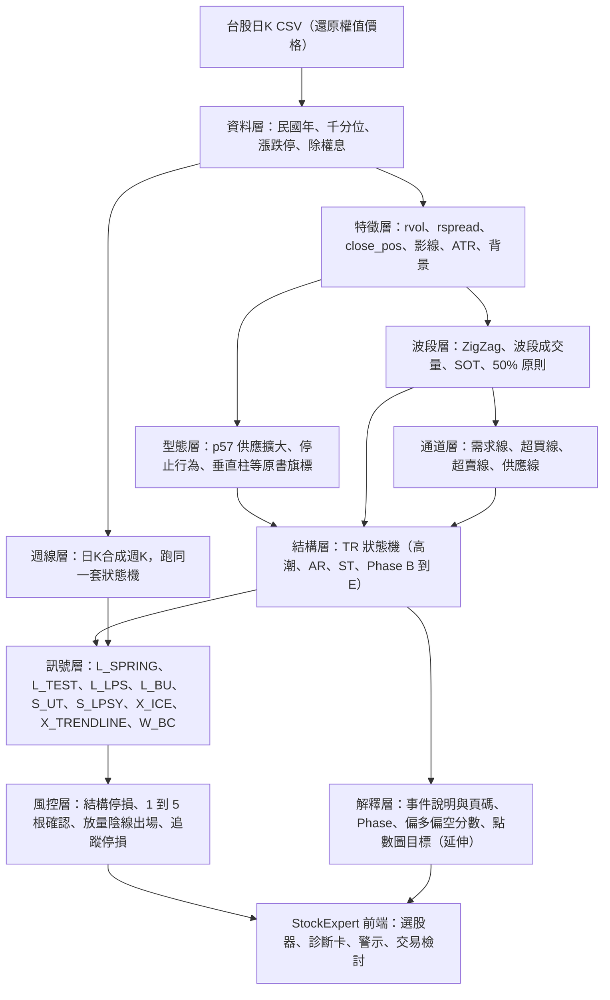
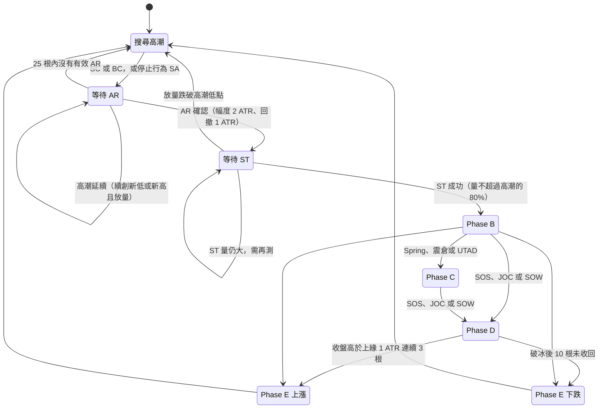

# 威科夫操盤法 完整知識整理

> 從孟洪濤《威科夫操盤法》到 StockExpert 可程式化價量訊號系統
> 研究日期：2026-11-01（v1.2 更新：2026-11-03）｜研究對象：Repository 內 `威科夫操盤法.pdf`（318 頁）｜原型程式：`wyckoff_prototype/`

---

## 0. 研究任務定義（優化後指令）

依使用者偏好，先將原始需求轉化為四個維度的精確指令，再依此執行：

| 維度 | 內容 |
|---|---|
| 【角色任務】 | 以「威科夫操盤法量化研究員＋台股系統設計顧問」身分，完整解讀孟洪濤著《威科夫操盤法》，產出可直接轉為 StockExpert 系統功能的知識庫與訊號規格。 |
| 【背景資訊】 | PDF 為簡體中文電子書轉檔（318 頁、無印刷頁碼），書中以「第一～四階段」與中文術語（初次支撐、恐慌拋售、上衝回落…）講解，**未使用** Phase A–E、AR、ST、UTAD 等標準縮寫；使用者要把理論落地成台股選股與決策輔助功能，並以 Repo 中的 CSV 做功能驗證。 |
| 【具體指令】 | ① 逐頁閱讀並建立頁碼索引 ② 整理核心哲學與三大法則 ③ 系統化四種結構與 Phase A–E ④ 建立 PS～SOW 事件辭典 ⑤ 為每個事件訂出進場、出場、停損與風控 ⑥ 把規則轉成公式、參數、狀態機與可執行程式 ⑦ 以台股情境示範應用 ⑧ 每個觀念標頁碼 ⑨ 區分【原書】與【延伸】。 |
| 【約束條件】 | 全文使用繁體中文 Markdown；頁碼一律標示 PDF 實體頁碼〔p.N〕；凡書中沒有的內容都明確標【延伸】；量化門檻集中列表並標註需校準；只新增檔案、保留原始 PDF 與既有檔案原狀、全程不下單交易；無法取得的資料如實說明。 |

---

## 1. 文件說明與閱讀指引

### 1.1 來源書籍

| 項目 | 內容 | 頁碼 |
|---|---|---|
| 書名 | 《威科夫操盤法：華爾街大師成功駕馭市場超過95年的秘技》 | 〔p.1、p.3〕 |
| 作者 | 孟洪濤（Edward Meng），1993 年起手繪日線圖與點數圖，曾任職通用資本、美國銀行，與 David Weis、Gary Fullett 共事 | 〔p.11–13〕 |
| 出版 | 山西人民出版社，2016 年 10 月第 1 版（本 PDF 為 2017 年 6 月第 3 次印刷），ISBN 978-7-203-09725-9 | 〔p.3–4〕 |
| 結構 | 前言＋六章＋後記；第五章 24 張「先看圖、自己判斷」練習，第六章公布答案 | 〔p.14–15〕 |

### 1.2 頁碼標註規則

- 〔p.N〕＝PDF 檔的**實體頁碼**（1–318），在 PDF 閱讀器輸入頁碼即可跳到該頁。本 PDF 由電子書轉檔，沒有印刷頁碼。
- 〔p.N–M〕＝跨頁；「圖 2-1」等圖號同步標示，方便在 PDF 內搜尋。
- PDF 為**簡體中文**，第 3 節術語表另列簡體原文，可直接用於 PDF 搜尋（例如搜尋「上冲回落」而非「上衝回落」）。

### 1.3 觀點來源標記

| 標記 | 意義 |
|---|---|
| **【原書】** | 書中明確寫出的定義、規則、案例結論，一律附頁碼 |
| **【延伸】** | 本報告依標準威科夫理論（Phase A–E、UTAD、BU 等通用術語）或研究判斷所做的推論，原書沒有直接寫出 |
| **【參數】** | 為了程式化而訂的數值門檻（例如「天量＝2 倍均量」），屬於延伸，必須用台股資料校準 |

### 1.4 兩個必須先知道的前提

1. **本書的術語體系與國際通用威科夫術語不同。** 書中以「吸籌第一～四階段」「派發四階段」組織內容；全書檢索「Phase」「AR」「ST」「UTAD」「BU」均為 0 筆。本報告第 7 章把書中內容對應到 Phase A–E，**這個對應本身屬【延伸】**。書中直接使用的英文縮寫只有：CM、SC、BC、SOS、SOW、JOC、UT、LPS、LPSY、SOT、VSB、TR、OKR、Spring、Shake out、Distribution、Oversold、bag holding。
2. **驗證狀態。** Repo 目前只有 PDF，沒有使用者提到的 CSV；本研究環境的網路政策也封鎖了證交所、Yahoo Finance、FinMind 等資料來源。因此第 10 章的程式只完成「邏輯自我測試」（合成資料），以及「隨機漫步」與「截斷資料重跑」兩項無未來函數檢查，**尚未用真實台股資料驗證績效**；第 11 章的台股案例中的價位為公開資訊的約略值，需以實際日 K 核對。CSV 推送後執行 `run_validation.py` 即可產出真實驗證報表（附錄 A）。

### 1.5 版本紀錄

> **StockExpert 開發者請直接閱讀《威科夫量價關係與程式化訊號規格.md》**：該文件把量價關係總表、指標公式、事件、交易訊號、出場規則、選股器與診斷卡規格整理成可實作的條列；本報告則保留理論全集與頁碼。

| 版本 | 日期 | 內容 |
|---|---|---|
| v1.0 | 2026-11-01 | 初版：全書整理、事件辭典、進出場與風控、狀態機原型、13 項測試 |
| v1.2 | 2026-11-03 | 補上原書的最小可行系統（牛市回調＋停止行為 `L_PULLBACK`）、死角交易法（`L_CORNER`）、無需求反彈（`S_NODEMAND`）、波段放量滯漲、持有期出場規則（SOT 縮緊停損、SOT＋回調>50% 離場、放量滯漲後量縮離場）、相對強弱整合與部位試算；測試增為 30 項；另立《威科夫量價關係與程式化訊號規格》供 StockExpert 開發使用 |
| v1.1 | 2026-11-03 | 新增通道線（需求線、超買線、超賣線、供應線）與 `X_TRENDLINE` 出場、由日 K 合成的週線背景、參數穩健性測試、點數圖目標價（延伸）、截斷資料因果性測試；測試增為 21 項（第 10.6.1、10.6.2、10.11、10.12 節） |

---

## 2. 執行摘要：十個關鍵結論

1. **全書只有一條主軸：用價格、成交量、走勢速度讀出供求關係，進而讀出主力（CM）的意圖**〔p.16、p.24〕；技術指標屬於「表象／第一層面」，作者主張完全放棄〔p.5–7、p.315〕。
2. **三大原則**：供求不平衡產生趨勢；趨勢反轉前必須有準備過程（因）；成交量增加卻沒帶來價格進展＝停止行為（努力與結果）〔p.24〕。
3. **絕不在左手邊抄底。** 熊市終止要依序看到「初次支撐→恐慌拋售→自動反彈→二次測試」四個行為〔p.70–75〕；從二次測試起才進入「右手邊」，才開始找進場點〔p.115〕。
4. **震盪區內部是 CM 控盤最集中、風險最大的地方**，要等區間右手邊出現 SOS 或 SOW 才行動，進場點在 SOS/SOW 的「測試」之中〔p.93、p.153、p.191〕。
5. **三個最安全的多方進場位置**：① SOS/JOC 之後的縮量回測（最安全）② 成功二次測試後的 Spring ③ 終極震倉（或其二次測試）〔p.82–83〕。在 JOC 當根追價屬於追高〔p.202〕。
6. **Spring 的品質取決於背景與量能**：縮量縮幅的 Spring 可直接進場；放量的 Spring 必須等二次測試；熊市或賣盤控制背景下的 Spring 是陷阱〔p.194–197、p.204、p.212〕。
7. **派發的四個停止行為**：初次供應→搶購高潮→自然回落→二次測試；確認派發要靠 UT 或 SOW，最佳做空（或最後出場）點是 SOW 之後的無量反彈 LPSY〔p.148、p.152–156〕。
8. **兩個可直接量化的原書規則**：「降價中供應擴大」三條件〔p.57〕，以及「SOS 可由連續三根更高的低點、收盤、高點加遞增量構成」〔p.95〕；另有 50% 原則〔p.143–147〕與突破幅度縮小 SOT〔p.137、p.140〕。
9. **危機管理＝對進場時機的甄別**，發生在進場後 1～3 或 3～5 根 K 線之內；沒有價量齊揚的跟隨，或出現放量陰線，就無條件出場〔p.83、p.316〕。
10. **程式化結論**：書中規則可分三類——可直接量化、可參數化、需人工判讀或多時間框架（【延伸估計】約為 2：6：2）。本研究已把前兩類實作成可執行的狀態機原型（第 10 章），在構造的完整週期中正確辨識 PS→SC→AR→ST→Spring→SOS→JOC→BU→BC→UTAD→SOW→破冰→LPSY，並通過無未來函數檢查；v1.1 再加入通道線、週線背景過濾、參數穩健性測試與點數圖目標價（延伸），21 項測試全數通過；v1.2 補上原書的最小可行系統（牛市回調＋停止行為）、死角交易法、無需求反彈與持有期出場規則，30 項測試全數通過。完整的量價關係總表與訊號規格見《威科夫量價關係與程式化訊號規格》；真實台股驗證依使用者指示暫緩。

---

## 3. 術語對照表（含 PDF 簡體原文，可直接搜尋）

| 原書用語（簡體，可搜尋） | 繁體 | 英文／縮寫 | 標準威科夫對應 | 主要頁碼 |
|---|---|---|---|---|
| 主力机构、CM | 主力（綜合人） | Composite Man, CM | CM | 〔p.7〕 |
| 初次支撑 | 初次支撐 | Preliminary Support | PS【縮寫為延伸】 | 〔p.71–73、p.76〕 |
| 恐慌抛售／超卖高潮／抛售高潮 | 恐慌拋售 | Selling Climax, SC | SC | 〔p.41、p.65 註3、p.73–74〕 |
| 自动反弹／自然反弹 | 自動反彈 | Automatic Rally | AR【縮寫為延伸】 | 〔p.72、p.74、p.113〕 |
| 二次测试 | 二次測試 | Secondary Test | ST【縮寫為延伸】 | 〔p.74–75〕 |
| 震荡区／交易区间／TR | 震盪區／交易區間 | Trading Range, TR | TR | 〔p.81、p.261〕 |
| 疲劳战术 | 疲勞戰術 | （無固定英文） | Phase B 的 CM 行為【對應為延伸】 | 〔p.83–86〕 |
| 弹簧效应／下冲反弹 | 彈簧效應／下衝反彈 | Spring | Spring | 〔p.40、p.66 註12、p.192–197〕 |
| 终极震仓／普通震仓 | 終極震倉／普通震倉 | Shake out | Shakeout／Terminal Shakeout | 〔p.65 註5、p.129–137〕 |
| 强势出现 | 強勢出現 | Sign of Strength, SOS | SOS | 〔p.66 註11、p.93〕 |
| 跳离震荡区／跳跃小溪 | 跳離震盪區／跳躍小溪 | Jump over the Creek, JOC | JAC／JOC | 〔p.66 註11、p.98–100〕 |
| 回测（跳离点） | 回測 | Back Up | BU【縮寫為延伸】 | 〔p.98、p.106、p.111〕 |
| LPS | 最後支撐點 | Last Point of Support | LPS | 〔p.115、p.133〕 |
| 弹跳板 | 彈跳板 | Springboard | Springboard | 〔p.200〕 |
| 初始供应／初次供应 | 初始供應 | Preliminary Supply | PSY【縮寫為延伸】 | 〔p.80、p.149〕 |
| 抢购高潮 | 搶購高潮 | Buying Climax, BC | BC | 〔p.47、p.66 註14、p.150–151〕 |
| 自然回落 | 自然回落 | Automatic Reaction | AR【縮寫為延伸】 | 〔p.152、p.160〕 |
| 上冲回落 | 上衝回落 | Upthrust, UT | UT | 〔p.38、p.66 註10、p.154〕 |
| （震荡区右手边的）上冲回落派发模式 | — | — | UTAD【命名為延伸】 | 〔p.182–184〕 |
| 弱势出现／熊市初显 | 弱勢出現 | Sign of Weakness, SOW | SOW | 〔p.66 註11、p.154–156〕 |
| 冰线／破冰 | 冰線／破冰 | Ice／Break of Ice | ICE | 〔p.34–35、p.65 註7、p.156〕 |
| 最后的派发点 | 最後派發點 | Last Point of Supply, LPSY | LPSY | 〔p.152、p.156〕 |
| 突破幅度缩小（递减） | 突破幅度縮小 | Shortening of Thrust, SOT | SOT | 〔p.137 註2、p.140–142〕 |
| 放量滞涨／放量滞跌 | 放量滯漲／放量滯跌 | （書中也統稱 SOT） | Effort without result | 〔p.46、p.58、p.66 註13〕 |
| 停止行为／终止行为 | 停止行為 | Stopping Action | Stopping Action | 〔p.78–80〕 |
| 垂直需求柱／垂直供应柱 | 垂直需求柱／垂直供應柱 | Vertical Supply Bar, VSB | — | 〔p.31、p.37、p.66 註9〕 |
| 死角 | 死角 | （收斂端點） | Apex／Coil【英文為延伸】 | 〔p.22、p.65 註4、p.114〕 |
| 超买线／超卖线／供应线／需求线 | — | Overbought/Oversold line, Supply/Demand line | 通道線 | 〔p.38、p.65 註8、p.263〕 |
| 吸收 | 吸收 | Absorption | Absorption | 〔p.115、p.293〕 |
| 张着口袋接盘 | — | bag holding | — | 〔p.276、p.278〕 |
| OKR | 外包反轉 | Outside Key Reversal | — | 〔p.298–299〕 |
| 左手边／右手边 | 左手邊／右手邊 | — | Phase A／Phase B 之後【對應為延伸】 | 〔p.115〕 |
| 高低价差 | 高低價差 | Spread | Spread | 〔p.282 註1〕 |
| 波形成交量／累积成交量 | 波段成交量 | Wave volume | Weis Wave【命名為延伸】 | 〔p.60–62、p.187、p.222〕 |
| 再吸筹／再派发 | 再吸籌／再派發 | Re-accumulation／Re-distribution | 同左 | 〔p.68、p.103、p.162–163〕 |

---

## 4. 核心理論與交易哲學

### 4.1 表象與本質：市場資訊的兩個層面【原書】

- 價格、成交量、技術指標是**表象**，屬於市場資訊的「第一層面」；必須拿到市場自身行為（本質，第二層面）去甄別真偽，才能判斷走勢〔p.5〕。
- 指標無法分辨價格背後的陷阱，這解釋了「交易系統一段時間有效、一段時間無效」與不斷修改參數的困境〔p.5、p.27〕。
- 只要掌握市場本質，可以放棄一切技術指標、不必解讀任何消息，因為消息的結果最終都反映在價量上〔p.5–7〕。
- 漲跌背後的動力若來自主力，是真漲跌；若來自公眾，則是主力設計的陷阱〔p.6–7〕。

### 4.2 主力（CM）的定義與行為習慣【原書】

CM（Composite Man）指掌握龐大資金、能短期控制價格走勢的投資人或機構；不必知道他們是誰，讀懂行為即可〔p.7〕。

| 行為習慣 | 頁碼 |
|---|---|
| 在主力眼中走勢是大大小小的交易區間：買點永遠在區間底部，出場永遠在區間頂部 | 〔p.8〕 |
| 進場時公眾恐慌，出場時公眾貪婪；震盪時製造長陽以便在頂部拋售，製造長陰甩掉公眾並吸收恐慌賣盤 | 〔p.8〕 |
| 吸籌時讓低價區走勢枯燥無味，使公眾絕望賣出；牛市初期嚴控走勢、成交清淡，不讓公眾進場 | 〔p.8〕 |
| 利好公布前拉抬，公布當天公眾搶購高潮＝主力出貨；壞消息前先派發 | 〔p.8〕 |
| 疲勞戰術、震倉（價格突然大幅下沉）、媒體配合（頂部唱多、底部唱衰） | 〔p.8–9〕 |
| 牛市中盡量把公眾擋在場外（否則出貨時找不到買家），需要公眾衝鋒時才用媒體與急漲造勢 | 〔p.148–149〕 |
| 在高位設定支撐（派發區底部）並以買單保護，直到貨出完才撤掉 | 〔p.150〕 |
| CM 不在市場時，價格移動是隨意的、價量極其模糊，這時應該休息 | 〔p.315〕 |

### 4.3 聰明錢與公眾的分析習慣【原書】〔p.11〕

| 公眾 | 聰明錢 |
|---|---|
| 嚴重依賴技術指標、新聞、傳言、基本面 | 不用技術指標、不解讀新聞，只用價格、成交量與變化速度 |
| 看到指標訊號就買賣 | 以市場自身行為與供求關係解讀價量 |
| 沒有危機管理，導致套牢 | 配合大背景下結論；使用危機管理把風險降到最低 |

### 4.4 三要素與九大用途【原書】〔p.16〕

三要素：**價格、成交量、走勢速度**；理論基礎：**供求關係**。九大用途：識別支撐阻力（價）、趨勢線角度＝速度（價）、超買超賣（價量）、誰在控盤（價量）、頂部 CM 製造狂熱（量）、底部 CM 製造恐慌（量）、支撐阻力的質量（量）、吸籌／派發的開始到結束（量）、CM 是否在吸收阻力上的賣盤並判斷能否突破（量）。

### 4.5 看盤五步驟【原書】〔p.17〕

1. **背景**（趨勢、所在階段）
2. **價量形態**：蠟燭長度、成交量高度、變化速度
3. **價量形態的性質**：強弱、原因、可能後果
4. **結論或預測**：洞察 CM 意圖並結合供求判斷方向
5. **措施和行動**：進場、出場、收緊停損

書中示範（圖 1-1～1-4，〔p.19–23〕）：上漲中回調的蠟燭與量都遞減＝供應沒進場，等停止行為或需求接盤再買；回調陰線擴大且量相對大＝供應擴大，不能做多；熊市中 SC 之後的反彈若帶超大量上影線＝遇強大供應；量萎縮的反彈＝SC 產生的需求枯竭；最後「高低範圍大幅縮小但量沒縮小」的停止行為加上略高的支撐，才是吸籌結束、可以進場的訊號。

### 4.6 市場本質交易法：先理論根據，再找價量確認【原書】

- 每次分析先問「這個判斷的理論基礎是什麼」，再到圖上找能確認理論基礎的價量；這種方法叫**市場本質交易法**〔p.225〕。
- 例：突破阻力的理論基礎＝阻力上的任何賣盤（包括很有威脅的賣盤）都被需求全部吸收，且需求占上風；在圖上找到吸收行為，就判斷阻力會被突破〔p.225〕。
- 例：判斷牛市結束的理論基礎＝需求減弱→供應大量進入→需求無力主導〔p.27–28〕；抄底的理論基礎＝供應枯竭＋需求增加並主導市場〔p.29〕。

### 4.7 行為需要被下一個行為確認【原書】〔p.98〕

證券市場是行情逐漸明朗的過程：**PS 需要 SC 確認；SC 需要 ST 確認（ST 確認後熊市終止）；SOS 需要後面的回測確認**，確認後代表 CM 已結束吸籌。這條確認鏈是第 10 章狀態機的骨架。

### 4.8 左手邊、右手邊與「區間內不交易」【原書】

- 熊市中的第一次反彈屬於左手邊，一般不在左手邊抄底；**從二次測試開始進入右手邊**，才開始尋找進場時機；右手邊最後確認牛市的是 SOS〔p.115〕。
- 吸籌中的進場首要原則：**必須在震盪區右手邊進場**，也就是在測試過程確認吸籌之後〔p.82〕。
- 震盪區是 CM 控盤最集中、交易風險最大的地方〔p.93〕；小區間內部不參與交易，任何震盪區形成後都要等 SOS 或 SOW〔p.109、p.153、p.191〕。

### 4.9 原則重於形態【原書】

- 掌握的不是形態而是原則：原則是本質，形態是表象〔p.72〕。
- 頭肩頂失敗率高，是因為忽略背後的供求關係；任何圖形都只是證明走勢理論根據的工具〔p.180〕。
- 圖形不能完全反映方向，必須同時參考背景、供求與價量〔p.224〕。

### 4.10 風控哲學【原書】

- 追求最好的交易時機，讓風險降到最低：即使觸發停損，虧損也在最低範圍〔p.6〕。
- 識別供求把風險降到最低後，**十次交易只對三到五次也能獲利**，一次獲利即可補平虧損〔p.27〕。
- 危機管理就是對進場時機的甄別，發生在進場後 1～3 或 3～5 根 K 線內；判斷錯誤就沒有任何藉口地立刻出場〔p.316〕。
- 交易筆記必不可少：記錄進場、出場、結果與感悟，每天堅持〔p.316〕。

### 4.11 作者反對「指標組合」——程式化要如何不違背原意

- 【原書】千萬別把本書方法和指標系統組合；威科夫方法獨立而完整，不需要再添加其他方法〔p.315–316〕。
- 【延伸】StockExpert 的程式化不是新增一個「黑箱指標」，而是把書中「用價量確認理論根據」的判讀步驟**結構化、可追溯**：每個訊號都附上它所依據的理論根據與頁碼（例如「Spring：跌破支撐 0.3 ATR、量 0.7 倍、當根收回〔p.195–197〕」），讓使用者看得到「為什麼」，而不是只看到「買／賣」。這與作者「看懂價量背後的理由」的精神一致，也能避免使用者盲目執行訊號。

---

## 5. 三大法則

### 5.1 供需法則（Supply and Demand）

**定義【原書】**
- 任何市場的價格波動都來自供求關係變化；供求不平衡產生趨勢；支撐、阻力、趨勢、價量波動等表象都由供求不平衡產生〔p.26〕。
- 需求＝購買力；供應＝流入市場的賣單數量，供應擴大＝拋售力度增加〔p.26〕。
- 供＞需→下降趨勢；需＞供→上漲趨勢；供需平衡→交易區間（「容易虧錢的危險區」）〔p.26〕。
- 例：要買 1,000 股但同價只有 200 股，經紀人只能以 101、102、103 元成交——價格上漲產生於供求不平衡〔p.26〕。

**趨勢中的供需【原書】**
- 上漲趨勢＝供不應求；當買方不必抬價就能買到（購買力被滿足），牛市開始停止；高成交量卻沒有上漲進展＝供應開始增加（CM 拋盤）〔p.28〕。
- 上漲中的回調是因為需求逐步減弱、要降價刺激新需求；看回調的關鍵＝**回調是否引起供應擴大**；回調後恢復上漲時若沒有更大的新需求，主力拋盤會繼續，進入派發〔p.28–29〕。
- 下降趨勢＝供＞需或需求很弱；要止跌，需求必須大量出現並吸收供應，之後盤整，CM 在盤整中吸籌或準備再次派發〔p.29〕。
- **抄底的價量順序：天量拋售→低量測底→震倉驅離最後的浮動供應，或長陽帶量離開吸籌區間**〔p.29〕。

**支撐與阻力的重新定義【原書】**〔p.30〕
- 支撐和阻力與圖上的線（均線、黃金分割線）無關，市場不知道你怎麼畫線。
- 支撐＝某價位購買力超過拋售壓力；價格再回到這裡時，觀察**反彈力度**＝需求質量。
- 阻力＝某價位拋售壓力超過購買力；價格再升到這裡時，觀察**回落力度**；回落量小＝賣單少，不威脅突破。
- 阻力＝買方不願按賣方出價成交；支撐＝賣方不願降價出售。

**支撐是否有效【原書】**
- 觸底後沒有強烈反彈＝買家在等更低價，支撐失效；要在支撐挺住，測試蠟燭必須是小蠟燭（供應枯竭）〔p.31–32〕。
- 放量但沒大跌且波動縮小＝賣方努力沒結果，可輕倉買入並做好危機管理，接下來有需求跟隨立刻加碼〔p.32〕。
- 在支撐進場後幾天出現低量小幅波動、沒有持續需求＝支撐無效，立刻出場〔p.32–34，圖 1-6〕。
- 支撐有兩個內涵：此價位買家需求大；此位置有大資金保護〔p.164〕。

**需求擴大、供應擴大的辨識【原書】**
- 震盪區中的需求擴大必須同時符合：**在震盪區右手邊、相對長的陽線（含長下影線）、擴大的成交量**；供應擴大相反〔p.39〕。
- 垂直需求柱＝長陽突破阻力＋量擴大，其底部自然形成支撐區，回測可作低風險買點〔p.31、p.39〕；垂直供應柱（VSB）的頂端是關鍵區，多單可在此出場，空方在此出現停止行為時進場〔p.66 註9〕。
- 阻力位判斷：向上突破的理論基礎＝阻力位沒有供應擴大、需求積極吸收阻力上的供應；向下反轉＝阻力位產生大量供應、需求無力吸收〔p.40〕。
- 在阻力區一系列蠟燭收盤相近＝需求減弱；陰線有跟隨且量遞增＝供應擴大〔p.36〕。
- 頂部右手邊出現相對放量的陰線＝看跌信號，必須清倉〔p.32〕。

**原書唯一的明確數量規則：降價中供應擴大**〔p.57〕
> 滿足以下條件即認為熊市開始：① 當日最低價和最高價分別低於昨日最低價和最高價 ② 當日收盤價低於昨日收盤價 ③ 當日成交量大於等於昨日成交量。

- 【延伸】此條件在一般下跌日也常成立，書中是放在「區間右手邊、已出現供應證據」的脈絡下使用（圖 1-19 的蠟燭 5），程式中應當作「背景條件下的確認」，而不是單獨的賣出訊號。

**牛市需要什麼樣的需求【原書】**〔p.316〕
- 需求占上風＝連續陽線伴隨遞增成交量；或以波為單位，每個上坡的蠟燭和成交量都比下坡的大。
- 牛市上漲不需要天量，只需勻速運行；出現天量上漲反而是搶購高潮〔p.116〕。

**程式化對照**（詳見第 10 章）

| 書中概念 | 程式欄位 |
|---|---|
| 需求／供應擴大 | `demand_exp`、`supply_exp_p57`、`vdb`、`vsb` |
| 上坡量大於下坡量 | `ud_vol_ratio`（上漲日總量／下跌日總量） |
| 支撐上的反彈力度 | 測試 K 線的 `rvol`、`rspread`、`close_pos` 與後續跟隨 |

### 5.2 因果法則（Cause and Effect）

**定義【原書】**
- 「因」＝趨勢出現前的準備過程（震盪區交易），「果」＝趨勢形成；研究因果是為了判斷反轉，在趨勢最初期介入以降低風險〔p.49〕。
- 任何主要趨勢反轉前都需要一個過程；沒有這個過程，接下來的趨勢不會持續太久；公眾在熊市第一個反彈就買入，失敗原因就是沒等吸籌結束〔p.24〕。
- 強調因果關係，就是提醒大家不要著急抄底〔p.49〕。

**熊轉牛的理論基礎【原書】**〔p.49〕：① 市場供應出現枯竭（賣單流入量已經很少）② 需求必須擴大並保持力度。2015 年 A 股 7 月初的長下影線放量是公眾抄底行為——跌勢雖猛、屬超賣，但沒有準備過程。

**CM 為何需要時間【原書】**
- 價格跌到 CM 滿意的成本後，市場上的股票遠不夠他們買，所以要把價格維持在小區間內（控制成本）並逼高位套牢者在區間內賣出，直到建倉滿〔p.50〕。
- 牛轉熊同樣需要震盪區：CM 隱蔽派發，不能一次賣完〔p.51〕。
- **恐慌拋售產生真正持久的牛市，沒有恐慌拋售的牛市不會持續太久**〔p.72〕。
- 沒有吸籌階段的上漲不會持續太久，就像民航機必須先在地面起跑〔p.258〕；最左邊的垂直下跌之後若沒有吸籌就迅速反彈，不符合因果關係，不找進場機會〔p.257〕。

**短暫的準備過程與多時間框架【原書】**
- 短的下跌常是大趨勢的深度回調；日線看不出準備過程時，可到較小時間框架找（圖 1-17 日線→圖 1-18 三小時圖），安全進場位置在區間右手邊〔p.53–54〕。
- 一般日線出現反轉前，小時線會提前出現上漲行為〔p.227〕；日線吸籌不明顯、類似 V 型反轉時，小時圖可以看到清楚的吸籌〔p.283〕。

**【延伸】點數圖與目標價**
- 原書只在作者經歷中提到手繪點數圖有助掌握吸籌與派發週期〔p.11〕，**全書沒有教授點數圖數格計算目標價**。標準威科夫以點數圖橫向數格衡量「因」的大小、推估「果」的幅度；原型已以 `cause_target()` 實作（v1.1）：區間內點數圖欄數 × 格值（區間內 ATR 中位數的一半）× 3 格反轉，自區間下緣或中線起算多方目標、自上緣或中線起算空方目標，並在診斷卡標示為延伸功能。
- 書中實際使用的目標是「結構性」的：上方前阻力、供應線、超買線、套牢區（例如〔p.229〕第一目標是供應線、〔p.237〕超買線是第一目標、〔p.298〕第一目標是套牢者的阻力區）。

### 5.3 努力與結果法則（Effort versus Result）

**定義【原書】**
- 努力＝成交量（市場流入訂單總量），結果＝價格進展幅度〔p.24〕；國內稱為放量滯漲、放量滯跌〔p.58〕。
- 成交量增長沒有使價格大幅增長＝走勢停止行為〔p.24〕。
- 在支撐附近量突然擴大但價格範圍很窄＝賣單被大量買單截住＝停止行為；在支撐和阻力位最實用，可以提前知道方向〔p.24–25〕。

**牛市中的放量滯漲【原書】**〔p.58–60，圖 1-20〕
- 購買力擴大而價格沒大漲＝遇到 CM 賣盤＝危險信號；後續可能 ① 回調後恢復上漲 ② 進入區間，怎麼努力都不漲（最危險，派發開始）。
- 量與前一天幾乎一樣但波動幅度明顯小於前一天＝努力沒結果；量擴大但無力創新高＝供應超過需求；**次日量迅速萎縮＝需求在消耗，這是清倉的最後時機**。
- 2015 年股指案例：十字星量沒減少但收在中部＝最明顯的派發信號〔p.170〕。

**熊市中的放量滯跌【原書】**
- 放量但蠟燭長度與跌幅大幅減小＝努力沒有結果＝放量滯跌〔p.46，圖 1-12〕；原因是 CM 接盤產生的需求超過公眾拋售〔p.66 註13〕。
- 第二種停止行為：下跌中蠟燭大幅縮小但成交量大幅增加；若發生在震盪區右手邊，可能大幅上漲〔p.80〕。

**波段成交量（努力的累積）【原書】**
- 不只看單根，而是看一波的累積成交量，更能體現努力程度〔p.60〕。
- 圖 1-21：第一個上漲波累積量 146 遠大於前幾波卻沒創新高＝放量滯漲（警告）；第二個上漲波 64 仍無進展＝供過於求；第三個下跌波量大增＝熊市開始〔p.60–62〕。
- 派發案例：BC 波 46.4 萬手、AC 突破幅度卻遠小於 ZA＝努力無結果；ST 波只剩 13.3 萬手＝需求耗盡；SOW 波 34.5 萬手是上漲以來最大下坡量〔p.187〕。
- SC 波 5.1 萬手 vs ST 5,000 手＝成功二次測試〔p.221〕；量增卻沒把價格推高＝浮動供應仍大〔p.222〕。

**UT 的努力與結果【原書】**〔p.154〕：價格 50→51 元努力是 1,000，51→52 元努力是 2,000，雙倍努力沒有相應收益＝供應擴大＝停止行為。「價格應該做什麼卻沒做成，是個警告」〔p.154、p.177〕。

**SOT 在書中有兩種用法（閱讀時要分清）**
- 〔p.66 註13〕：熊市放量滯跌與牛市放量滯漲都屬停止行為，**統稱 SOT**。
- 〔p.137 註2、p.142〕：**SOT＝Shortening of Thrust，突破幅度縮小**；可以是蠟燭之間、波峰之間或波谷之間的比較；價格測試主要支撐或阻力時出現 SOT，應立刻進場。
- 【延伸】國際通用的 SOT 指後者；本報告與程式一律以 SOT 表示「突破幅度縮小」，以「努力無結果／放量滯漲滯跌」表示前者。

**程式化對照**

| 書中概念 | 程式欄位 |
|---|---|
| 單根努力與結果 | `evr = rvol / rspread`（高＝放量窄幅） |
| 放量滯漲／滯跌 | `stop2_up`、`stop2_down`（量 ≥ 昨日、振幅 ≤ 昨日 60%） |
| 波段努力 | `waves()` 的 `wave_vol`、`vol_per_bar`，比較上漲波與下跌波 |
| 突破幅度縮小 | `SOT_up`、`SOT_down`（連續三個波峰／波谷的推進幅度遞減） |

---

## 6. 四種市場結構

### 6.1 吸籌（Accumulation）：書中的四個階段【原書】

吸籌＝CM 建倉並期待價格進入牛市的過程；收購的是公眾已失去興趣、因恐慌拋售而釋出的股票〔p.81〕。第二章宗旨：不盲目抄底，在風險最小的階段介入〔p.68〕。

| 書中階段 | 主要市場行為 | CM 的任務 | 供求狀態 | 頁碼 |
|---|---|---|---|---|
| 第一階段：熊市終止 | 初次支撐 → 恐慌拋售 → 自動反彈 → 二次測試 | 開始接盤；測試是否還有清倉行為 | 供＞需，但 SC 顯示需求開始吸收供應；成功 ST＝熊市暫停 | 〔p.70–77、p.81〕 |
| 第二階段：震盪拉鋸 | 區間震盪；早期波動與量較大、之後逐漸縮小；上漲波力度與量應大於下降波 | 控制上漲以大量收購；疲勞戰術（頂部壓價、反覆打壓、枯燥下滑） | 大致平衡，需求漸強、供應漸竭 | 〔p.81–89〕 |
| 第三階段：測試 | 終極震倉／Spring，及其二次測試 | 測試浮動供應，確認是吸籌而不是再派發 | 浮動供應被清除 | 〔p.90–91〕 |
| 第四階段：進入牛市 | SOS＋測試、JOC＋測試 | 撤掉頂部壓價賣單、允許上漲 | 需求超過供應、占絕對優勢 | 〔p.81、p.92–111〕 |

**第一階段要點**
- 熊市終止＝需求擴大後供應逐漸耗盡；四個行為全部清晰出現才判定熊市終止〔p.70、p.73〕。
- 自動反彈後小碎步下跌、量遞減＝熊市終止，市場進入震盪區、CM 暗自吸籌〔p.72〕。
- 熊市不是一次需求努力就能停止，需要幾次努力〔p.74〕。

**第二階段要點（疲勞戰術）**
- CM 的三步：恐慌拋售打擊→冗長枯燥的區間（每次回升立刻被打壓）→震倉（迅速穿透所有支撐，評估市面待售股票）〔p.83〕。
- 圖 2-6：蠟燭 3（AR 高點）與蠟燭 4（成功 ST）之間形成區間；突破阻力後又跌回＝CM 收購未完，無論市場有多少抄底消息都不能抄底；緩慢枯燥、量低迷的自由下滑最折磨公眾〔p.85–86〕。
- **CM 在底部收購不到股票時，會把收購價往上提**——表現為區間內支撐逐步墊高〔p.86、p.89、p.114、p.245〕。
- 回測停在高於原支撐的位置＝CM 最低價開始提高，是即將上漲的信號〔p.89〕。

**第三階段要點**
- 終極震倉三任務：迅速衝破所有支撐吸收剩下的股票、迫使弱者賣出、製造續跌假象〔p.90〕。
- 跌破幅度很小時叫 Spring，意義相同；之後會出現相應的二次測試；**終極震倉和 Spring 的二次測試是風險最低的抄底點**〔p.90〕。

**第四階段要點**
- SOS：區間內長陽伴隨明顯增高的成交量；測試若出現長陰放量，SOS 立刻失效〔p.93〕。
- JOC：SOS 突破區間頂部；必須發生在區間右手邊、突破後量要有跟隨、回調不能出現放量陰線〔p.98〕。

**變化型**
- **吸籌過程較短**（圖 2-19、2-20，〔p.112–117〕）：SC 的臨時支撐用兩種方法驗證——突破下降趨勢線、成功的二次測試；死角是最好的進場時機。
- **長期吸籌**（圖 2-21～2-24，〔p.117–123〕）：吸籌可能超過數年；過程中可能出現「看似熊市恢復」的深跌，事後由快速反彈確認為終極震倉；突破震倉趨勢線是很好的入場機會。
- **沒有恐慌拋售的熊市底部**（〔p.127–128〕）：中國股市底部前很少出現恐慌拋售；CM 改用「拉長區間時間」（拖數年）與「終極震倉（有時多次、幅度更大）」逼公眾賣出。上證 2009–2014 的冗長區間最後以 2014 年末的 JOC（或 SOS）結束，JOC 後的縮量回調是安全進場（或加碼）點。
- 【延伸】台股也常見「沒有典型 SC、以長區間＋震倉築底」的情況，程式因此允許以「停止行為」代替 SC 起算區間（參數 `allow_stopping_action_start`）。

### 6.2 派發（Distribution）：書中的四個階段【原書】

派發＝主力出貨；供應克服需求，結果是終止牛市並轉為熊市；主力清倉後不再提供支撐，甚至建立空頭；**派發常比吸籌在更短時間完成**〔p.65 註6、p.151〕。

| 書中階段（〔p.148〕） | 主要市場行為 | 頁碼 |
|---|---|---|
| ① 牛市如何結束 | 初次供應 → 搶購高潮 → 自然回落 → 二次測試（成功 ST 標誌牛市結束）；有時無 BC、以圓頂結束 | 〔p.148–153〕 |
| ② 設立派發區、引誘公眾 | CM 在高位設支撐並保護；每次回到支撐就反彈、反彈到頂部量擴大＝在派發 | 〔p.150、p.153〕 |
| ③ 測試（最重要） | 確認需求耗盡、準備降價；表達方式為上衝回落 UT | 〔p.148、p.154〕 |
| ④ 熊市信號 | SOW 出現，進入熊市；破冰後的無量反彈＝LPSY | 〔p.148、p.155–156〕 |

> 注意：書中〔p.148〕說派發有四個階段、第三階段是測試，但〔p.154〕的小節標題寫「第二階段：派發的確認階段」並同時講 UT 與 SOW。兩處編號不一致，本報告以〔p.148〕的四階段為準（詳見第 13 章）。

**派發的關鍵判讀【原書】**
- 最終決定由牛轉熊的因素是供應：只要沒有出現股票供應量擴大，牛市就沒有真正終止〔p.154〕。
- 單靠需求匱乏不能把牛市轉為熊市，必須在供應擴大的背景下，需求匱乏才表示熊市即將開始〔p.270〕。
- 受 CM 保護的支撐被長陰線增量跌破＝CM 撤掉夾板、貨快出完，熊市即將開始〔p.150〕。
- 二次測試之後的區間初期波動猛烈（公眾仍在搶購），隨 CM 出貨逐漸減弱；此時還無法確定是派發、吸籌或橫盤，要等測試階段才能確認〔p.153〕。
- 一般下跌速度快於上升速度，做空利潤來得更快〔p.191〕。

**派發的變化型【原書】**

| 類型 | 特徵 | 頁碼 |
|---|---|---|
| 沒有搶購高潮的派發 | 區間內每次反彈的蠟燭與量隨價格上漲遞減（需求耗盡），然後立刻放量下挫；確認方法是價格回落中供應劇增 | 〔p.173–175〕 |
| 低位派發 | 發生在 SOW 之後，常被誤認為做底；若下降的量和蠟燭大於上升的，或每次反彈都遇明顯供應＝派發。三個確認行為：背景有放量下挫、出現 UT、回升沒有需求 | 〔p.165–169、p.175–178〕 |
| 上衝回落派發模式 | 區間右手邊嘗試向上突破，蠟燭相對縮短但量大幅上升，1～3 根內回到區間＝派發 | 〔p.182–184〕 |
| 頭肩頂（威科夫解讀） | 左肩＝初始供應、頭＝搶購高潮、右肩＝測試；要看背後供求，不死記圖形 | 〔p.180–181〕 |
| 市場自我否定 | 強力 Spring 與巨量買盤之後價格無進展＝供應強勁，背景已改變 | 〔p.178–180〕 |
| 2015 年中國股指 | 7 個交易日漲 800 多點（趨勢線近乎垂直）＝CM 製造搶購高潮；收盤低於前一天＝CM 開始降價滿足公眾需求，是最重要但最易被忽視的熊市信號 | 〔p.169–173〕 |

### 6.3 再吸籌（Re-accumulation）

**【原書】散見於多處，沒有獨立章節：**
- 第二章也討論如何識別牛市中的再吸籌〔p.68〕。
- 上升趨勢中的窄幅盤整經常屬於再吸籌，之後繼續上漲；判斷關鍵是通道上軌（超買線）有無大量賣單、多數蠟燭是否收在中部以上〔p.103〕。
- 再吸籌中也會出現終極震倉（圖 2-30）：高量寬幅陰線深度跌破前期所有支撐，再由停止行為與 SOS 確認〔p.134–135〕。
- JOC 後的小區間全是小蠟燭＝再次吸籌，是專業操盤手的進場點〔p.110〕。
- 區間頂部出現兩次有威脅的長陰卻都沒有跟隨、被底部需求吸收＝小盤整是上漲前的再吸籌；關鍵的 Spring 確認是再吸籌而不是派發〔p.208–209〕。
- TR 中 Spring 之後出現 SOS 並被確認＝吸籌行為；TR 低點沒回到整個上漲的 50%＝上漲未受威脅〔p.262–263〕。

### 6.4 再派發（Re-distribution）

**【原書】**
- 第三階段的測試要確認震盪區是吸籌而不是再派發〔p.90〕。
- 黃金案例（圖 3-10～3-12）：SOW 後的下跌止於前支撐，看似小型恐慌拋售、可能再吸籌；但區間內一直沒出現 SOS，最後 13～15 這一波 SOW 跌破冰線，確認整個區間是再派發，黃金兩個半月由 1,600 跌到 1,200〔p.162–164〕。
- 低位派發發生在 SOW 之後、而不是頂部〔p.165〕；【延伸】在標準術語中，這類熊市中途的派發區間即屬再派發。

### 6.5 四種結構的判別

**原書的明確規則**
- 判斷震盪區是吸籌還是派發，關鍵是**測試階段**的市場行為〔p.162〕：
  - 出現 **SOS、終極震倉或 Spring** → 再吸籌，牛市恢復
  - 出現 **SOW 或帶量上衝回落** → 再派發，熊市繼續〔p.163〕
- 確定區間屬於吸籌最重要的特徵：**向上 JOC，或向下震倉後迅速上揚**〔p.258〕。
- 底部沒有看到終極震倉或 SOS（含 JOC）之一，不要抄底〔p.133〕。

**【延伸】四象限分類（程式採用）**

| 進入區間前的趨勢 | 區間的解決方向 | 結構 |
|---|---|---|
| 下跌 | 向上（Spring／震倉、SOS、JOC） | 吸籌 |
| 下跌 | 向下（UT、SOW、破冰） | 再派發 |
| 上漲 | 向下（UT／UTAD、SOW、破冰） | 派發 |
| 上漲 | 向上（Spring、SOS、JOC） | 再吸籌 |

**區間進行中的證據清單**（原書證據＋延伸計分；程式以 `bias` 累計）

| 偏多（吸籌／再吸籌）證據 | 頁碼 | 偏空（派發／再派發）證據 | 頁碼 |
|---|---|---|---|
| ST 量遠小於 SC | 〔p.74〕 | ST 量仍大、未見需求耗盡 | 〔p.183〕 |
| 上漲波力度與量大於下降波 | 〔p.81、p.316〕 | 下降的量和蠟燭大於上升 | 〔p.165〕 |
| 支撐逐步墊高（CM 提高收購價） | 〔p.89、p.114〕 | 高點台階式下降（浮動供應仍在） | 〔p.131〕 |
| 區間內量能隨時間遞減 | 〔p.81、p.245〕 | 反彈到頂部時放量（CM 在派發） | 〔p.150〕 |
| Spring／終極震倉後快速收回 | 〔p.90、p.131〕 | 帶量 UT 並有放量下挫跟隨 | 〔p.154、p.163〕 |
| SOS／JOC 並有縮量回測 | 〔p.98〕 | SOW 並有無量反彈 | 〔p.156〕 |
| 有威脅的長陰沒有跟隨、被吸收 | 〔p.209〕 | 有威脅的長陽沒有跟隨（努力無結果） | 〔p.177、p.179〕 |
| 死角中上漲波量大於下降波 | 〔p.290〕 | 死角＋供應加大背景 | 〔p.272〕 |

---

## 7. Phase A–E 詳解

### 7.1 對照表【延伸：把書中階段對應到標準 Phase】

| 標準 Phase | 吸籌（書中） | 吸籌事件 | 派發（書中） | 派發事件 |
|---|---|---|---|---|
| **A** 停止前一趨勢 | 第一階段：熊市終止〔p.70–77〕 | PS、SC、AR、ST | ① 牛市如何結束〔p.148–153〕 | PSY、BC、AR（自然回落）、ST |
| **B** 建立「因」 | 第二階段：震盪拉鋸〔p.81–89〕 | 區間震盪、疲勞戰術、量能遞減、支撐墊高 | ② 設立派發區〔p.150、p.153〕 | CM 護盤、反彈至頂放量、上漲無功而返 |
| **C** 測試 | 第三階段：測試〔p.90–91〕 | 終極震倉／Spring＋二次測試 | ③ 測試〔p.148、p.154〕 | UT／UTAD（區間右手邊的上衝回落〔p.182〕） |
| **D** 區間內確立方向 | 第四階段：進入牛市〔p.92–111〕 | SOS、JOC、LPS／BU | ④ 熊市信號〔p.155–156〕 | SOW、破冰、LPSY |
| **E** 離開區間 | 「告別吸籌區、開始牛市旅程」〔p.98〕 | 上漲、再吸籌、搶購高潮預警 | 熊市〔p.148〕 | 下跌、再派發 |

> 差異說明【延伸】：書中第四階段同時涵蓋標準的 Phase D 與 Phase E 的起點；書中也沒有細分 Phase B 內部的「上衝行為（UA）」「B 段二次測試」等事件，而是用「疲勞戰術」描述整個過程。

### 7.2 Phase A：停止前一趨勢

| 項目 | 吸籌 | 派發 |
|---|---|---|
| 特徵【原書】 | 持續無反抗的下跌後，PS 以擴大量止跌；SC 超長陰＋超高量；AR 是空頭回補；ST 蠟燭與量大幅縮小〔p.72–75〕 | 初次供應放量；BC 量陡增、上漲角度走向垂直；自然回落；ST 量小於 BC〔p.149–153〕 |
| 判斷條件【原書】 | 四個行為全部清晰出現＝熊市終止〔p.73〕；**成功 ST＝熊市停止信號**〔p.75〕 | **成功的二次測試標誌牛市結束**〔p.148、p.152〕 |
| 區間邊界【原書】 | AR 高點與 ST 形成區間（圖 2-1、2-6、2-28）〔p.71、p.85、p.87〕 | 自然回落的低點與二次測試的高點形成區間；自然回落底部＝冰線〔p.152、p.160〕 |
| 可以做什麼 | 開始分析、畫區間；**不在 SC、AR 進場**〔p.76–77、p.113〕；AR 若要搶只能短線〔p.119〕 | 持股者預警、縮緊停損；ST 成功後不再買入、應考慮離場〔p.141、p.152〕 |
| 量化條件【參數】 | SC：下跌 ≥15% 後創 60 日新低、量 ≥2 倍均量、振幅 ≥1.25 倍；AR：反彈 ≥2 ATR；ST：回到區間下方 40%、測試最大量 ≤ SC 量 80% | BC：上漲 ≥20% 後創 60 日新高、量 ≥2 倍、振幅 ≥1.25 倍、10 日漲幅 ≥4 ATR；AR：回落 ≥2 ATR；ST：回到區間上方 40%、量 ≤ BC 量 80% |

### 7.3 Phase B：建立「因」

| 項目 | 吸籌 | 派發 |
|---|---|---|
| 特徵【原書】 | 早期波動與量較大，逐漸縮小；上漲波力度與量大於下降波；CM 用疲勞戰術；收購價逐步提高〔p.81–89〕 | 初期波動猛烈（公眾仍在搶購），CM 不斷投放股票使上漲無功而返，波動和量逐漸減弱〔p.153〕 |
| 判斷條件 | 區間右手邊才有判斷意義；看量能是否遞減、支撐是否墊高、震倉前預警（高點台階下降）〔p.131〕 | 每次回到支撐就反彈、反彈到頂部放量＝CM 派發〔p.150〕 |
| 可以做什麼 | **不在區間內部交易**〔p.93、p.109〕；等 Phase C／D 訊號 | 同左；持股者準備出逃計劃 |
| 量化條件【參數】 | 區間建立後的量能趨勢、上漲日／下跌日量比 `ud_vol_ratio`、轉折低點是否墊高 | 反彈波量與回落波量比、轉折高點是否下降 |

### 7.4 Phase C：測試

| 項目 | 吸籌 | 派發 |
|---|---|---|
| 特徵【原書】 | 終極震倉：深度跌破區間底部；Spring：小幅跌破後 1～3 根回到支撐上方〔p.90、p.137 註1、p.194〕 | UT：試圖突破區間頂部、沒堅持住，1～3 根內跌回；過程中量增加〔p.154〕；右手邊「蠟燭縮短但量大幅上升」的 UT〔p.182〕 |
| 判斷條件【原書】 | 震倉或 Spring 後出現相應的二次測試，判斷浮動供應是否被全部吸收〔p.90〕 | UT 之後必須有跟隨（放量下挫）才能證明供應強勁〔p.154〕 |
| 可以做什麼 | Spring／震倉二次測試＝風險最低的抄底點〔p.90〕 | UT 是做空點，停損放在頂部高一個點〔p.154、p.207、p.212〕 |
| 量化條件【參數】 | 跌破 ≥0.05 ATR、3 根內收回＝Spring；跌破 ≥1 ATR 且放量或寬幅、10 根內收回＝震倉；二次測試量 ≤0.8 倍均量且 ≤ 跌破時量 70% | 突破 ≥0.05 ATR、3 根內收盤回到區間＝UT；距 ST 已 ≥10 根且前趨勢向上＝UTAD；後 3 根內出現量增陰線＝UT 確認 |

### 7.5 Phase D：區間內確立方向

| 項目 | 吸籌 | 派發 |
|---|---|---|
| 特徵【原書】 | SOS：區間內長陽放量，或連續 2～3 根「三個更高」＋遞增量；JOC：放量長陽突破區間頂部〔p.93–98〕 | SOW：放量長陰，必須在區間右手邊；或直接跌破冰線〔p.155–156〕 |
| 確認【原書】 | SOS 必須經隨後回調確認，確認過程一定是小蠟燭和小成交量〔p.66 註11〕 | SOW 必須經緊接著的無量上漲確認〔p.156〕 |
| 失效【原書】 | 測試出現長陰伴隨擴大成交量〔p.93〕 | 確認過程出現相對大的陽線伴隨遞增量〔p.161〕 |
| 可以做什麼 | LPS／BU（縮量回測守住）進場〔p.82、p.115〕 | LPSY 做空或最後出場〔p.152、p.156〕 |

### 7.6 Phase E：離開區間

| 項目 | 吸籌之後（上漲） | 派發之後（下跌） |
|---|---|---|
| 特徵【原書】 | 連續陽線、更高的高點／低點／收盤，量穩定遞增而非大幅增加〔p.89、p.131〕；回調力度小於上漲力度〔p.283〕 | 破冰後下跌空間很大，任何反彈都是做空點〔p.158〕 |
| 風控【原書】 | 搶購高潮是預警〔p.117〕；SOT＋回調超過 50%→縮緊停損，帶量跌破上升趨勢線→無論盈虧離場〔p.141–146〕 | 熊市中搶反彈是逆勢，風險遠大於盈利〔p.147〕 |
| 量化條件【參數】 | 收盤高於區間上緣 1 ATR 連續 3 根 | 收盤跌破區間下緣、10 根內未收回 |

---

## 8. 重要事件辭典

> 每個事件依序列出：原書定義（附頁碼）→ 價量特徵 → 確認 → 失效 → 交易意義 → 程式化條件【參數】。

### 8.1 PS 初次支撐（Preliminary Support）
- **原書定義**：熊市中 CM 提前介入、阻止下跌所提供的暫時支撐；若目的是吸籌，會隨價格下跌繼續收購〔p.72〕。
- **價量**：擴大成交量使下跌停止；之前應是持續、無反抗的下跌〔p.73〕；常見為下影線＋放量（圖 2-2 蠟燭 1）〔p.76〕；有時與 SC 發生在一起〔p.72〕。
- **確認**：需要後續 SC 確認〔p.98〕。
- **交易意義**：只是需求初現，不進場。案例：巴菲特 2008 年 9 月以 123 美元買高盛（後跌破 50 美元＝SC）、2016 年 1 月買 Phillips 66〔p.73〕。
- **程式化**：SC 出現後，回頭在前 3～40 根內找「放量（≥1.5 倍）停止行為」作為 PS；因為只能事後確認，其確認日＝SC 當天。

### 8.2 SC 恐慌拋售（Selling Climax）
- **原書定義**：也叫超賣高潮；下降趨勢持續一段時間後的潮水般恐慌拋售；標誌下降趨勢結束或接近結束；極寬振幅＋超高成交量，可在一天或幾天內完成；**沒有上述特徵就不是 SC；不是所有下降趨勢都有 SC；所有 SC 之後的成功二次測試將終止熊市**〔p.65 註3〕。
- **供求解讀**：天量＋超長陰線不是續跌信號，而是遇到巨大買盤；供應來自公眾恐慌，需求來自 CM 收購，需求的質量好於供應〔p.41–42〕。
- **確認**：需要二次測試確認〔p.75、p.98〕；也可由「突破下降趨勢線」驗證臨時支撐〔p.112〕。
- **交易意義**：抄底分析從這裡開始，但還不是進場時機〔p.76〕；SC 後市場也可能繼續下跌一段〔p.77〕。
- **程式化**：前置跌幅 ≥15%、收盤低於 50 日均線、創 60 日新低、`rvol ≥ 2.0`、`rspread ≥ 1.25`；若之後 1～2 根續創新低且放量，視為高潮延續並更新低點。

### 8.3 AR 自動反彈（Automatic Rally）
- **原書定義**：SC 之後的正常反彈；常是空頭回補，不會持續太久，**不要在這裡抄底**〔p.72、p.74、p.113〕；若要搶，必須是短線〔p.119〕。
- **區間意義**：AR 高點界定區間上緣（圖 2-1、2-6）〔p.71、p.85〕；AR 突破最近的趨勢線可以確認 SC 形成的支撐〔p.114〕。
- **辨識空頭回補**：空頭回補的上漲之後價格迅速帶量回落、抹掉漲幅；需求擴大的上漲之後二次測試緩慢、量與高低價差都減小〔p.228〕。
- **程式化**：SC 後追蹤最高點；反彈幅度 ≥2 ATR，且收盤自高點回撤 ≥1 ATR（高點須在先前的 K 線）時確認，該高點即區間上緣。

### 8.4 ST 二次測試（Secondary Test）
- **原書定義**：CM 想知道市場上是否還有清倉行為；**測試過程應是大幅減小的蠟燭和成交量**〔p.72〕；是決定熊市是否終止的關鍵一步，觀察重點是供應是否出現〔p.74〕。
- **成功**：價格波動和成交量與 SC 相比都非常小〔p.74〕；逐漸提高的支撐＝CM 提高收購價〔p.114〕。
- **需要再測**：量依然大但低於 SC，仍屬二次測試，要等待進一步測試直到供應耗盡〔p.74、p.77〕。
- **失敗**：測試過程中量繼續擴大＝浮動供應還在，會跌破支撐、熊市恢復〔p.74〕；ST 之後反彈無力會導致震倉或熊市繼續〔p.77〕。
- **交易意義**：ST 成功後進入右手邊〔p.115〕；積極者可在 ST 進場（「如果你已在二次測試階段進場，SOS 是對你的確認」〔p.94〕；〔p.125〕蠟燭 10 是二次測試可以進場；〔p.288〕小量小價差的二次測試可先買一些）。
- **程式化**：AR 確認後，價格回到區間下方 40% 的一段「測試」期間，其最大量 ≤ SC 量的 80%、最低點不低於 SC 低點 1 ATR，且之後收盤離開該區域時確認。

### 8.5 Spring 彈簧效應（下衝反彈）
- **原書定義**：價格迅速跌破支撐，然後迅速返回支撐上方，本身是下跌走勢的停止行為〔p.192〕；概念來自終極震倉，**與震倉的主要區別是突破幅度**〔p.137 註1〕；一般持續 1～3 根蠟燭〔p.194〕。
- **CM 目的**：收購恐慌拋出的股票；測試支撐附近是否存在大量賣單〔p.192〕。
- **種類（圖 4-2）**〔p.195–197〕：
  | 類型 | 跌破時的價量 | 處理 |
  |---|---|---|
  | 中間型（最佳） | 蠟燭和成交量都大幅縮小 | **可直接進場** |
  | 右側型 | 蠟燭和量略微擴大 | 等二次測試（要量縮、價差縮）；例外：牛市中收在中點之上可直接進場 |
  | 衍生成功型 | 量擴大、蠟燭不能超長、必須是收在 50% 之上的下影線 | 成功（高量代表需求吸收賣盤） |
  | 左側型 | 蠟燭和量都很大 | 不是需要的 Spring；在吸籌右手邊叫震倉，等二次測試 |
  | 失敗 | 反彈沒有持續上漲、量不隨價漲遞增 | 會跌破支撐續跌 |
- **位置**〔p.195〕：牛市區間底部；JOC 後回測突破點；回測垂直需求柱底部；吸籌尾聲（Spring 後出現 SOS＝吸籌結束）；熊市中（陷阱，不進場）；牛市中連續失敗＝預警。
- **確認**：之後價格應創新高，否則需求不足，價格形成區間或進入熊市〔p.66 註12〕；正確的 Spring＝跌破時供應耗盡（小量）、反彈時需求擴大（持續創新高的陽線＋遞增量）〔p.223〕。
- **背景過濾**：成功率高的 Spring 發生在上升趨勢中；**千萬不要在熊市中找 Spring**；賣盤控制背景下不能利用 Spring 進場〔p.194、p.204、p.223〕；下降趨勢中 Spring 經常失敗，專業空方利用它做空〔p.224〕。
- **前提**：支撐必須是之前已經建立的強支撐〔p.224〕。
- **程式化**：區間建立後，最低價跌破支撐 ≥0.05 ATR，並在 3 根內收盤回到支撐上方；依跌破 K 線的 `rvol`、`rspread`、`close_pos` 分成 A（<1.0、<1.0，直接進場）、B+（量 ≥1.0 但收在 50% 之上，直接進場）、B（等測試）、C（≥1.5、≥1.5，類震倉等測試）；近 10 根若有 ≥2 根放量陰線，且近 20 根下跌日總量大於上漲日總量，視為賣盤控制，一律改為等測試。

### 8.6 Shakeout 震倉（終極震倉／普通震倉）
- **原書定義**：震盪區中故意使價格下降以激起公眾平倉、投機者接盤；普通震倉發生在上升趨勢中、多受不利消息影響、之後快速恢復上漲；終極震倉發生在吸籌過程中，讓死扛的公眾拋股〔p.65 註5〕。
- **終極震倉總結**〔p.130–131〕：發生在吸籌或區間末期；表現為急速大幅深跌、衝破所有支撐，之前區間內每次反彈都離不開區間且高度越來越低，隨後快速反彈回區間；**震倉前預警＝反彈到不了前高、高點台階式下降**；震倉後的反彈必須帶牛市特點：持續更高的高點／低點／收盤，量穩定遞增（不是大幅增加）。
- **普通震倉**〔p.135–137〕：上漲中沒有任何供應出現時突然急跌；量相當大時必須等二次測試，二次測試必須小量小振幅，牛市才能恢復。
- **進場**：可直接在震倉中進場，但在二次測試進場風險較小〔p.83〕；突破震倉趨勢線是很好的入場機會〔p.123〕。
- **辨識**：牛市中突然大跌但沒有跟隨、隨後迅速反彈＝震倉；若沒有快速反彈而出現震盪區＝派發〔p.248〕。
- **程式化**：跌破深度 ≥1 ATR 且放量或寬幅，於 10 根內收回區間；若跌破後已觸發「破冰」，10 根內收回則改判為震倉；之後等待二次測試。

### 8.7 Test 二次測試（Spring／震倉之後）
- **原書**：終極震倉或 Spring 之後的二次測試，目的是判斷市面股票是否全部被吸收；是風險最低的抄底點〔p.90〕。普通震倉例：測試蠟燭 1 底部時量明顯縮小、收於高位＝供應耗盡，正是進場好時機〔p.137〕。
- **程式化**：在 Spring／震倉後 20 根內，最低價回到其低點上方 1 ATR 範圍內但不跌破低點 0.25 ATR 以上，`rvol ≤ 0.8`、量 ≤ 跌破時量的 70%、`rspread ≤ 1.1`、收盤位置 ≥0.4。

### 8.8 SOS 強勢出現（Sign of Strength）
- **原書定義**：需求控制市場的信號；之前常是交易區間或吸籌；特點是超長陽線伴隨超大成交量，有時是連續陽線伴隨遞增成交量；**SOS 必須經過隨後的價格回調確認，確認過程一定是小蠟燭和小成交量**〔p.66 註11〕。
- **上升波形式**：連續 2～3 根陽線，更高的最低價、收盤價和最高價，伴隨遞增成交量〔p.95、p.115〕。
- **失效**：測試出現長陰伴隨擴大成交量〔p.93〕；SOS 後量與蠟燭範圍立刻連續縮小＝沒有新需求跟進，到阻力區兩次放量下挫＝浮動供應未清〔p.95〕。
- **交易意義**：一般 SOS 後會有縮量回調，是安全的進場點〔p.95〕；SOS 後的三種走法：回測（希望縮量縮幅）、橫盤（可能派發）、立刻創新高（牛市繼續）〔p.97〕。
- **程式化**：區間內陽線、`rspread ≥ 1.25`、`rvol ≥ 1.5`、`close_pos ≥ 0.6`、收在區間中線之上；或 `demand_wave3`（連三根三個更高＋量不減）且收在中線之上；3 根內只記一次。

### 8.9 JOC 跳離震盪區（Jump over the Creek）
- **原書定義**：SOS 信號的一種；價格強烈上漲突破前期關鍵阻力或交易區間上邊界，高成交量和非常寬的振幅〔p.66 註11〕；由威科夫學生伊文斯總結〔p.93〕。
- **條件**：必須發生在震盪區右手邊；突破後成交量必須有跟隨；即使回調也不能出現放量陰線，否則失效、價格回到區間〔p.98〕。
- **跳躍小溪比喻**：小溪充滿賣單；價格先找供應薄弱處、短暫後退助跑再越過；回調中可能出現強反彈或震倉，可在那裡進場〔p.98–99〕。
- **交易意義**：**在 JOC 進場屬於追高**〔p.202〕；要等縮量回測突破點〔p.98、p.111〕。圖 2-12：第一次回落量非常大不是理想時機，量幾乎為零的那根才是最佳進場點〔p.100〕。
- **程式化**：收盤高於區間上緣 0.1 ATR，`rvol ≥ 1.3`、`rspread ≥ 1.0`、`close_pos ≥ 0.6`；量不足的突破記為「突破（量不足）」，需等測試〔p.125〕。

### 8.10 LPS 最後支撐點／BU 回測
- **原書**：價格回到支撐出現漂亮的反彈＝對 SOS 的確認，威科夫理論稱為 LPS，又一個安全進場點；高支撐位反彈說明下方已經沒有股票可買〔p.115〕。JOC 本身也是 SOS，其後的縮量回測屬於 LPS，是好的進場時機〔p.133〕。需求控制背景下，回調停在半路是牛市特徵〔p.133〕。
- **BU【縮寫為延伸】**：書中稱「回測跳離點／突破點」——價格回落到原阻力（現支撐）時量減少或有反彈即可進場〔p.106〕；回測中出現放量陰線＝供應回到市場〔p.111〕。
- **程式化**：SOS／JOC 後 15 根內出現回調（收盤走低），回調期間平均 `rvol ≤ 0.9`、最大 `rspread ≤ 1.25`、不出現放量長陰；JOC 情況回調低點不低於區間上緣 0.5 ATR（BU），SOS 情況回調低點高於前測試低點 0.25 ATR（LPS）；之後出現「收盤高於前一根最高價」即觸發。

### 8.11 PSY 初始供應（Preliminary Supply）
- **原書定義**：牛市中首次出現大量供應；部分來自 CM（價格接近目標）；圖上表現為放量下跌，或先急速上漲後放量下跌；只是臨時阻止牛市，不是牛市結束；對持倉者是預警〔p.149〕。上升中放量長上影線之後若出現放量急漲，該上影線就是初次供應〔p.80〕。
- **程式化**：BC 出現後回頭找前 3～40 根內的放量（≥1.5 倍）上影停止行為或放量陰線。

### 8.12 BC 搶購高潮（Buying Climax）
- **原書定義**：上升趨勢結束時，公眾受利好影響、擔心錯過而大舉買入，在高潮中耗盡力量；量明顯增加、振幅變大；之後自然下跌或橫盤，再出現二次測試或再次上漲；BC 後若回落非常弱＝供應沒擴大，價格會繼續上漲〔p.66–67 註14〕。
- **圖上表現**：成交量陡然劇增、上漲速度驟然加快，趨勢線角度走向垂直、嚴重超過 45 度〔p.151〕；天量可以看單日，也可以看一波的累積量是否為上漲以來最大〔p.151、p.174〕。
- **供求解讀**：需求來自公眾搶購，供應來自 CM（利潤目標到達），供應的質量好於需求；牛市中不希望看到超長陽線和放量〔p.47〕。
- **三種危險信號**：垂直上漲、頂部放量、趨勢線角度突然變陡〔p.97〕。
- **辨識竅門**：急速上漲若突破了一個重要阻力＝正常上漲；若在空中急漲、沒有通過任何阻力＝搶購高潮〔p.209〕。
- **交易意義**：持倉者預警、縮緊停損；牛市中沒看到供應擴大不能輕易猜頂〔p.47、p.117〕。
- **程式化**：前置漲幅 ≥20%、收盤高於 50 日均線、創 60 日新高、`rvol ≥ 2.0`、`rspread ≥ 1.25`、10 日漲幅 ≥4 ATR；同時發出 `W_BC` 警示。

### 8.13 AR 自然回落（Automatic Reaction）
- **原書**：BC 之後的自然回落；自然回落的底部是 CM 建立的派發支撐，也就是冰線；派發未結束前 CM 會保護此支撐〔p.152、p.160〕。
- **程式化**：BC 後追蹤最低點；回落 ≥2 ATR，且收盤自低點回升 ≥1 ATR 時確認，低點即區間下緣（冰線）。

### 8.14 ST（派發的二次測試）
- **原書**：二次測試的成功標誌牛市終止；看公眾的購買力是否耗盡，若沒有則需要幾次測試〔p.152〕；ST 量相對增長但小於 BC 量＝購買力開始消耗〔p.161〕；第一次測試量很大不是理想 ST，要等第二次（量大幅遞減）〔p.183〕。
- **程式化**：價格回到區間上方 40% 範圍，最大量 ≤ BC 量 80%、高點不超過 BC 1 ATR，之後收盤離開該區域時確認。

### 8.15 UT 上衝回落（Upthrust）
- **原書定義**：突破阻力線後又收在阻力線之下（上影線）；有時由 2～3 根完成；意義是主力迅速吃掉空方停損單然後任價格下跌〔p.66 註10〕；形成過程 1～3 根；**過程中成交量是增加的**；之後必須有跟隨才能證明供應強勁；確認＝接下來放量下挫〔p.154〕。
- **背景差異**：上升趨勢中的 UT 若量沒增加只是試探，不能做空；UT 後回調蕭條＝供應枯竭，有機會形成 JOC〔p.38〕；上升趨勢中的 UT 屬探索、不是反轉信號，回落停在反彈 50% 的位置＝探索行為〔p.102〕；牛市中的 UT 是陷阱，會誤導人做反轉〔p.110〕。
- **交易意義**：做空時 UT 是一個進場點；UT 和 SOW 是市場對買方的最後通牒〔p.154–155〕；停損放在頂部高一個點，第一目標在下方支撐〔p.207〕。
- **程式化**：區間建立後最高價突破上緣 ≥0.05 ATR、3 根內收盤回到上緣之下；突破段 `rvol ≥ 1.2` 記為放量 UT；之後 3 根內出現「陰線且量大於前一根」＝UT 確認，於派發背景或偏空區間發出 `S_UT`。

### 8.16 UTAD（派發後的上衝回落）【命名為延伸】
- **原書對應**：「上衝回落的派發模式」——BC、自然回落、ST 確認牛市終止後，在**震盪區右手邊**嘗試向上突破，蠟燭相對縮短但成交量大幅上升，1～3 根內又回到區間＝此區間是派發〔p.182–184〕；從蠟燭 2 開始的 UT 屬最後的派發測試階段，做空進場點應在測試 SOW 的回升中〔p.184〕。
- **程式化**：前趨勢向上的區間中、距 ST 已 ≥10 根的 UT 標為 UTAD，權重較一般 UT 更偏空。

### 8.17 SOW 弱勢出現（Sign of Weakness）
- **原書定義**：供應控制市場；價格下降伴隨變寬的振幅、成交量增加到非常大；之前常是交易區間，是熊市標誌；需要隨後的反彈確認，反彈無力則 SOW 有效〔p.66 註11〕。
- **條件**：特點是放量長陰，**必須出現在震盪區右手邊才有效**；出現時只是「可能的 SOW」，必須經緊接著的無量上漲確認；兩種表現：區間內向下努力、直接跌破區間（破冰）〔p.155–156〕。
- **失效**：確認過程是相對大的陽線伴隨遞增量＝新需求進場，SOW 失效〔p.161〕。
- **其他確認例**：下跌 21 天、上漲 43 天但量大幅縮小＝供應大於需求，上漲過程確認 SOW〔p.161〕；花三週反彈仍沒彌補下跌、量保持但價格無進展＝努力無結果，確認 SOW〔p.173〕。
- **程式化**：區間內陰線、`rspread ≥ 1.25`、`rvol ≥ 1.5`、`close_pos ≤ 0.4`、收在中線之下；3 根內只記一次；若之後出現放量長陽收復 SOW 高點＝SOW 失效。

### 8.18 冰線與破冰（Ice／Break of Ice）
- **原書定義**：冰線是上升趨勢中最後一道防線；冰線上大量買單因跌破而套牢＝供應戰勝需求，跌破後下跌幅度很大；位置一般是新高前反彈波段的低點，或下降趨勢中回調前的反彈低點〔p.65 註7〕；在下降趨勢中，冰線（橫線）是被套買單的成本區，也是阻力〔p.34–35〕。
- **破冰**：價格跌破震盪區底部，就像人跌落冰下，向上時碰到厚冰層（供應）會再沉；破冰後返回冰線遇強大供應，價格重新下跌〔p.156〕；破冰之後任何反彈都是做空點〔p.158〕；任何回測冰線都可能是做空時機〔p.175〕。
- **CM 意義**：冰線是 CM 為高位派發設立的支撐；派發完畢的第一個動作就是不再防守冰線，直到下一個吸籌階段才會再建多倉〔p.299、p.314〕。冰線一旦被帶量突破，大跌在即〔p.171〕。
- **程式化**：收盤跌破區間下緣 0.25 ATR 且已過 2 根仍未收回＝`ICE`，發出 `X_ICE`（多單出場）；10 根內收回則改判震倉；未收回則區間判定向下解決。

### 8.19 LPSY 最後派發點（Last Point of Supply）
- **原書**：破冰後反彈量遞減＝需求耗盡，反彈頂部是最後的派發點；**做空的最佳位置、出逃的最後一班車**〔p.152〕；SOW 之後以小成交量和小蠟燭的反彈＝LPSY，是威科夫交易中的最佳做空點〔p.156〕。
- **程式化**：SOW 或破冰後 15 根內的反彈，平均 `rvol ≤ 0.9`、高點不超過 SOW K 線高點（或冰線）0.25 ATR，之後出現「收盤低於前一根最低價」即觸發 `S_LPSY`。

### 8.20 其他關鍵行為

| 行為 | 原書定義與用法 | 頁碼 | 程式化 |
|---|---|---|---|
| 停止行為（第一種） | 下跌中較大下影線＋擴大量；上升中較大上影線＋擴大量；暫時停止、非立即反轉 | 〔p.78〕 | `stop1_down`、`stop1_up`（影線 ≥40%、`rvol ≥ 1.2`、對照 3 日前收盤判斷方向） |
| 停止行為（第二種） | 蠟燭大幅縮小但成交量大幅增加；在回調或二次測試中出現停止行為是買入時機 | 〔p.80、p.97〕 | `stop2_*`（量 ≥ 昨日、振幅 ≤ 昨日 60%、`rvol ≥ 1.0`） |
| 上升中放量上影後的三種情況 | 縮量回調後創新高（暫時供應）；出現區間（可能派發）；放量急漲（瘋狂搶購，上影＝初次供應） | 〔p.80〕 | 由後續事件判定 |
| 垂直需求柱／VSB | 長陽放量突破＝底部為支撐；VSB 頂端為關鍵區，多單出場、空方在頂端停止行為時進場 | 〔p.31、p.66 註9、p.212〕 | `vdb`、`vsb`（`rspread ≥ 1.5`、`rvol ≥ 1.5`、收盤位置 ≥0.6／≤0.4） |
| 死角 | 支撐或阻力位上高點遞降、低點遞升、波動越走越窄；意味很快大幅波動，是提前進場的好時機；需求背景下的死角＝死角交易法，扣扳機的依據是「進入死角」這個現象 | 〔p.65 註4、p.114、p.272〕 | `dead_corner`（近 10 根平均振幅 < 近 60 根 60%、5 日高點下降、5 日低點上升） |
| 吸收 | 供應區附近套牢者保本賣出、量擴大但收盤在高位＝需求吸收賣盤；只發生在強勢出現之後 | 〔p.115、p.237、p.293、p.303〕 | 區間上緣附近高量＋高收盤位置 |
| 超賣／超買 | 持續急速下跌（含跌破下降通道超賣線）中間沒有反彈；超賣後在主要支撐會反彈 | 〔p.65 註2、p.263〕 | 通道線（連接連續波谷）【延伸】 |
| bag holding | 回測支撐時量大增但價格下跌緩慢＝買方張著口袋接盤 | 〔p.276、p.278〕 | 高 `evr`＋低跌幅 |
| OKR | 阻力區右手邊高量陰線包住前一根＝市場行為已轉變 | 〔p.298–299〕 | `okr_bear`、`okr_bull` |
| 收盤低於前一天 | 量略升但收盤低於前一天＝CM 開始降價滿足公眾需求，最重要的熊市信號之一 | 〔p.171、p.250〕 | 區間右手邊 `c < c[-1]` 且量增【延伸組合】 |

---

## 9. 進場、出場、停損與風險控管

### 9.1 原書的多方進場位置

| # | 進場位置 | 進場條件【原書】 | 頁碼 | 程式（v1.2） |
|---|---|---|---|---|
| L1 | **SOS／JOC 之後的回測**（最安全） | 回測過程必須是小蠟燭和低成交量；回落到原阻力（現支撐）時量減少或有反彈；或回測中出現停止行為 | 〔p.82、p.98、p.106、p.111〕 | ✔ `L_BU`、`L_LPS` |
| L2 | **成功 ST 後的 Spring** | 已見成功 ST，且上漲陽線與量比下降陰線與量長；Spring 稍微跌破支撐可直接進場；跌破較大且量增，必須等二次測試 | 〔p.82〕 | ✔ `L_SPRING` |
| L3 | **終極震倉** | 可直接在震倉中進場，但在後來的二次測試進場風險較小 | 〔p.83〕 | ◐ `L_TEST`（在其二次測試進場） |
| L4 | **Spring／震倉的二次測試** | 風險最低的抄底點；測試量縮、守住低點、收於高位 | 〔p.90、p.137〕 | ✔ `L_TEST` |
| L5 | **縮量縮幅的 Spring**（牛市區間底部） | 無量小蠟燭的 Spring 可直接進場 | 〔p.195–196〕 | ✔ `L_SPRING`、`L_PULLBACK` |
| L6 | **SOS 後的 LPS** | 回到支撐漂亮反彈、高支撐位反彈 | 〔p.95、p.115〕 | ✔ `L_LPS` |
| L7 | **死角** | 需求逐漸擴大的背景下行情進入死角＝買入風險最低 | 〔p.114、p.233、p.290〕 | ✔ `L_CORNER` |
| L8 | **牛市回調的停止行為** | 需求背景下回調應是更小的蠟燭和成交量，扣扳機的地方是停止行為（SOT 或 Spring）；可配合 50% 或垂直需求柱底部 | 〔p.31、p.40、p.239–240、p.316〕 | ✔ `L_PULLBACK` |
| L9 | **冰線交易法** | 下降通道中突破冰線後，以低量回調到冰線／突破 K 線低點／1～3 波 50% 進場 | 〔p.240–242〕 | ◐ `L_PULLBACK` 的突破點支撐區 |
| L10 | **二次測試本身**（積極型） | 小量小價差的二次測試可先買一些，等需求出現再補倉 | 〔p.94、p.125、p.288〕 | ✘ 只產生 `ST` 事件（刻意不發訊號） |

**不可進場的位置【原書】**：SC 當下〔p.76〕、AR（空頭回補）〔p.72、p.113〕、震盪區內部〔p.93、p.109〕、JOC 當根（追高）〔p.202〕、熊市或賣盤背景下的 Spring〔p.204、p.212、p.313〕、搶購高潮附近〔p.47、p.116〕。

### 9.2 原書的空方（或多單出場）位置

| # | 位置 | 條件【原書】 | 頁碼 | 程式（v1.2） |
|---|---|---|---|---|
| S1 | **UT** | 突破區間頂部後 1～3 根回到區間，量增，之後有放量下挫跟隨 | 〔p.154、p.161、p.207、p.212〕 | ✔ `S_UT` |
| S2 | **SOW 之後的回測／LPSY** | SOW 後小量小蠟燭的反彈＝最佳做空點；多單的最後一班車 | 〔p.152、p.154、p.156、p.184〕 | ✔ `S_LPSY` |
| S3 | **破冰後的回測** | 破冰後任何反彈、任何回測冰線都可能是做空時機；須在冰線附近出現停止行為 | 〔p.158、p.175、p.282、p.299〕 | ✔ `X_ICE`、`S_LPSY` |
| S4 | **供應背景下的無需求反彈** | 跌破支撐線後的第一個反彈，蠟燭和量必須縮小 | 〔p.229–231、p.253、p.273、p.284〕 | ✔ `S_NODEMAND` |
| S5 | **熊市背景的阻力區停止行為** | 上漲到前期阻力遇阻、出現 SOT 或停止行為 | 〔p.233〕 | ✘ 回測只做多 |
| S6 | **頂部右手邊相對放量陰線** | 持股必須清倉、絕不能再買 | 〔p.32〕 | ◐ M03、`SOW` |

【延伸】台股散戶放空受融券、借券、平盤下不得放空等限制；StockExpert 預設把 S1～S6 當作**多單出場或避開的訊號**，放空功能另設開關。

### 9.3 原書的停損設定（逐條彙整）

| 情境 | 停損位置【原書】 | 頁碼 |
|---|---|---|
| 突破冰線後回測進場 | 突破蠟燭的低點 | 〔p.36〕 |
| UT 做空 | 頂部高一個點 | 〔p.207、p.212〕 |
| 小時圖確認、日線進場 | 日線最低點下面一個點 | 〔p.229〕 |
| 熊市阻力區做空 | 範例中的固定價位（止損在 58） | 〔p.233〕 |
| JOC 回測出現 Spring | 比 JOC 蠟燭底部低 2 個點 | 〔p.215〕 |
| Spring | 突破（跌破）的最低點 | 〔p.224〕 |
| 判斷為震倉後輕倉進場 | 蠟燭 4（震倉前低點）下方低一點 | 〔p.263〕 |
| 二次測試進場 | 跳離區間蠟燭下方一個點（「需求的起始」，災難性停損） | 〔p.289〕 |
| Spring 進場 | 蠟燭 3（Spring 前的需求柱）下方 | 〔p.306〕 |

歸納【延伸】：原書的停損一律放在「**證明判斷錯誤的結構點**」之外一小段距離——需求的起點（突破 K 線低點、Spring 最低點、震倉低點）或供應的起點（UT 高點）。程式以「結構點 ± 0.1 ATR」實作，「一個點」在台股可換算為最小跳動單位（例如 50～100 元股價為 0.1 元）。

### 9.4 進場後的確認與危機管理【原書】

| 規則 | 頁碼 |
|---|---|
| 進場後必須看到價格和成交量遞增；若看到放量陰線＝遇到大量供應，立刻出場 | 〔p.83〕 |
| Spring 買入後若再遇強大供應＝市場否定進場時機，當機立斷離場，再觀察新供應是曇花一現還是新清倉 | 〔p.192〕 |
| 聰明錢進場做多後，必須看到價格伴隨成交量持續上漲且不能遇到強大供應，否則離場 | 〔p.198〕 |
| 進場前設好停損；進場後觀察是否出現持續新高的陽線與遞增量，否則立刻出場、等下一個二次測試 | 〔p.223〕 |
| 日線出現陰線且量增＝供應恢復力量，無論盈虧一定出場 | 〔p.229〕 |
| 做空後若出現帶量長陽或收於中間之上的下影線，立刻出場 | 〔p.233〕 |
| 支撐買入後若出現小蠟燭小量反彈（無需求反彈），立刻出場 | 〔p.235、p.261〕 |
| 進場後若沒有連續上漲和遞增量，立刻離場 | 〔p.240、p.251〕 |
| 做空後期待下跌伴隨量遞增，否則出場等候 | 〔p.253〕 |
| JOC 回測時出現放量陰線回到區間，立刻離場；尚未進場者放棄進場計劃 | 〔p.258、p.268〕 |
| 反彈後量立刻大幅縮小＝需求後勁不足；回落時量上升＝賣盤介入，做離場準備 | 〔p.263〕 |
| 價格跌破主要支撐後無需求反彈，立刻離場 | 〔p.278〕 |
| 做空後帶量下跌繼續持有；任何陽線突破冰線立刻離場 | 〔p.282〕 |
| 回測量大且收低、之後反彈量遞減＝警告，應減倉或出場；向下跌破死角則平倉 | 〔p.295〕 |
| 出現陰線回調伴隨擴大的成交量，減倉或平倉離場 | 〔p.300、p.304〕 |
| **危機管理＝進場後 1～3 或 3～5 根內甄別進場時機；發現過早或判斷錯誤，沒有任何藉口地立刻出場** | 〔p.316〕 |

### 9.5 持有期間的出場與減碼【原書】

| 訊號 | 處置 | 頁碼 |
|---|---|---|
| 搶購高潮（量陡增＋角度變陡） | 預警；縮緊停損 | 〔p.97、p.116–117〕 |
| 上升波突破幅度遞減（SOT） | 縮緊停損、準備出逃計劃 | 〔p.141〕 |
| 上升趨勢線被突破 | 無論盈虧必須離場（程式：放量跌破需求線 → `X_TRENDLINE`） | 〔p.142、p.146〕 |
| SOT＋回調跌破前波 50% 且波動與量增加 | 立刻離場是避免災難的唯一方法 | 〔p.145–146〕 |
| 量擴大但價格不再創新高、次日量萎縮 | 清倉的最後時機 | 〔p.59–60〕 |
| 價格到區間右手邊、買方努力無結果 | 逐步平倉 | 〔p.98〕 |
| 破冰 | 多單必須出場 | 〔p.156、p.171〕 |
| LPSY | 出逃的最後一班車 | 〔p.152〕 |

### 9.6 部位與資金管理

**【原書】**
- 低風險進場是一切的前提：即使停損，虧損也在最低範圍〔p.6〕；勝率三到五成仍能獲利〔p.27〕。
- 試單與加碼：放量滯跌時可輕倉買入，需求跟隨立刻加倉〔p.32〕；二次測試先買一些，等需求出現再補倉〔p.288〕；判斷為震倉後輕倉進場〔p.263〕；JOC 後的縮量回調是安全的進場（或加倉）點〔p.128、p.133〕。

**【延伸】建議的系統化規則（供 StockExpert 試算）**
- 單筆風險：帳戶淨值 × 0.5%～1%；股數＝風險金額 ÷（進場價 − 停損價），再依台股每張 1,000 股或零股取整。
- 分批：Spring／ST 試單 1/3 → 出現 SOS 或測試成功加碼 1/3 → JOC 回測（BU）再加碼 1/3，每次加碼後把整體停損上移到最新結構點。
- 程式：`position_size()` 依結構停損與單筆風險比例計算股數（含來回成本、部位上限 25%、可保留零股）（v1.2）。
- 以 R 倍數記錄（R＝初始每股風險），統計每種訊號的期望值；原書「勝率三到五成也能獲利」意謂平均獲利至少要是平均虧損的 1.5～2.5 倍以上。
- 單一產業或高度相關個股的同時曝險設上限，避免同一個大盤 SOW 一次擊穿多筆停損。

### 9.7 各事件的進場、停損、出場、風控總表 ★

| 事件 | 方向 | 進場觸發 | 初始停損 | 確認（1～5 根內） | 失效／出場 | 原書頁碼 |
|---|---|---|---|---|---|---|
| PS | — | 不進場 | — | 等 SC | — | p.72–73 |
| SC | — | 不進場（開始畫區間） | — | 等 AR、ST | 放量跌破 SC 低點＝熊市恢復 | p.74–77 |
| AR | — | 不進場（短線搶反彈除外） | — | — | — | p.72、p.119 |
| ST（積極） | 多 | 小量小價差、守住 SC 低點的測試 K 收盤 | 測試低點或 SC 低點下一檔 | 出現 SOS | 量增跌破支撐 | p.94、p.125、p.288 |
| Spring A／B+ | 多 | Spring K 收盤（或次日開盤） | Spring 最低點下一檔 | 持續創新高陽線＋量遞增 | 反彈無需求、收盤跌破 Spring 低點、放量陰線 | p.195–197、p.224 |
| Spring B／C、震倉 | 多 | 等二次測試：量縮、價差縮、守住低點 | 跌破低點下一檔 | 同上 | 二次測試仍放量長蠟燭→放棄 | p.83、p.90、p.196–197 |
| SOS | — | 不追；等縮量回調 | — | — | 測試出現放量長陰＝失效 | p.93、p.95 |
| LPS | 多 | 縮量回調守住更高低點後需求回來 | LPS 低點下一檔 | 三個更高＋遞增量 | 回調出現放量陰線 | p.115、p.133 |
| JOC | — | 不追（追高） | — | — | 回測放量陰線回到區間 | p.98、p.202 |
| BU（JOC 回測） | 多 | 縮量回測突破點、出現停止行為或強反彈 | 突破 K 線低點下 1～2 檔 | 連續陽線、更高高低收 | 放量陰線回到區間 | p.36、p.106、p.111、p.215、p.300 |
| 死角 | 多 | 需求背景下進入死角，或向上突破死角 | 死角低點下【延伸】 | 突破後量增 | 向下跌破死角→平倉 | p.114、p.295 |
| 牛市回調停止行為 | 多 | 需求占上風、回調 ≤50% 且縮量，在支撐區出現停止行為（Spring、放量滯跌、長下影、縮量小蠟燭、SOT） | 觸發 K 與支撐結構低點下一檔 | 價量齊揚 | 放量陰線、跌破停損 | p.316、p.143、p.239–251 |
| PSY | 出場預警 | — | — | — | 縮緊停損 | p.149 |
| BC | 出場預警 | — | — | — | 停損上移至 BC 低點【延伸】 | p.97、p.117、p.141 |
| ST（派發） | 不買 | 成功＝牛市終止 | — | — | 持股考慮離場 | p.152 |
| UT／UTAD | 空／出場 | UT 確認（放量下挫跟隨） | UT 高點上一檔 | 下跌伴隨量遞增 | 帶量長陽、收於中間之上的下影線 | p.154、p.207、p.212、p.233 |
| SOW | 出場 | 不在當根追空；等無量反彈 | — | 無量上漲確認 | 大陽線＋遞增量＝SOW 失效 | p.155–156、p.161 |
| 破冰 | 出場 | 多單出場 | — | — | 10 根內收回＝震倉 | p.156、p.171 |
| LPSY | 空／最後出場 | 無量反彈後供應回來 | 反彈高點上一檔 | 帶量下跌 | 陽線突破冰線 | p.152、p.156、p.282 |
| 無需求反彈 | 出場 | 放量跌破需求線後的縮量反彈被拒 | 反彈高點上一檔 | 帶量下跌 | 帶量長陽收復 | p.229–231、p.272–273 |

---

## 10. 程式化：技術指標與交易訊號（StockExpert 核心）★

### 10.1 轉譯原則

| 類別 | 定義 | 例子 | 處理方式 |
|---|---|---|---|
| A. 原書可直接量化 | 書中已給出可計算的條件 | p.57 降價中供應擴大三條件；p.95 三個更高＋遞增量；p.194 Spring 1～3 根收回；p.154 UT 1～3 根；p.143 50% 原則；p.137 SOT | 照書實作，不改動 |
| B. 可參數化 | 書中是定性描述，可用相對量與相對振幅表達 | 天量、超長陰線、小蠟燭小量、放量滯漲 | 以 `rvol`、`rspread`、`close_pos` 門檻表達，集中在 `Params`，需校準【參數】 |
| C. 需人工或多時間框架 | 書中依賴畫線、通道、小時圖、消息背景 | 超買／超賣線、供應線、小時圖吸籌、普通震倉的消息面 | 原型只做輔助（例如 ZigZag 波段、相對強弱），保留人工確認欄位 |

三個工程原則：
1. **不偷看未來**：每個事件有「事件 K 線 `idx`」與「確認 K 線 `confirm`」，訊號只在確認 K 線產生，回測於下一根開盤成交。
2. **每個訊號都可解釋**：輸出附上判斷依據與原書頁碼。
3. **背景優先**：同一個型態在不同背景意義相反（例如 UT 在上升趨勢是探索、在派發區是空頭訊號〔p.102、p.154〕；Spring 在上升趨勢成功率高、在賣盤背景是陷阱〔p.194、p.212〕），因此事件一律掛在「交易區間（TR）＋前趨勢」底下判讀。

### 10.2 系統架構



### 10.3 資料規格與台股前處理

| 項目 | 規格 | 原因 |
|---|---|---|
| 欄位 | date, open, high, low, close, volume（可選 symbol、adj close） | 三要素：價格、成交量、走勢速度〔p.16〕 |
| 日期 | 支援西元與民國年（113/01/02、1130102） | 證交所 STOCK_DAY 匯出為民國年 |
| 數字 | 去除千分位逗號；「--」「X」視為無資料 | 證交所格式 |
| 價格 | **使用還原權值價格**；若有 Adj Close，以 adj/close 比例還原 OHLC | 台股高息股除息缺口會被誤判為 SOW、破冰或 p.57 供應擴大 |
| 成交量 | 股數或張數皆可（只用相對量）；剔除停牌日 | 相對量不受單位影響 |
| 漲跌停 | 標記 `limit_move`（漲跌幅 ≥9.5%）；鎖死時的量縮不代表無需求／無供應 | 台股 ±10% 漲跌幅限制 |
| 最少長度 | 至少 150 根（建議 ≥500 根） | 均線、60 日新高新低、區間發展需要歷史 |

### 10.4 第一層：基礎特徵（公式）

| 特徵 | 公式 | 對應原書 |
|---|---|---|
| 高低價差 `spread` | high − low | 〔p.282 註1〕 |
| `ATR` | 真實區間 20 日平均 | 【延伸】停損與距離的單位 |
| 相對量 `rvol` | volume ÷ 前 20 日平均量 | 努力〔p.24〕 |
| 相對振幅 `rspread` | spread ÷ 前 20 日平均 spread | 結果〔p.24〕 |
| 收盤位置 `close_pos` | (close − low) ÷ (high − low) | 收在高位／中部／低位〔p.97、p.197〕 |
| 上／下影比例 | 影線長度 ÷ spread | 停止行為〔p.78〕 |
| 背景 `regime` | 收盤 > 50 日均線且均線 10 日斜率 > 0＝上升；反之＝下降；其他＝區間 | 看盤第一步：背景〔p.17〕 |
| 速度 `accel` | (close − close₋₁₀) ÷ ATR | 走勢速度、趨勢線角度〔p.16、p.151〕 |
| 努力／結果 `evr` | rvol ÷ max(rspread, 0.2) | 努力與結果〔p.24、p.58〕 |
| 前置跌幅／漲幅 | close ÷ 120 日最高（最低）− 1 | 「下跌趨勢持續一段時間之後」〔p.65〕 |

成交量與振幅分級【參數】：

| 等級 | rvol | rspread | 書中用語 |
|---|---|---|---|
| 高潮級 | ≥ 2.0 | ≥ 1.25～1.5 | 天量、超高成交量、極寬振幅〔p.65、p.66〕 |
| 放量／寬幅 | ≥ 1.5 | ≥ 1.5 | 放量長陽／長陰、垂直柱〔p.31、p.66〕 |
| 量增 | ≥ 1.2 | — | 擴大的成交量〔p.78〕 |
| 縮量／窄幅 | ≤ 0.8 | ≤ 0.8 | 小蠟燭、小成交量〔p.66、p.82〕 |
| 量極小 | ≤ 0.6 | — | 成交量幾乎為零〔p.100〕 |

### 10.5 第二層：原書型態旗標

| 旗標 | 條件式（第 t 根） | 類別 | 頁碼 |
|---|---|---|---|
| `supply_exp_p57` | Lₜ<Lₜ₋₁ 且 Hₜ<Hₜ₋₁ 且 Cₜ<Cₜ₋₁ 且 Vₜ≥Vₜ₋₁ | A | p.57 |
| `demand_exp` | Hₜ>Hₜ₋₁ 且 Lₜ>Lₜ₋₁ 且 Cₜ>Cₜ₋₁ 且 Vₜ≥Vₜ₋₁ | A（p.57 鏡像，延伸） | p.95 |
| `demand_wave3` | `demand_exp` 連續 3 根 | A | p.95、p.115 |
| `stop1_down` / `stop1_up` | 3 日下跌（上漲）＋下影（上影）≥40%＋rvol≥1.2 | B | p.78 |
| `stop2_down` / `stop2_up` | Vₜ≥Vₜ₋₁ 且 spreadₜ≤0.6×spreadₜ₋₁ 且 rvol≥1.0（依 3 日方向分多空） | B | p.80、p.46、p.58 |
| `vdb` / `vsb` | 陽（陰）線＋rspread≥1.5＋rvol≥1.5＋close_pos≥0.6（≤0.4） | B | p.31、p.37、p.66 |
| `no_demand` / `no_supply` | 收漲（收跌）＋rspread≤0.8＋rvol≤0.8＋量小於昨日；漲跌停鎖死除外 | B | p.36、p.229–235 |
| `supply_bar` / `demand_bar` | 陰（陽）線＋rvol≥1.3＋rspread≥1.2＋close_pos≤0.35（≥0.65） | B | p.83、p.304 |
| `okr_bear` / `okr_bull` | 外包線（高≥昨高、低≤昨低）＋反向收盤＋rvol≥1.2 | B | p.298–299 |

### 10.6 第三層：波段、警示與連續型指標

**波段（ZigZag）**：以 2×ATR 為反轉門檻找轉折點，每個轉折點記錄被確認的 K 線（避免未來函數）；波段累積成交量 `wave_vol`、每根均量 `vol_per_bar`、漲跌幅、根數〔p.60–62、p.187〕。

| 警示 | 條件 | 背景限制 | 頁碼 |
|---|---|---|---|
| `SOT_up` | 連續三個波峰都創新高，但推進幅度遞減 | 上升背景 | p.140–142 |
| `SOT_down` | 連續三個波谷都創新低，但推進幅度遞減 | 下降背景 | p.142 |
| `RETR_GT50` | 上升波之後的回調超過該波 50% | 上升背景 | p.143–146 |
| `RALLY_LT50` | 下跌波之後的反彈未達該波 50% | 下降背景 | p.147、p.299 |

**連續型指標（選股器排序用）**

| 指標 | 公式 | 解讀 | 依據 |
|---|---|---|---|
| `ud_vol_ratio` | 近 20 日上漲日總量 ÷ 下跌日總量 | >1＝上坡量大於下坡量＝需求占上風 | 原書 p.81、p.316 |
| `evr` | rvol ÷ rspread | 高＝放量窄幅（吸收或停止） | 原書 p.24、p.58 |
| `dry_up` | 近 5 日平均 rvol | <0.7＝量能枯竭，適合等測試 | 原書 p.82、p.100 |
| `range_pos` | 收盤在近 60 日高低區間的位置 | 判斷靠近支撐或阻力 | 延伸 |
| `contraction` | 近 10 日平均振幅 ÷ 近 60 日平均振幅 | <0.6＝窄幅，可能死角 | 原書 p.65、p.114 |
| `dead_corner` | contraction<0.6、5 日高點下降、5 日低點上升 | 死角 | 原書 p.65、p.114 |
| `demand_score` | 50 + 15·clip(log₂ud_vol_ratio, ±2) + 20·(10 日平均收盤位置 − 0.5) + 4·(需求柱 − 供應柱) + 2·(無供應 − 無需求)，限制在 0～100 | 綜合需求分數，>60 偏多、<40 偏空 | **權重屬延伸，需校準** |

#### 10.6.1 通道線（v1.1 新增）【原書概念＋延伸畫法】

書中大量以通道判讀背景與停止行為：下降通道的下軌是超賣線、上軌是供應線〔p.34、p.65 註8、p.132〕；上升通道的上軌是超買線、下軌是需求線（支撐線、上升趨勢線）〔p.38、p.142、p.269–270〕；中線用來衡量反彈或回落的力道〔p.132、p.143〕。原書是人工畫線，程式採以下自動畫法（只用已確認的波段低點，無未來函數）：

| 通道 | 下軌 | 上軌 | 原書依據 |
|---|---|---|---|
| 上升通道 | 需求線＝連接兩個墊高的波段低點 | 超買線＝通過兩低點之間最高點的平行線 | p.38、p.142、p.269–270 |
| 下降通道 | 超賣線＝連接兩個連續、下降的波段低點（書中畫法） | 供應線＝通過兩低點之間最高點的平行線 | p.65 註8、p.132、p.263 |

【參數】兩個低點至少相隔 5 根、通道寬度至少 1 ATR；收盤明確穿出通道 1 ATR 後通道失效，等新的波段低點重畫。

| 事件 | 條件 | 意義（原書） | 區間分數 | 頁碼 |
|---|---|---|---|---|
| `OVERSOLD` | 最低價回到或跌破超賣線 | 超賣，之後至少會有反彈 | 0 | p.65 註2、p.263–264 |
| `SUPPLY_LINE_BREAK` | 收盤高於供應線 0.1 ATR；rvol ≥ 1.3 且 rspread ≥ 1.0 為「強」 | 需求吸收供應線上的賣單，可能反轉，仍須看供應是否枯竭；也用來驗證 SC 形成的臨時支撐 | 強：+1（前趨勢向下的區間）或 +0.5 | p.65 註8、p.112、p.132 |
| `OVERBOUGHT` | 最高價觸及超買線 | 觀察是否出現供應 | 0 | p.38、p.98、p.235 |
| `DEMAND_LINE_BREAK` | 收盤低於需求線 0.1 ATR；rvol ≥ 1.2 為「強」 | 強：供應超過需求，持股離場（發出 `X_TRENDLINE`）；弱：看跌破過程與後續跟隨 | 強 −1、弱 −0.3 | p.142、p.146、p.270 |
| `SOT_CH_UP` | 回調到需求線附近後，反彈高點仍低於超買線 1/4 通道寬 | 突破幅度縮小、需求減弱，縮緊停損（發出 `W_SOT_CH`） | −0.5 | p.142–143、p.186 |
| `SOT_CH_DOWN` | 下跌低點高於超賣線 1/4 通道寬 | 供應減弱，待吸籌過程驗證 | +0.5 | p.132、p.142 |

> 通道事件在雜訊中也很常見（2,500 根隨機漫步約有數十次觸及或穿越），它們是**背景資訊**，不是獨立的進場訊號。唯一會影響交易的是「放量跌破需求線」，而且只在多單已通過 1～5 根確認後才觸發出場，避免與本來就會短暫跌破支撐的 Spring 衝突。

#### 10.6.2 週線背景（多時間框架，v1.1 新增）【原書精神＋延伸實作】

- 原書以週線看大背景（歐元周線〔p.31〕、上證周線〔p.127、p.146〕），並示範「週線需求匱乏、日線仍創新高＝回調而非反轉」〔p.268–272〕；也一再強調進場前先看背景〔p.147〕、熊市中不能隨意抄底〔p.225〕。
- 實作：日 K 合成週 K（週五為週別，日期取該週最後一個交易日），在週線上跑同一套狀態機（30 週均線、半年高潮判斷窗；週量是 5 日合計、較平滑，高潮門檻降為 1.6 倍均量）；再以「已完成的週」對應回每根日 K，週中的日 K 只看得到上一週的狀態。
- `wk_ok_long`：週線仍是下降背景、且週線尚未出現由高潮與二次測試構成的區間（Phase 空白、A 或 E）時為 False。日線多方訊號會加註「⚠ 週線仍在下跌且尚未形成區間」；`Params.weekly_filter=True` 時，回測直接略過這些訊號。
- 預設**不過濾**：過濾會減少熊市末段的日線早期進場，是「早進場」與「可靠度」的取捨，應以台股資料決定；`run_validation.py` 會同時輸出過濾與不過濾兩組結果。
- 書中用小時圖確認日線〔p.53、p.227、p.283〕需要盤中資料，原型尚未支援。

### 10.7 第四層：交易區間（TR）狀態機



**區間解決後的分類**：前趨勢向下＋向上解決＝吸籌；前趨勢向下＋向下解決＝再派發；前趨勢向上＋向下解決＝派發；前趨勢向上＋向上解決＝再吸籌（第 6.5 節）。

**區間內每根 K 線的判斷順序（虛擬碼）**

```text
for 每根 K 線 t（只用 t 以前的資料）:
    處理跨區間的待觸發設定（Spring 測試、LPS/BU、LPSY、UT 確認）
    if 沒有進行中的區間:
        若 t 是 SC/BC（或停止行為 SA）→ 建立區間，回頭標記 PS/PSY
    elif 區間在 Phase A:
        追蹤 AR 極值 → 確認 AR → 追蹤 ST 測試期 → 依測試量判斷 ST 成功/需再測/失敗
    else:  # Phase B/C/D
        下方穿越：3 根內收回 → Spring(A/B+/B/C)；≥1ATR 放量且 10 根內收回 → 震倉
                  收盤跌破 0.25ATR 已過 2 根 → 破冰（X_ICE）；10 根未收回 → 區間向下解決
        上方穿越：3 根內收回 → UT/UTAD（後 3 根量增陰線 → UT 確認、S_UT）
                  放量長陽收在上緣之上 → JOC（建立 BU 設定，取消 LPS 設定）
        區間內：長陽放量收在中線上 → SOS（建立 LPS 設定）；長陰放量收在中線下 → SOW（建立 LPSY 設定）
        離開區間計數 → Phase E
    記錄本根的 phase、tr_id、bias、support、resistance
```

**偏多／偏空分數 `bias`（延伸計分，用於區間尚未解決時的即時判讀）**

| 事件 | 權重 | 事件 | 權重 |
|---|---|---|---|
| ST 成功 | +1.0 | ST（派發）成功 | −1.0 |
| Spring | +2.0（賣盤背景 +0.5） | UT（放量）| −1.0（前趨勢向上）／−0.5 |
| 震倉 | +2.0 | UTAD | −2.0 |
| 二次測試 | +1.0 | UT 確認 | −1.0 |
| SOS／SOS(波) | +2.0／+1.5 | SOW | −2.0 |
| JOC | +3.0 | 破冰 | −3.0 |
| LPS／BU | +2.0 | LPSY | −2.0 |
| SOW 失效 | +2.0 | SOS 失效／Spring 失敗 | −2.0 |

`bias ≥ 3` 標示「偏吸籌／再吸籌」，`bias ≤ −3` 標示「偏派發／再派發」，其餘為「未定」。

### 10.8 第五層：交易訊號規格

| 訊號 | 意義 | 觸發條件 | 停損 | 原書頁碼 |
|---|---|---|---|---|
| `L_SPRING` | Spring 直接進場 | A 型或 B+ 型 Spring，且非賣盤控制背景 | Spring 最低點 − 0.1 ATR | p.195–197、p.224 |
| `L_TEST` | Spring／震倉的二次測試 | 第 8.7 節條件 | min(跌破低點, 測試低點) − 0.1 ATR | p.83、p.90、p.137 |
| `L_LPS` | SOS 後的 LPS | 第 8.10 節條件 | LPS 低點 − 0.1 ATR | p.95、p.115、p.133 |
| `L_BU` | JOC 回測 | 第 8.10 節條件 | min(JOC K 線低點, 回測低點) − 0.1 ATR | p.36、p.98、p.106、p.215 |
| `S_UT` | UT／UTAD 確認 | UT 後 3 根內量增陰線，且前趨勢向上或 bias<0 | UT 高點 + 0.1 ATR | p.154、p.207、p.212 |
| `S_LPSY` | 最後派發點 | 第 8.19 節條件 | 反彈高點 + 0.1 ATR | p.152、p.156 |
| `X_ICE` | 破冰，多單出場 | 第 8.18 節條件 | — | p.156、p.171 |
| `W_BC` | 搶購高潮預警 | 第 8.12 節條件 | 多單停損上移至 BC 低點 | p.116–117、p.141 |
| `W_SOT_up` / `W_RETR_GT50` | 上升背景的需求減弱／供應擴大 | 第 10.6 節條件 | 縮緊停損 | p.140–146 |
| `X_TRENDLINE` | 放量跌破需求線，多單出場 | 第 10.6.1 節 `DEMAND_LINE_BREAK`（強） | — | p.142、p.146 |
| `W_SOT_CH` | 通道式突破幅度縮小 | 第 10.6.1 節 `SOT_CH_UP` | 縮緊停損 | p.142–143、p.186 |
| `L_PULLBACK` | 牛市回調的停止行為（原書最小可行系統，v1.2） | 規格文件 S05 | min（觸發 K 低點, 支撐結構點）− 0.1 ATR | p.316、p.143、p.239–251 |
| `L_CORNER` | 死角交易法（v1.2） | 規格文件 S06 | 近 10 根最低點 − 0.1 ATR | p.114、p.233、p.290 |
| `S_NODEMAND` | 跌破需求線後的無需求反彈（v1.2） | 放量跌破需求線後 15 根內縮量反彈被拒 | 反彈高點 + 0.1 ATR | p.229–231、p.272–273 |
| `W_WAVE_STALL_UP` | 波段放量滯漲（v1.2） | 上漲波累積量 ≥ 前幾波平均但未創新高 | 縮緊停損 | p.60–62、p.187 |

**回測中的持倉管理（`backtest()`）**

1. 訊號 K 收盤確認，下一根開盤進場；開盤已跌破停損則放棄。
2. 進場後 5 根內須出現「收盤突破訊號 K 高點且 rvol ≥ 1.0」的跟隨，否則收盤出場〔p.83、p.316〕。
3. 確認期內出現放量陰線（`supply_bar`）立即出場〔p.83、p.304〕。
4. 確認後停損上移至最近一個已確認的波段低點 − 0.1 ATR（收緊停損〔p.17、p.141〕）。
5. 出現 `X_ICE`、`S_UT`、`S_LPSY` 時下一根開盤出場；`W_BC` 時停損上移到 BC 當日低點；進場確認後若出現 `X_TRENDLINE`，下一根開盤出場〔p.142、p.146〕。
6. 最長持有 120 根；交易成本：買 0.1425%、賣 0.4425%（含 0.3% 證交稅）。
7. `weekly_filter=True` 時，`wk_ok_long` 為 False 的日子不接受多方訊號〔p.147、p.225〕。
8. SOT 類警示（含波段放量滯漲）或回調超過 50%：停損縮緊到近 5 根最低點；兩者 10 根內先後出現則下一根開盤離場〔p.141、p.145–146〕（v1.2）。
9. 確認後出現放量滯漲、次日量縮到 0.8 倍均量以下：當日收盤出場〔p.59–60〕（v1.2）。
10. `S_NODEMAND` 出現時下一根開盤出場；資料結束仍持有者以最後收盤價結算並標示未平倉（v1.2）。

### 10.9 參數總表（預設值與校準建議）

| 參數 | 預設 | 意義 | 來源 | 校準建議 |
|---|---|---|---|---|
| `n` | 20 | 均量、均幅回看 | 延伸 | 15～30 |
| `vol_climax` | 2.0 | 高潮量 | 延伸（「天量」） | 依個股量能分布取 95 分位 |
| `vol_high` / `vol_low` | 1.5 / 0.8 | 放量／縮量 | 延伸 | 依產業調整 |
| `spread_wide` / `spread_big` / `spread_narrow` | 1.5 / 1.25 / 0.8 | 振幅分級 | 延伸 | — |
| `min_decline` / `min_rise` | 15% / 20% | 高潮前趨勢幅度 | 延伸（p.65「持續一段時間」） | 大型權值股可降至 10%／15% |
| `accel_atr` | 4.0 | BC 的急漲程度 | 延伸（p.151「走向垂直」） | 3～6 |
| `ar_min_atr` / `ar_confirm_atr` | 2.0 / 1.0 | AR 幅度與確認 | 延伸 | — |
| `st_zone` / `st_vol_ratio` | 0.40 / 0.80 | ST 位置與量 | 延伸（p.74「非常小」） | 0.6～0.8 |
| `spring_recover_bars` | 3 | Spring／UT 收回根數 | **原書 p.66、p.154、p.194** | 固定 |
| `shakeout_depth_atr` / `shakeout_recover_bars` | 1.0 / 10 | 震倉深度與收回 | 延伸（p.131「急速大幅深跌」） | — |
| `confirm_bars` | 5 | 進場後甄別 | **原書 p.316（1～3 或 3～5 根）** | 3 或 5 |
| `stop_buffer_atr` | 0.1 | 停損緩衝 | 延伸（「一個點」） | 改用最小跳動單位 |
| `buy_cost` / `sell_cost` | 0.1425% / 0.4425% | 交易成本 | 台股法定費率 | 依券商折扣 |
| `channel_min_sep` / `channel_min_width_atr` | 5 / 1.0 | 畫通道的最小間隔與寬度 | 延伸 | — |
| `exit_on_demand_line_break` | True | 放量跌破需求線出場 | **原書 p.142、p.146** | 可關閉做比較 |
| `use_weekly` / `weekly_filter` | True / False | 週線背景／是否略過逆週線的多方訊號 | 延伸（p.147、p.225 的精神） | 以樣本外結果決定 |
| `weekly_params()` | 30 週均線、高潮量 1.6 倍 | 週線狀態機參數 | 延伸 | — |
| `pb_max_retr` | 0.5 | 趨勢回調上限 | **原書 p.143–146** | 固定 |
| `pb_lookback` / `pb_min_leg_atr` / `pb_max_age` | 40 / 3.0 / 25 | 趨勢回調的波段定義 | 延伸 | — |
| `pb_zone_atr` / `pb_ud_min` / `pb_max_risk_atr` / `pb_cooldown` | 0.75 / 1.1 / 3.5 / 8 | 支撐區寬、需求門檻、最大風險、冷卻 | 延伸 | 優先校準 |
| `corner_demand_min` / `corner_range_pos_max` / `corner_rvol_max` | 55 / 0.45 / 0.8 | 死角條件 | 延伸 | 優先校準 |
| `exit_on_stall` / `tighten_on_sot` / `exit_on_sot_retr` | 開 / 開 / 開 | 持有期出場規則 | **原書 p.59–60、p.141、p.145–146** | 可關閉做比較 |

### 10.10 StockExpert 輸出格式（JSON 範例）

```json
{
  "symbol": "示例代號",
  "date": "2026-10-30",
  "background": "上升背景",
  "phase": "C",
  "tr": {"id": 12, "prior": "up", "climax": "SA", "support": 980.0, "resistance": 1085.0,
         "bias": 3.0, "lean": "偏吸籌/再吸籌"},
  "recent_events": [
    {"date": "2026-10-28", "kind": "Spring",
     "note": "彈簧效應 A 縮量縮幅（最佳，可直接進場）；跌破 0.30 ATR 後 0 根收回",
     "page": "p66,p192-197"}
  ],
  "recent_signals": [
    {"date": "2026-10-28", "kind": "L_SPRING", "stop": 972.5,
     "note": "Spring 直接進場（A ），停損放在跌破最低點下方", "page": "p195-197,p224"}
  ],
  "indicators": {"ud_vol_ratio": 1.42, "demand_score": 64.8, "dry_up": 0.71, "range_pos": 0.18, "dead_corner": false},
  "channel": {"direction": "上升通道", "lower": 978.0, "upper": 1102.0, "mid": 1040.0, "position": 0.21,
              "lower_name": "需求線", "upper_name": "超買線"},
  "weekly": {"regime": "上升", "phase": "無有效區間", "bias": 0.0, "ok_long": true},
  "cause_target": {"tr_id": 12, "columns": 14, "box": 9.5, "reversal": 3, "bull_from_support": 1379.0,
                   "bull_from_mid": 1431.5, "bear_from_resistance": 686.0, "bear_from_mid": 633.5,
                   "note": "【延伸】點數圖橫向數格估算（欄數×格值×反轉格數）；原書未教授，僅供參考，需回測驗證"},
  "rule_reminders": ["進場後 1~5 根內沒有價量齊揚的跟隨，就無條件出場〔p316〕"]
}
```

> 上例為格式示意（數值非真實資料）。

### 10.11 驗證方法學（避免自我欺騙）

1. **無未來函數**：事件只在確認 K 產生、隔日開盤成交；以隨機漫步資料檢查（若出現顯著正報酬即代表偷看未來），並以「截斷資料重跑」比對截斷點之前的事件、訊號、通道線與週線狀態是否完全一致。
2. **事件研究**：每類事件確認後 5／10／20／60 日的平均報酬與勝率，對照「全部 K 線」的無條件基準（`event_study()`）。
3. **隨機進場基準**：同一檔股票、相同停損距離（ATR 倍數）與相同出場規則，只把進場點換成隨機，重複 200 次；策略平均淨報酬應高於隨機分布的 95 分位才算有意義（`run_validation.py`）。
4. **樣本內外**：以 `--split` 切分（例如 2018 年前校準、之後驗證），樣本外不可顯著劣化。
5. **參數穩健性**：主要門檻（vol_climax、st_vol_ratio 等）上下調整 ±20%（`run_validation.py --sensitivity` 已實作單變數版本），結果應平滑，不應只有單一參數組合有效；原書規則（如 Spring 1～3 根）不列入調整。
6. **多重檢定**：同時測試多種訊號與參數，必然有部分「看起來有效」；應以跨股票、跨期間的一致性為準，而非挑最佳組合。
7. **存活者偏差**：股票池需包含下市、減資、全額交割股的歷史資料。
8. **週線過濾比較**：同一次掃描同時回報「不過濾」與「略過逆週線背景的多方訊號」兩組交易統計，用資料決定是否開啟〔p.147、p.225〕。

### 10.12 原型程式與自我測試結果

**檔案**（`wyckoff_prototype/`）

| 檔案 | 內容 |
|---|---|
| `wyckoff_engine.py` | 資料讀取、特徵、原書旗標、波段、通道線、週線背景、TR 狀態機、訊號、回測、事件研究、點數圖目標（延伸）、診斷卡、交易紀錄檢討 |
| `run_validation.py` | 台股 CSV 一鍵驗證：每檔輸出事件、訊號、區間、逐日 Phase、交易、事件研究、診斷卡；總表含隨機進場基準、樣本內外、相對強弱、週線過濾比較，以及 `--sensitivity` 參數穩健性 |
| `test_engine.py` | 30 項單元測試（合成資料、隨機漫步、截斷資料因果性） |

**自我測試結果（僅驗證程式邏輯，非市場績效）**

| 測試 | 結果 |
|---|---|
| p.57 三條件、第二種停止行為 | 逐根判斷正確 |
| 證交所格式讀檔（民國年、千分位） | 正確轉換 |
| 依原書描述構造的完整週期（398 根） | 依序辨識 PS→SC→AR→ST→Spring(A)→SOS→JOC→BU→上漲(Phase E)→BC→AR(自然回落)→ST(派發)→UTAD→UT 確認→SOW→破冰→LPSY→下跌(Phase E)；兩個區間分別判為「吸籌」與「派發」；Phase A～E 全部出現；Spring 停損位於跌破最低點之下 |
| 訊號 | 產生 `L_SPRING`、`L_BU`、`W_BC`、`S_UT`、`X_ICE`、`S_LPSY` |
| 交易紀錄檢討 | JOC 當天買進被標示「追高〔p.202〕」；BC 附近買進被標示危險；SOW 後賣出被標示合理 |
| 通道線（v1.1） | 構造的上升通道被放量跌破時偵測到 `DEMAND_LINE_BREAK`（強）並發出 `X_TRENDLINE`；下降通道中偵測到觸及超賣線與放量突破供應線 |
| **截斷資料因果性** | 合成週期、隨機漫步、牛市回調、死角 4 組資料各在 3 個位置截斷重跑：截斷點之前的事件、訊號、通道線與週線狀態**完全一致** |
| 週線（v1.1） | 週 K 合成正確；週三只使用上一個已完成週的狀態 |
| 點數圖（v1.1） | 標準範例的欄位正確（X、O、X）；吸籌區間的多方目標高於區間下緣 |
| v1.2 新規則 | 牛市回調訊號正確觸發、停損在觸發低點之下；回調過深（>50%）或回調中出現供應時不觸發；死角、無需求反彈、波段放量滯漲、SOT＋50% 出場、放量滯漲出場、相對強弱、部位試算皆通過 |
| **隨機漫步健全性檢查** | 30 組 × 1,500 根（共 45,000 根）雜訊資料：177 筆交易、平均淨報酬 +0.71%、標準誤 0.62%（t≈1.1，不顯著）；每千根約 4.3 個進場訊號（v1.2 加入趨勢回調與死角訊號後）——**沒有偷看未來的跡象，且在無結構的資料上很少出手** |
| 效能 | 2,500 根日 K 約 1.0 秒（含週線；不含約 0.8 秒，單執行緒）；`--sensitivity` 每檔約多 15～20 秒 |

執行方式：

```bash
cd wyckoff_prototype && python3 -m unittest -v test_engine.py
```

### 10.13 已知限制與改進方向

| 限制 | 說明 | 改進方向 |
|---|---|---|
| 尚未用真實台股驗證（依使用者指示暫緩） | Repo 無 CSV、環境無法連到資料源 | 資料到位後執行 `run_validation.py`，依結果校準 `Params`；原書方法的完整覆蓋表見規格文件第 13 章 |
| 通道線（v1.1 已實作） | 書中多為人工畫線，程式畫法（兩個波段低點＋平行線）可能與讀者畫的不同 | 前端允許手動調整通道錨點 |
| 多時間框架（週線 v1.1 已實作） | 小時圖確認〔p.53、p.227、p.283〕需要盤中資料 | 取得 60 分 K 後以同一套狀態機偵測小區間 |
| 一次只追蹤一個區間 | 大區間內的小區間（例如 JOC 後的再吸籌）會被忽略 | 改為巢狀 TR（主區間＋子區間） |
| 點數圖目標（v1.1 已實作，延伸） | 原書未教授；格值與數格範圍是研究者的選擇 | 以台股資料檢驗目標達成率後再決定是否在前端顯示 |
| 參數穩健性（v1.1 已實作） | 目前為單變數 ±20% | 資料到位後做雙變數網格與滾動樣本外 |
| 相對強弱 | 原型只有基本版（大盤創新低時個股未創新低且回調未過 50%）〔p.253–258〕 | 加入產業指數比較與排名 |
| 效能 | 全市場約 1,800 檔 × 10 年需數十分鐘 | 盤後批次＋多程序平行；狀態機可增量更新，只算新 K 線 |

### 10.14 StockExpert 功能藍圖

| 功能 | 說明 | 使用的模組 |
|---|---|---|
| **威科夫選股器** | 篩選「Phase C/D、bias ≥ 3、最近出現 Spring／二次測試／LPS／BU」的股票，以及多頭回調買點（`L_PULLBACK`）、死角觀察、相對強勢、避開名單（規格文件第 10.1 節）；以 `demand_score`、相對強弱排序 | 狀態機、連續型指標、`relative_strength()` |
| **個股診斷卡** | 顯示背景、目前 Phase、區間上下緣、最近事件（附頁碼）、待觸發設定、結構停損、通道位置、週線背景、點數圖目標（延伸） | `snapshot()` |
| **盤後警示** | 持股出現 `W_BC`、`W_SOT_up`、`W_SOT_CH`、`S_UT`、`X_ICE`、`X_TRENDLINE`、`S_LPSY` 時推播 | 訊號層 |
| **交易紀錄檢討** | 匯入使用者買賣紀錄，標示「買在 Spring／LPS ✔」「在區間內部買 ✘」「JOC 當天追高 ✘」「恐慌時賣在 SC ✘」 | `audit_trades()` |
| **部位試算** | 依結構停損與單筆風險 % 自動算股數與 R | 第 9.6 節 |
| **教學模式** | 把歷史 K 線上的事件逐根標示並連到原書頁碼，練習「先自己判斷再看答案」（同第五、六章的練習方式） | 事件表＋頁碼 |

---

## 11. 台股實戰應用

> **重要說明**：本研究環境無法連到證交所等資料源，Repo 也沒有 CSV，因此本章**沒有用程式掃描真實台股資料**。11.2～11.5 是「用原書框架判讀已知行情」的情境演練：指數與股價的關鍵價位是公開報導的約略值，逐日量價細節須以實際日 K 核對；各段的「檢核點」就是 StockExpert 套用到真實資料時要驗證的條件。CSV 到位後，可用 `run_validation.py` 產出逐根事件表，替換本章的假設性判讀。

### 11.1 台股市場特性對威科夫判讀的影響【延伸】

| 台股特性 | 對判讀的影響 | 處理方式 |
|---|---|---|
| 漲跌幅限制 ±10%（2015 年 6 月起） | 鎖死漲停或跌停時振幅極小、量可能萎縮，不是「無需求／無供應」，也不是 SC 或 BC；真正的高潮常出現在打開跌停、爆量的那一天 | 標記 `limit_move`，鎖死日排除於縮量判讀；高潮以「打開板＋爆量」為準 |
| 除權息缺口（高殖利率、季配息） | 未還原價格會出現假的跳空下跌，誤觸 p.57 供應擴大、SOW、破冰 | 一律使用還原權值價格 |
| 當沖比重高 | 成交量被短線交易放大，「放量」未必代表主力行為 | 相對量以個股自身歷史校準；可另以「扣除當沖量」做敏感度測試 |
| 處置股分盤交易 | 量價被機制壓縮 | 處置期間的事件降低權重或排除 |
| 融券限制、平盤下放空限制 | 散戶執行空方訊號困難 | 空方訊號預設當作多單出場與避開名單 |
| 法人與主力籌碼資料（外資、投信、券商分點） | 原書只從價量讀 CM，並明言不要混用其他方法〔p.316〕 | 若使用，只作為「旁證」欄位，不參與訊號觸發 |
| 中小型股流動性 | 量能跳動大，rvol 門檻容易誤觸 | 設定最低日均成交值門檻（例如 5,000 萬元）【參數】 |
| 底部常無典型 SC | 與原書描述的中國市場相似〔p.127〕：常以長區間與震倉築底 | 啟用以停止行為起算區間（`allow_stopping_action_start`） |

### 11.2 情境演練一：台積電（2330）2022～2023 年的底部

**公開資訊背景（約略值）**：股價自 2022 年 1 月約 688 元高點一路下跌，2022 年 10 月 25 日前後觸及約 370 元低點（同日加權指數約 12,629 點）；2023 年上半年回到 500 元以上。2022 年 11 月中旬，波克夏揭露其第三季買進台積電 ADR，之後又於第四季大幅減持。

**用原書框架逐步檢核**

| 步驟 | 要在日 K 上確認的條件 | 原書依據 |
|---|---|---|
| 背景 | 2022 年是持續的下降背景；**不在下跌途中抄底**，先等停止行為 | p.70、p.225 |
| PS／SC | 2022 年 10 月是否出現「超長陰線＋超高量」的 SC，或至少是放量停止行為（長下影、量大但跌幅縮小）；台股常無典型 SC，若只有停止行為，則以 SA 起算並降低信心 | p.65 註3、p.78–80、p.127 |
| AR | 低點後的第一波反彈高點＝區間上緣；這波多為空頭回補，**不追** | p.72、p.113 |
| 大資金的角色 | 波克夏的買進類似原書描述的「初次支撐」型需求（書中用巴菲特 2008 年買高盛作例〔p.73〕）；但隨後減持，提醒「若目的是在反彈中逢高出貨，阻止行為只是臨時支撐」 | p.72–73 |
| ST | 回測 10 月低點區時，成交量與振幅是否都明顯小於 SC；若量仍大，按原書要等下一次測試 | p.74–75 |
| Phase B | 區間內上漲波的量是否大於下跌波、低點是否墊高（CM 提高收購價） | p.81、p.89、p.114 |
| Phase C／D | 是否出現 Spring／震倉，或直接出現放量長陽突破 AR 高點的 JOC | p.90、p.98 |
| 進場 | JOC 之後縮量回測 AR 高點（BU），或 SOS 後的 LPS；停損放在 JOC K 線低點下 | p.82、p.106、p.215 |
| 持有 | 之後若出現量陡增、角度走向垂直的長紅＝搶購高潮預警，停損上移 | p.97、p.151 |

**StockExpert 應輸出的檢核**：`SC` 或 `SA`→`AR`→`ST`（測試量比例）→`JOC`／`SOS`→`BU`／`LPS`（`L_BU`、`L_LPS` 與結構停損），以及 `bias` 從負轉正的時間點。

### 11.3 情境演練二：加權指數 2020 年 3 月的崩跌與 V 型反轉

**公開資訊背景（約略值）**：2020 年 1 月中約 12,197 點，新冠疫情衝擊下 2020 年 3 月 19 日觸及約 8,523 點；之後快速回升，2020 年下半年突破 1990 年的 12,682 點歷史高點。

**用原書框架的判讀要點**
- 3 月中下旬若出現爆量長黑後收出長下影或止跌，符合「下降趨勢持續後的恐慌拋售」〔p.65、p.74〕；之後的急彈是 AR，原書主張不在這裡抄底〔p.72〕。
- 日線上看起來是 V 型反轉、吸籌區間不明顯。原書的提醒有兩個：一是**到更小的時間框架（例如 60 分 K）找吸籌**〔p.53–54、p.283〕；二是「沒有吸籌的上漲不會持續太久」〔p.257–258〕。2020 年的上漲延續得很長，說明原書的規則是「判讀框架」而非機械定律——日線看不到「因」時，要嘛去小時圖找，要嘛承認判讀信心較低、以較小部位與較緊停損參與〔p.258：沒看到吸籌，只做短期〕。
- 對系統設計的啟示：狀態機在 V 型反轉中可能來不及形成完整區間，`L_*` 訊號會偏少；這是「寧可錯過、不要做錯」的設計取捨，與原書「等待也是一種交易策略」一致〔p.223〕。

**StockExpert 應輸出的檢核**：是否偵測到 `SC`；AR 後是否有 ST；若無完整區間，診斷卡應顯示「Phase A 後直接上漲，因果不足」並把進場信心降級。

### 11.4 情境演練三：加權指數 2024 年 7～8 月的高檔急漲與急跌

**公開資訊背景（約略值）**：2024 年 7 月 11 日創下約 24,416 點的歷史高點；8 月 5 日單日重挫約 8.35%（約 1,807 點，收盤約 19,831 點），隨後數日反彈。

**兩個競爭假設與原書的判別方法**

| 假設 | 支持它需要看到的證據 | 原書依據 |
|---|---|---|
| A. 派發（牛市結束） | 7 月前後出現量陡增、角度變陡的搶購高潮；自然回落後的 ST 量能明顯萎縮且無法創高；之後出現 UT 或放量長黑跌破區間（破冰），反彈無量（LPSY） | p.148–156、p.270 |
| B. 普通震倉（牛市回檔） | 大跌由突發消息觸發、事前未見供應持續擴大；急跌後**迅速反彈**；回測急跌低點時量明顯縮小、收在高位 | p.65 註5、p.135–137、p.248 |

- 原書的關鍵判準：牛市中突然大幅下跌後**沒有快速反彈、反而出現震盪區＝派發**；有快速反彈且二次測試量縮＝震倉〔p.136–137、p.248〕。
- 另一個判準：單靠需求減弱不能讓牛市轉熊，必須看到供應擴大〔p.270〕；以及 50% 原則——回調是否跌破前一上升波的 50% 且量能放大〔p.143–146〕。
- 風控上，在答案揭曉前：持股者遇到 BC 預警應縮緊停損〔p.117、p.141〕；急跌當下不追殺也不搶反彈，等二次測試給答案〔p.136〕。

**StockExpert 應輸出的檢核**：7 月是否出現 `W_BC`；8 月急跌是否先觸發 `ICE`（破冰），10 根內是否收回而改判 `Shakeout`；二次測試的量能比例；`RETR_GT50` 是否觸發。

### 11.5 補充情境：2025 年 4 月的關稅衝擊

依公開報導，加權指數 2025 年 4 月 7 日單日重挫約 9.7%（約 2,066 點），4 月 10 日單日大漲約 9.3%。以原書框架：爆量長黑可能是 SC 候選〔p.65〕；隨後的單日暴漲屬 AR，原書明言 AR 多為空頭回補、不要在此抄底〔p.72、p.113〕；真正的判斷點在之後回測低點時的量能（ST）〔p.74〕。此例數據請以證交所資料核對。

### 11.6 台股操作 SOP（StockExpert 工作流）

1. **先看大盤背景**：加權指數目前是上升、下降或區間？是否在派發的 Phase C／D？熊市背景下搶反彈是逆勢〔p.147〕。
2. **相對強弱篩選**：大盤創新低時沒有創新低、回調未過 50% 的個股；大盤回升時漲幅更大者優先〔p.253–258〕。
3. **個股定位**：找出目前的交易區間、前趨勢、Phase 與 `bias`；區間內部不出手〔p.93〕。
4. **等待原書進場點**：`L_SPRING`、`L_TEST`、`L_LPS`、`L_BU`；JOC 當天不追〔p.202〕。
5. **部位與停損**：停損放在結構點外一檔；依單筆風險 0.5%～1% 算張數【延伸】。
6. **1～5 根內甄別**：沒有價量齊揚的跟隨、或出現放量陰線，無條件出場〔p.83、p.316〕。
7. **持有管理**：`W_BC`、`W_SOT_up`、`W_RETR_GT50` 收緊停損；`S_UT`、`X_ICE`、`S_LPSY` 出場〔p.141–156〕。
8. **寫交易筆記**：記錄進出場理由與結果，搭配 `audit_trades()` 定期檢討〔p.316〕。

### 11.7 CSV 到位後的驗證計畫

1. 準備資料：至少 30 檔不同產業、規模的台股（含權值股、中小型股），10 年以上日 K、還原權值；另備加權指數日 K。
2. 執行：

```bash
cd wyckoff_prototype
python3 run_validation.py ../data/*.csv --index ../data/TAIEX.csv --split 2020-01-01 --sensitivity --out ../results
```

3. 判讀 `results/summary.md`：
   - 各訊號（`L_SPRING`、`L_TEST`、`L_LPS`、`L_BU`）的筆數、勝率、平均淨報酬、平均 R、獲利因子；
   - 策略平均淨報酬是否高於隨機進場分布的 95 分位；
   - 樣本外是否顯著劣化；
   - 「週線背景過濾比較」中，過濾與不過濾哪一組在樣本外較好；
   - 「參數穩健性」表中，各變體是否與基準接近且方向一致；
   - `event_study.csv` 中 SC、ST、Spring、SOS、SOW 確認後的報酬是否與原書描述方向一致。
4. 校準：只調整【參數】類門檻（10.9 節），【原書】規則不動；每次調整都重跑樣本外。

---

## 12. 原書觀點與延伸推論對照總表

| 主題 | 【原書】觀點 | 【延伸】本報告補充 |
|---|---|---|
| 理論基礎 | 供求、因果、努力與結果三原則〔p.24〕 | 以相對量、相對振幅、收盤位置把三原則參數化 |
| 技術指標 | 完全放棄，且不要與本方法組合〔p.5、p.315〕 | 程式化只做「價量判讀的結構化」，每個訊號附理由與頁碼 |
| 階段劃分 | 吸籌四階段〔p.70–111〕、派發四階段〔p.148〕 | 對應到標準 Phase A–E（第 7 章） |
| 事件縮寫 | 使用 SC、BC、SOS、SOW、JOC、UT、LPS、LPSY、SOT | 補上 PS、AR、ST、PSY、BU、UTAD 等標準縮寫 |
| UTAD | 「震盪區右手邊的上衝回落派發模式」〔p.182〕 | 以 UTAD 命名並量化 |
| 結構分類 | 測試階段決定再吸籌或再派發〔p.163〕 | 前趨勢 × 解決方向的四象限分類、`bias` 即時計分 |
| 目標價 | 以前阻力、供應線、超買線、套牢區作目標〔p.229、p.237、p.298〕 | 點數圖數格法（書中未教授）以 `cause_target()` 實作並標為延伸 |
| 停損 | 結構點外「一個點／兩個點」〔p.36、p.207、p.215、p.224、p.289〕 | 以 ATR 緩衝或最小跳動單位實作 |
| 部位管理 | 輕倉試單、需求跟隨再加碼〔p.32、p.288〕 | 單筆風險 0.5%～1%、三段式加碼、R 倍數統計 |
| 選股 | 與大盤比較相對強弱〔p.253–258〕 | `relative_strength()` 與 `demand_score` 排序 |
| 多時間框架 | 以週線看大背景、以小時圖確認日線〔p.31、p.53、p.127、p.227、p.268–272、p.283〕 | 由日 K 合成週 K 的週線背景已實作；小時圖待盤中資料 |
| 趨勢中的進場 | 牛市回調＋停止行為的最小可行系統〔p.316〕、死角交易法〔p.114〕 | 以 `L_PULLBACK`、`L_CORNER` 實作（支撐區與門檻為延伸） |
| 通道線 | 超買線、超賣線、供應線、需求線與中線的判讀〔p.38、p.65、p.132、p.142–143、p.263–270〕 | 以兩個波段低點畫平行通道的自動畫法與事件化 |
| 量化門檻 | 只有 p.57、p.95、p.194、p.154、p.143、p.137 有明確條件 | 其餘門檻全為【參數】，需台股校準 |
| 台股特性 | 書中案例為陸股、期貨、外匯、黃金等 | 漲跌停、除權息、當沖、處置股、融券等處理（11.1 節） |
| 驗證方式 | 以案例講解，未提供統計回測 | 事件研究、隨機進場基準、樣本內外、隨機漫步檢查 |

---

## 13. 原書內部不一致與閱讀注意事項

| # | 問題 | 位置 | 本報告處理 |
|---|---|---|---|
| 1 | **SOT 有兩種定義**：註 13 把放量滯漲／滯跌統稱 SOT；第二章註 2 與第三章定義為「突破幅度縮小（Shortening of Thrust）」 | 〔p.66 註13〕vs〔p.137 註2、p.142〕 | 以後者為 SOT；前者稱「努力無結果」 |
| 2 | **派發階段編號不一致**：說派發分四階段、第三階段是測試；但小節標題寫「第二階段：派發的確認階段」 | 〔p.148〕vs〔p.154〕 | 以 p.148 的四階段為準 |
| 3 | 第二章第三節標題是「哪些市場行為告訴我們吸籌結束和牛市開始」，內容實際在講第二階段的震盪與疲勞戰術 | 〔p.81〕 | 依內容歸入 Phase B |
| 4 | 同一事件多種叫法：恐慌拋售／超賣高潮／拋售高潮；自動反彈／自然反彈；初次供應／初始供應 | 〔p.65、p.113、p.226〕；〔p.72、p.113〕；〔p.80、p.149〕 | 術語表統一 |
| 5 | 「二次測試」同時用於吸籌（ST）、派發（ST）與 Spring／震倉之後的測試 | 〔p.74、p.152、p.90〕 | 程式分為 `ST`、`ST(派發)`、`Test` |
| 6 | UT 的意義依背景相反：上升趨勢中是探索、牛市中是陷阱；派發區是空頭訊號 | 〔p.38、p.102、p.110〕vs〔p.154〕 | 依區間前趨勢與 `bias` 決定是否發出 `S_UT` |
| 7 | Spring 的意義依背景相反：吸籌 Phase C 的 Spring 測試是最低風險抄底點；熊市中的 Spring 是陷阱 | 〔p.90、p.195〕vs〔p.204、p.212〕 | 賣盤背景下 Spring 一律改為等測試 |
| 8 | 圖 1-20 的說明寫「從上影線看出大量賣單……價格卻沒有創新低」，語意上較像下影線，可能是筆誤，請對照原圖 | 〔p.60〕 | 只引用其結論（放量未創新低＝賣方努力無結果） |
| 9 | p.57 的「熊市開始」三條件在一般下跌日也常成立，書中是在區間右手邊、已有供應證據時使用 | 〔p.57〕 | 程式只當作背景下的確認 |
| 10 | 書中案例多為期貨、外匯、黃金、陸股指數，且有日內圖（10 分、小時）；直接套用到台股個股日 K 需要校準 | 見下表 | 第 11 章的台股處理 |
| 11 | 書中多處導向作者網站的視訊課程（死角交易法、JOC、LPSY 等），書內並未完整說明那些方法 | 〔p.104、p.114、p.152、p.155、p.223、p.282〕 | 只整理書中已寫出的內容 |
| 12 | 部分頁面的 PDF 文字層有斷字、錯位（例如 p.17、p.47、p.128、p.187、p.262），引用時已對照上下文還原語意 | 各頁 | 如需逐字引用，請直接看 PDF 頁面 |

**書中主要圖例的市場與時間框架（查證用）**

| 圖號 | 市場／時間框架 | 頁碼 |
|---|---|---|
| 圖 1-5 | 歐元周線 | p.31 |
| 圖 1-14 | 2015 年 A 股 | p.49–50 |
| 圖 2-19 | 歐元期貨 6E 10 分鐘（2009/2/10） | p.113 |
| 圖 2-27 | 上證指數周線（2008～2015） | p.127–128 |
| 圖 2-29 | 澳元日線（2016 年 3 月） | p.132–133 |
| 圖 3-1、3-3 | 上證指數日線（2015） | p.140–145 |
| 圖 3-4 | 上證指數周線（2014～2015） | p.146 |
| 圖 3-5 | 紐約銅（2011 末～2012 上半年） | p.151 |
| 圖 3-8 | 深振業日線（2015/9～2016/2） | p.156–158 |
| 圖 3-9～3-12 | 黃金 3 日線（2011 Q4 起） | p.159–165 |
| 圖 3-16、3-17 | 2015 年中國股指 | p.169–173 |
| 圖 3-24 | 美元期貨日線 | p.182–184 |
| 圖 4-6、4-7 | 歐元期貨 6E 小時圖（2010 年 6 月） | p.202–204 |
| 圖 4-8、4-9 | 美元期貨小時圖（2010 年 6 月） | p.204–206 |
| 圖 5-1、5-2 | 標普期貨日線與小時圖（2009 年 3 月） | p.225–229 |
| 圖 5-5 | 黃金 | p.233–235 |

---

## 14. 主題頁碼索引

| 主題 | 頁碼 |
|---|---|
| 表象與本質、放棄指標 | p.5–7、p.27、p.63–64、p.315–316 |
| CM 定義與行為 | p.7–9、p.148–150、p.315 |
| 聰明錢 vs 公眾 | p.11–12 |
| 三要素、看盤五步驟 | p.16–23 |
| 三大原則 | p.24–25 |
| 供求關係 | p.26–29 |
| 支撐與阻力 | p.30–38、p.164 |
| 冰線、供應線 | p.34–36、p.65 註7–8、p.156、p.160、p.240–242、p.299、p.313–314 |
| 需求／供應擴大 | p.39–46、p.57 |
| 搶購高潮 BC | p.47–48、p.66–67、p.97–98、p.116–117、p.150–152、p.209 |
| 因果關係 | p.49–57、p.257–258 |
| 努力與結果 | p.58–62、p.154 |
| 第一章註解（術語定義） | p.64–67 |
| 熊市終止：PS、SC、AR、ST | p.70–77 |
| 停止行為 | p.78–80 |
| 吸籌第二階段、疲勞戰術 | p.81–89 |
| 吸籌第三階段：測試 | p.90–91 |
| SOS、JOC、跳躍小溪 | p.92–111 |
| 吸籌綜合案例、LPS、死角、左右手邊 | p.112–126 |
| 無恐慌拋售的底部 | p.127–128 |
| 震倉 | p.129–137 |
| SOT、50% 原則 | p.137 註2、p.140–147 |
| 派發過程：PSY、BC、AR、ST | p.148–153 |
| UT、SOW、LPSY | p.152–158 |
| 派發案例（含再派發、低位派發、頭肩頂、UT 派發模式、破冰） | p.159–191 |
| Spring 定義、位置、種類 | p.192–197 |
| Spring 案例 | p.198–222 |
| Spring 注意事項與總結 | p.223–224 |
| 綜合分析 24 圖（交易計劃與危機管理） | p.225–282 |
| 綜合分析結果 | p.283–314 |
| 後記（最小可行系統、危機管理、交易筆記） | p.315–316 |

---

## 附錄 A：原型程式使用方式

**環境**：Python 3.10 以上、pandas 2.2 以上、numpy（不需其他套件；本研究以 Python 3.13、pandas 3.0、numpy 2.5 測試）。

**CSV 格式**（擇一即可，欄名大小寫不拘）：

```text
英文：Date, Open, High, Low, Close, Volume[, Adj Close][, Symbol]
中文：日期, 開盤價, 最高價, 最低價, 收盤價, 成交股數（或成交量、成交張數）[, 股票代號]
日期：2024-01-02、2024/01/02、20240102、113/01/02（民國）皆可
```

**指令**

```bash
cd wyckoff_prototype
python3 -m unittest -v test_engine.py
```

```bash
python3 run_validation.py ../data/*.csv --out ../results
```

```bash
python3 run_validation.py ../data/2330.csv --index ../data/TAIEX.csv --trades ../data/my_trades.csv --split 2020-01-01 --out ../results
```

**每檔輸出**：`events.csv`、`signals.csv`、`trs.csv`、`bars.csv`（含 Phase、通道線、週線欄位）、`trades.csv`、`trades_weekly_filter.csv`、`event_study.csv`、`card.json`；加上 `--sensitivity` 另有 `sensitivity.csv`；總表為 `summary.md`。

**在其他程式中呼叫**

```python
from wyckoff_engine import (load_ohlcv_csv, WyckoffScanner, backtest, snapshot, cause_target,
                            relative_strength, position_size)

df = list(load_ohlcv_csv("2330.csv").values())[0]
sc = WyckoffScanner(df).run()
events  = sc.events_df()    # 事件：idx, confirm, kind, price, note, page
signals = sc.signals_df()   # 訊號：L_SPRING / L_TEST / L_LPS / L_BU / S_UT / S_LPSY / X_ICE / W_BC ...
bars    = sc.bars_df()      # 逐日：phase, tr_id, bias, support, resistance, demand_score ...
card    = snapshot(sc)      # 最新一根的診斷卡（dict，可轉 JSON）
trades  = backtest(sc)      # 依原書規則的簡化回測
trades_wf = backtest(sc, weekly_filter=True)   # 略過逆週線背景的多方訊號
target  = cause_target(sc)  # 【延伸】點數圖目標價
rs      = relative_strength(df, taiex_df)                        # 原書相對強弱〔p253–258〕
size    = position_size(1_000_000, entry=100, stop=95, risk_pct=0.01)  # 部位試算（股數、風險金額）
```

**交易紀錄檢討的輸入格式**（`--trades`）：欄位 `date, side, price[, symbol]`，`side` 可填 buy／sell 或 買／賣。

## 附錄 B：研究過程紀錄

- 以 `pdftotext` 逐頁擷取 318 頁文字並建立頁碼索引；全書逐段閱讀，筆記約 12.8 萬字元，每條附頁碼。
- 以影像檢視關鍵示意圖：圖 2-1（PS→SC→AR→ST 與吸籌區間，p.71）、圖 2-4（三個進場位置，p.82）、圖 2-9（SOS、JOC＋測試，p.92）、圖 2-19（6E 10 分鐘實例，p.113）、圖 2-28（終極震倉與二次測試，p.130）、圖 3-6（初次供應→搶購高潮→自然回落→二次測試，p.153）、圖 3-7（UT 與 SOW，p.155）、圖 4-2（三種 Spring，p.196），確認文字描述與圖示一致。
- 全書關鍵字檢索：「Phase」「AR」「ST」「UTAD」「BU」皆 0 筆（證實第 1.4 節的前提）。
- v1.1（2026-11-03）：再次確認 Repo 仍無 CSV、台股資料源仍被網路政策封鎖；在不依賴真實資料的前提下完成通道線、週線背景、參數穩健性測試與點數圖目標價（延伸），並新增截斷資料因果性測試，單元測試由 13 項增為 21 項。
- v1.2（2026-11-03）：盤點原書每一種進出場方法的程式覆蓋，發現「牛市回調＋停止行為」（原書後記的最小可行系統）、死角交易法、無需求反彈與持有期出場規則尚未程式化，予以補齊；另立規格文件；依使用者指示暫緩資料驗證；單元測試增為 30 項。
- 原始 PDF 與既有檔案均未修改；全程未執行任何交易。

