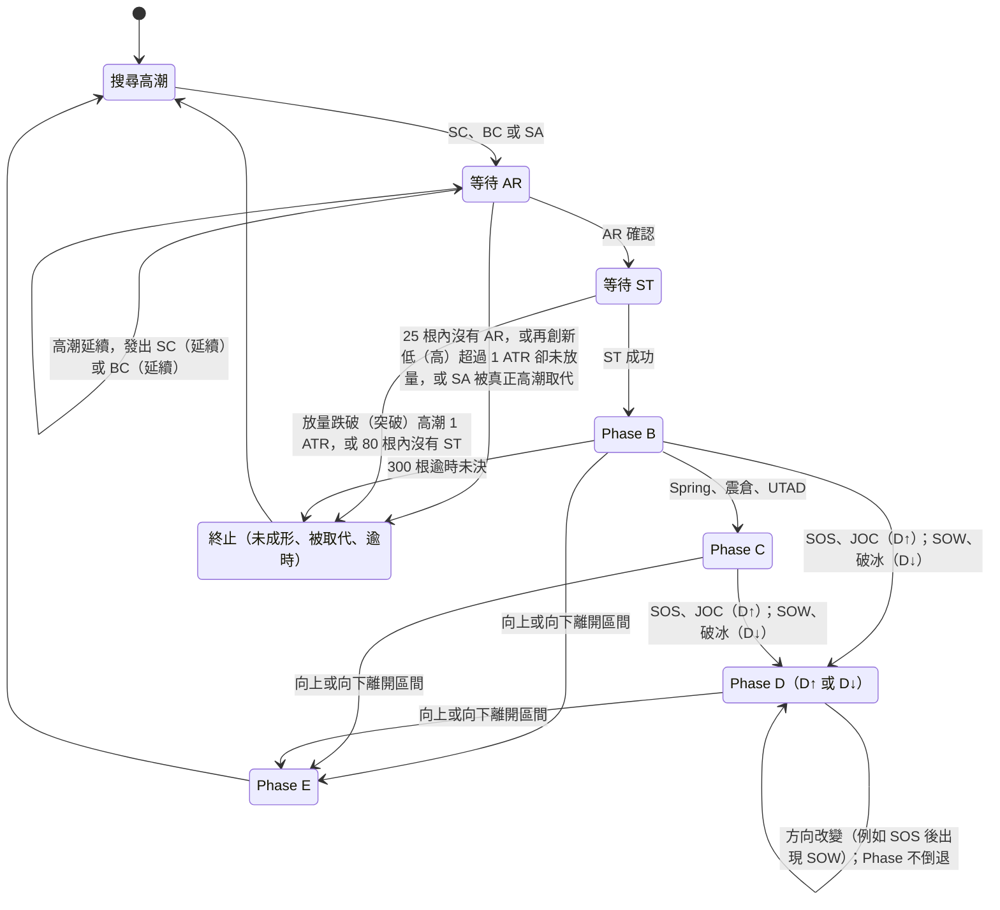

# 威科夫量價關係與程式化訊號規格（StockExpert 開發版）

> 版本：v1.4（2026-11-04）｜依據：孟洪濤《威科夫操盤法》（PDF 318 頁）｜對應程式：`wyckoff_prototype/wyckoff_engine.py`
> 姊妹文件：`威科夫操盤法_完整知識整理.md`（理論全集、事件辭典與原書頁碼）
> 狀態：程式邏輯已通過 32 項自動測試（含「截斷資料重跑」的無未來函數檢查）；**已用 150 檔台股（2019-09～2026-10，未還原價）完成第一輪實證與交易規則校準**，結果與 v1.3 預設值見第 14 章
> v1.4：以系統分析法（反例推翻、決策表、狀態轉換、資料流、5 Whys、規則競合、生命週期）審查並補強，摘要見第 15 章。標 **〔v1.4 規格｜程式待實作〕** 的條文尚未進入程式，第 14 章的數字不受影響。

---

## 1. 文件定位與閱讀方式

本文件把原書的量價判讀，整理成 StockExpert 可以直接實作的規則。每條規則都有編號、條件式、參數、原書頁碼與對應程式：

| 編號 | 類別 | 說明 | 章節 |
|---|---|---|---|
| A～C | 量價關係總表 | 原書所有量價型態，依「位置與背景」給出解讀與程式條件 | 第 3 章 |
| F | 特徵公式 | 相對量、相對振幅、收盤位置、努力／結果比、波段量、通道線…… | 第 4 章 |
| P | 量價型態旗標 | 單根或數根 K 線的原書型態（停止行為、垂直柱、無供應……） | 第 5 章 |
| E | 結構事件 | PS、SC、AR、ST、Spring、SOS、JOC、UT、SOW、LPSY…… | 第 6 章 |
| S | 交易訊號 | 6 個進場、5 個出場、5 個警示訊號；進場否決表（8.5） | 第 8 章 |
| M | 持倉管理 | 進場後確認、停損移動、出場規則；同一根 K 線的判斷順序（9.1） | 第 9 章 |
| X | 系統功能 | 選股器、診斷卡、警示、交易檢討、部位試算 | 第 10 章 |
| — | 台股實證（v1.3） | 每個訊號的實證判讀、交易規則校準、台股建議設定 | 第 14 章 |
| — | 系統分析補強（v1.4） | 發現摘要、生命週期、資料流、決策表、根因、待實作清單 | 第 15 章 |

**標記**：〔p.N〕＝PDF 實體頁碼；【原書】＝書中明寫；【延伸】＝研究者補充；【參數】＝為程式化而訂的門檻，需以台股資料校準。

**三種轉譯類型**（決定實作方式）：

| 類型 | 定義 | 例子 | 實作 |
|---|---|---|---|
| A 原書可直接量化 | 書中已給出可計算的條件 | p.57 降價中供應擴大三條件、p.95 三個更高＋遞增量、p.194 Spring 1～3 根收回、p.143 50% 原則、p.316 進場後 1～5 根甄別 | 照書實作，不調整 |
| B 可參數化 | 書中是定性描述 | 天量、超長陰線、小蠟燭小量、放量滯漲 | 以相對量 rvol、相對振幅 rspread、收盤位置 close_pos 表達，門檻集中在 `Params` |
| C 需人工或更多資料 | 依賴畫線、盤中圖、消息背景 | 手畫通道、小時圖確認、普通震倉的消息面 | 程式提供輔助（自動通道、週線背景），保留人工判讀 |

---

## 2. 量價關係的核心原理

### 2.1 三要素與三原則【原書】

- **三要素**：價格、成交量、走勢速度；**理論基礎**：供求關係〔p.16、p.26〕。
- **三原則**〔p.24〕與其程式意義：

| 原則 | 原書內容 | 程式意義 |
|---|---|---|
| 供求 | 趨勢的動力來自供求不平衡；需求＝購買力，供應＝流入市場的賣單〔p.24、p.26〕 | 判斷「誰在控盤」：上漲日量 vs 下跌日量（F11）、需求柱 vs 供應柱（P07） |
| 因果 | 趨勢形成前需要準備過程（吸籌或派發的震盪區）〔p.24、p.49〕 | 反轉訊號只在「交易區間」成立後才發（狀態機，第 7 章）；沒有區間的急漲急跌降低信心 |
| 努力與結果 | 成交量增長沒有使價格大幅增長＝停止行為〔p.24、p.58〕 | 努力／結果比（F10）、放量滯漲滯跌（P04、P05）、波段放量滯漲（E 系列 WAVE_STALL） |

### 2.2 看盤五步驟 → 程式流程【原書 p.17】

| 步驟 | 原書 | 程式層 |
|---|---|---|
| ① 背景 | 趨勢、所在階段 | `regime`（F07）、週線背景（F19）、交易區間與 Phase（第 7 章） |
| ② 價量形態 | 蠟燭長度、成交量高度、變化速度 | 特徵公式（第 4 章）、型態旗標（第 5 章） |
| ③ 形態的性質 | 強弱、原因、後果 | 結構事件（第 6 章）、偏多偏空分數 `bias` |
| ④ 結論或預測 | 洞察 CM 意圖、判斷方向 | 區間分類（吸籌／再吸籌／派發／再派發）、診斷卡 |
| ⑤ 措施與行動 | 進場、出場、收緊停損 | 交易訊號（第 8 章）、持倉管理（第 9 章） |

### 2.3 同一個量價型態，位置與背景不同，意義相反【原書】

這是程式設計最重要的原則：**所有事件都必須掛在「背景＋位置」底下判讀**。

| 量價型態 | 情境一 | 情境二 |
|---|---|---|
| 天量長陰 | 長期下跌後創新低＝恐慌拋售 SC，遇到巨大買盤（偏多）〔p.41、p.65〕 | 區間右手邊、收在中線之下＝弱勢出現 SOW（偏空）〔p.155〕 |
| 放量上影、突破後收回 | 上升趨勢中、量未增＝探索，不是反轉〔p.38、p.102〕 | 派發區右手邊、量增＝上衝回落 UT，做空點〔p.154、p.182〕 |
| 縮量小蠟燭的回調 | 需求背景＝無供應，進場點〔p.36、p.38、p.100〕 | 供應背景的縮量反彈＝無需求反彈，會續跌〔p.229–231〕 |
| 跌破支撐後收回 | 上升趨勢或吸籌尾聲＝Spring，最佳進場〔p.194–195〕 | 熊市或賣盤控制背景＝陷阱，不能抄底〔p.204、p.212〕 |
| 價漲量縮 | 牛市初期＝主力不希望公眾進場、供應枯竭（不是警訊）〔p.8、p.199、p.306〕 | 跌破支撐後的反彈＝無需求（警訊）〔p.229、p.284〕 |

---

## 3. 量價關係總表 ★

> 欄位說明：「程式」欄是對應的旗標／事件／訊號名稱；「—」代表目前只用於判讀說明、尚未自動化。

### 3.1 上漲中的量價

| # | 量價型態 | 位置／背景 | 原書解讀 | 程式 | 用途 | 頁碼 |
|---|---|---|---|---|---|---|
| A1 | 連續 2～3 根「更高的低點、收盤、高點」＋量遞增 | 區間右手邊、支撐反彈後 | 以上升波完成的 SOS，需求占上風 | `demand_wave3` → `SOS(波)` | 進場確認 | p.95、p.115、p.316 |
| A2 | 長陽放量（垂直需求柱） | 突破阻力 | 需求控制；柱底自然形成支撐，回測可低風險買進 | `vdb` | 支撐區、回測進場 | p.31、p.39–40、p.248–251 |
| A3 | 長陽放量收在區間上緣之上 | 區間右手邊 | 跳離震盪區 JOC（越過小溪） | `JOC` | 等縮量回測 | p.66、p.98 |
| A4 | 量陡增、超長陽、角度走向垂直 | 長期上漲後、空中未通過阻力 | 搶購高潮 BC：公眾瘋狂、CM 出貨 | `BC`、`W_BC` | 持股預警、停損上移 | p.47、p.97、p.151、p.209 |
| A5 | 價漲量縮、小蠟燭 | 供應背景、跌破後的反彈 | 無需求反彈，供應會再進來 | `no_demand`、`NoDemandRally`、`S_NODEMAND` | 出場、不搶反彈 | p.229–231、p.253、p.273 |
| A6 | 價漲量縮 | 需求背景、牛市初期 | 缺乏供應而非需求減弱；主力不讓公眾進場 | 不視為警訊 | 避免誤判 | p.8、p.199、p.306 |
| A7 | 量 ≥ 昨日、振幅 ≤ 昨日 60%（放量滯漲） | 上升中、阻力位 | 努力沒有結果，遇到 CM 賣盤；次日量縮＝清倉最後時機 | `stop2_up`；次日量縮 → 出場（M08） | 出場 | p.58–60、p.170 |
| A8 | 新高長上影＋放量 | 上升途中 | 第一種停止行為；若之後放量急漲，該上影是初次供應 | `stop1_up` → `PSY`／`SA` | 預警 | p.78、p.80、p.149 |
| A9 | 突破上緣後 1～3 根收回、過程量增 | 區間上緣 | 上衝回落 UT；須有放量下挫跟隨 | `UT`、`UTAD`、`UT確認`、`S_UT` | 出場、做空 | p.66、p.154、p.182 |
| A10 | 突破但量或陽線長度不足 | 區間上緣 | 突破品質不足，耐心等測試 | `突破(量不足)` | 觀望 | p.125 |
| A11 | 上漲波累積量大於前幾波，卻沒有創新高 | 上升背景（波段） | 波段放量滯漲，CM 出貨的警告 | `WAVE_STALL_UP`、`W_WAVE_STALL_UP` | 縮緊停損 | p.60–62、p.187 |
| A12 | 上升波的突破幅度遞減；回調到需求線後反彈到不了超買線 | 上升背景 | SOT：需求減弱 | `SOT_up`、`SOT_CH_UP` → `W_SOT_up`、`W_SOT_CH` | 縮緊停損 | p.140–143、p.186 |
| A13 | 觸及超買線 | 上升通道 | 超買，觀察是否出現供應 | `OVERBOUGHT` | 觀察 | p.38、p.98、p.235 |
| A14 | 量略升但收在中部的十字星 | 急漲後 | 供應正在超過需求，最明顯的派發信號 | `stop2_up`（部分）＋背景【延伸組合】 | 預警 | p.170 |

### 3.2 下跌中的量價

| # | 量價型態 | 位置／背景 | 原書解讀 | 程式 | 用途 | 頁碼 |
|---|---|---|---|---|---|---|
| B1 | 超長陰＋超高量、創新低 | 長期下跌之後 | 恐慌拋售 SC：遇到巨大買盤，抄底分析從此開始但不進場 | `SC` | 開始畫區間 | p.41–42、p.65、p.74 |
| B2 | 量增但跌幅與振幅大幅縮小（放量滯跌） | 下跌中、支撐附近 | 第二種停止行為：需求吸收供應 | `stop2_down` | 扣扳機 | p.46、p.80、p.239 |
| B3 | 長下影＋放量 | 下跌中 | 第一種停止行為；初次支撐 PS | `stop1_down` → `PS`／`SA` | 預警、扣扳機 | p.72–73、p.76、p.78 |
| B4 | 價跌量縮、小蠟燭（無供應） | 需求背景的回調、測試 | 供應枯竭；沒有賣盤時任何低量回調都是進場點 | `no_supply` → `Test`、`LPS`、`BU`、`L_PULLBACK` | 進場 | p.36、p.38、p.82、p.100 |
| B5 | 最高與最低皆低於昨日、收盤低於昨日、量 ≥ 昨日 | 區間右手邊、已見供應 | 降價中供應擴大＝熊市開始 | `supply_exp_p57` | 空方確認 | p.57 |
| B6 | 長陰放量（垂直供應柱） | 區間內或跌破時 | 供應完全控制；柱頂是阻力，多單在此出場 | `vsb`、`SOW` | 出場、阻力區 | p.37、p.66、p.212 |
| B7 | 放量長陰跌破區間下緣 | 派發區右手邊 | 破冰：CM 不再護盤，大跌在即 | `ICE`、`X_ICE` | 出場 | p.65、p.156、p.171 |
| B8 | 小幅跌破支撐、縮量縮幅、1～3 根收回 | 強支撐、上升趨勢或吸籌尾聲 | 最好的 Spring，可直接進場 | `Spring`（A／B+）→ `L_SPRING` | 進場 | p.192–197 |
| B9 | 跌破支撐時量大、振幅大 | 區間底部 | 供應仍在或屬震倉，須等二次測試 | `Spring`（B／C）、`Shakeout` → `Test` → `L_TEST` | 等測試 | p.90、p.131、p.196 |
| B10 | 急速深跌衝破所有支撐、隨後快速收回 | 吸籌末期 | 終極震倉 | `Shakeout` | 等二次測試 | p.129–131 |
| B11 | 下跌波累積量大於前幾波，卻沒有創新低 | 下降背景（波段） | 波段放量滯跌：需求在吸收 | `WAVE_STALL_DOWN` | 留意轉折 | p.60–62、p.222 |
| B12 | 下跌推進幅度遞減；跌不到超賣線 | 下降背景 | SOT：供應減弱，待吸籌驗證 | `SOT_down`、`SOT_CH_DOWN` | 留意吸籌 | p.132、p.142 |
| B13 | 回到或跌破超賣線 | 下降通道 | 超賣，之後至少有反彈 | `OVERSOLD` | 不追空 | p.65、p.263–264 |
| B14 | 陰線包住前一根且量增（OKR） | 阻力區右手邊 | 市場行為已轉變 | `okr_bear` | 出場參考 | p.298–299 |
| B15 | 量略升但收盤低於前一天 | 派發區右手邊 | CM 開始降價滿足公眾需求，最重要卻最易忽視的熊市信號 | —【延伸：可組合 `ret<0`＋量增＋區間位置】 | 出場參考 | p.171、p.250 |
| B16 | 持續急速下跌、中間沒有反彈 | 下降 | 超賣；在主要支撐會出現反彈 | `accel`＋`OVERSOLD` | 不追空 | p.65 註2 |

### 3.3 測試、區間與高潮之後

| # | 量價型態 | 位置／背景 | 原書解讀 | 程式 | 用途 | 頁碼 |
|---|---|---|---|---|---|---|
| C1 | 二次測試的量與振幅遠小於高潮 | SC／BC 之後 | 成功 ST：熊市（牛市）停止，進入右手邊 | `ST`、`ST(派發)` | 開始找進場點 | p.74–75、p.152 |
| C2 | 二次測試量仍大（但小於高潮） | SC 之後 | 需要再測試 | `ST(量大)` | 等待 | p.74、p.77 |
| C3 | 回測突破點時縮量小蠟燭、守住 | JOC 之後 | 最安全的進場位置 | `BU` → `L_BU` | 進場 | p.82、p.98、p.106 |
| C4 | 回測時出現放量長陰 | SOS／JOC 之後 | SOS／JOC 失效，價格回到區間 | `SOS失效` | 放棄進場 | p.93、p.98、p.111 |
| C5 | SOW 後的縮量小蠟燭反彈、收不回 | 派發 | LPSY：最佳做空點、多單最後一班車 | `LPSY` → `S_LPSY` | 出場 | p.152、p.156 |
| C6 | SOW 後放量長陽收復 | 派發 | 新需求進場，SOW 失效 | `SOW失效` | 取消空方判斷 | p.161 |
| C7 | 區間內上漲波的力度與量大於下跌波 | 區間 | 正常吸籌、需求漸強 | `ud_vol_ratio`、`bias` | 判讀 | p.81、p.316 |
| C8 | 區間內量能隨時間遞減、支撐墊高 | 區間 | CM 吸籌、提高收購價 | `bias`（ST、Test）＋人工 | 判讀 | p.81、p.89、p.114、p.245 |
| C9 | 回到支撐就反彈、反彈到頂部時放量 | 高位區間 | CM 在派發，啟動出逃計劃 | —【延伸】 | 判讀 | p.150 |
| C10 | 阻力附近高量窄幅、收在高位 | SOS 之後 | 吸收：需求吸收套牢者的賣盤，會導致 JOC | `absorption`（指標） | 判讀 | p.115、p.237、p.293、p.303 |
| C11 | 量價都很小、高點遞降低點遞升 | 支撐、需求背景 | 死角：買入風險最低，扣扳機依據是「進入死角」 | `dead_corner` → `CORNER` → `L_CORNER` | 進場 | p.65、p.114、p.290 |
| C12 | 回測支撐時量大增但價格跌得很慢 | 支撐 | 張著口袋接盤（bag holding），需求大量進入 | `evr`（高） | 判讀 | p.276、p.278 |
| C13 | 終止行為之後接陽線 | 回調或測試 | 需求吸收供應後還有剩餘（需求過剩）；接陰線則供應過剩 | 由後續 K 線判斷 | 判讀 | p.209 |
| C14 | 放量反轉 K 之後沒有跟隨、被吸收 | 牛市中 | 單一反轉蠟燭不威脅趨勢；有跟隨才是警告 | `UT確認`、M02 確認規則 | 避免誤判 | p.173–177、p.265–267 |

---

## 4. 特徵公式（F 系列）

| ID | 名稱 | 公式 | 參數 | 依據 | 程式欄位 |
|---|---|---|---|---|---|
| F01 | 高低價差 | high − low | — | 原書 p.282 註1 | `spread` |
| F02 | ATR | 真實區間 20 日平均 | n=20 | 延伸（距離單位） | `atr` |
| F03 | 相對量（努力） | volume ÷ 前 20 日平均量 | n=20 | 原書 p.24 | `rvol` |
| F04 | 相對振幅（結果） | spread ÷ 前 20 日平均 spread | n=20 | 原書 p.24 | `rspread` |
| F05 | 收盤位置 | (close − low) ÷ (high − low) | — | 原書 p.97、p.197 | `close_pos` |
| F06 | 影線比例 | 上（下）影長 ÷ spread | — | 原書 p.78 | `upper_wick`、`lower_wick` |
| F07 | 背景 | 收盤 > 50 日均線且均線 10 日斜率 > 0＝上升；反之＝下降；其餘＝區間 | 50、10 | 原書 p.17（背景優先）；門檻延伸 | `regime` |
| F08 | 前置跌幅／漲幅 | close ÷ 120 日最高（最低）− 1 | 120 | 原書 p.65「持續一段時間之後」 | `drawdown`、`runup` |
| F09 | 走勢速度 | (close − close₋₁₀) ÷ ATR | 10 | 原書 p.16、p.151 | `accel` |
| F10 | 努力／結果比 | rvol ÷ max(rspread, 0.2) | — | 原書 p.24、p.58 | `evr` |
| F11 | 上下坡量比 | 近 20 日上漲日總量 ÷ 下跌日總量 | 20 | 原書 p.81、p.316 | `ud_vol_ratio` |
| F12 | 量能枯竭 | 近 5 日平均 rvol | 5 | 原書 p.82、p.100 | `dry_up` |
| F13 | 區間位置 | 收盤在近 60 日高低區間的位置（0＝底、1＝頂） | 60 | 延伸 | `range_pos` |
| F14 | 振幅收斂 | 近 10 日平均 spread ÷ 近 60 日平均 spread | 10、60 | 原書 p.65 註4、p.114 | `contraction` |
| F15 | 需求分數 | 50 + 15·clip(log₂F11, ±2) + 20·(10 日平均 F05 − 0.5) + 4·(需求柱 − 供應柱) + 2·(無供應 − 無需求)，限 0～100 | 權重 | **延伸**（權重需校準） | `demand_score` |
| F16 | 波段量 | 兩個已確認轉折點之間的累積量、每根均量、漲跌幅、根數 | ZigZag 2×ATR | 原書 p.60–62、p.187 | `waves()` |
| F17 | 通道線 | 上升：需求線＝連兩個墊高的波段低點、超買線＝平行線；下降：超賣線＝連兩個下降的波段低點、供應線＝平行線 | 間隔≥5、寬≥1 ATR | 原書 p.38、p.65 註8、p.263、p.269–270；畫法延伸 | `channels()` |
| F18 | 回調比例 | (波段高點 − 回調低點) ÷ (高點 − 上漲腿起點) | — | 原書 p.143–147 | `pivot_warnings()`、`_pullback_pass()` |
| F19 | 週線背景 | 日 K 合成週 K，跑同一套狀態機，以**已完成的週**對應回日 K。**當週還沒收完時（資料最後一天不是該週最後一個交易日），最新一根也使用上一個已完成週**〔v1.4 規格｜程式待實作〕（目前最新一根會用未完成的週；台積電非週五截斷有 7.6% 的日子與事後回看不同，見 15.1 F3） | 30 週均線、累積 ≥40 週才判斷；需交易日曆判斷當週是否收完 | 原書 p.31、p.127、p.147、p.268–272；實作延伸 | `weekly_context()` |
| F20 | 漲跌停 | 單日漲跌幅 ≥ 9.5%（未還原價時，除權息日可能誤判；「鎖死」另以開高低收相同判斷【延伸】） | — | 台股制度 | `limit_move` |
| F21 | 相對強弱 | ①大盤創 60 日新低、個股未創新低且回調 < 50%；②個股回調比大盤淺 15 個百分點以上；③自大盤低點起算的超額報酬 | 60 | 原書 p.253–258 | `relative_strength()` |

---

## 5. 量價型態旗標（P 系列）

> 每根 K 線計算一次；方向判斷「下跌中／上升中」以收盤對 3 日前收盤比較。

| ID | 旗標 | 條件式（第 t 根） | 類型 | 頁碼 |
|---|---|---|---|---|
| P01 | `supply_exp_p57` | Lₜ<Lₜ₋₁ 且 Hₜ<Hₜ₋₁ 且 Cₜ<Cₜ₋₁ 且 Vₜ≥Vₜ₋₁ | A | p.57 |
| P02 | `demand_exp` | Hₜ>Hₜ₋₁ 且 Lₜ>Lₜ₋₁ 且 Cₜ>Cₜ₋₁ 且 Vₜ≥Vₜ₋₁ | A（p.57 鏡像） | p.95 |
| P03 | `demand_wave3` | P02 連續 3 根 | A | p.95、p.115 |
| P04 | `stop2_down` 放量滯跌 | 下跌中、Vₜ≥Vₜ₋₁、spreadₜ≤0.6×spreadₜ₋₁、rvol≥1.0 | B | p.46、p.80 |
| P05 | `stop2_up` 放量滯漲 | 上升中、同上條件 | B | p.58–60 |
| P06 | `stop1_down`／`stop1_up` | 下跌中下影≥40%（上升中上影≥40%）且 rvol≥1.2 | B | p.78 |
| P07 | `vdb`／`vsb` 垂直需求柱／垂直供應柱 | 陽（陰）線、rspread≥1.5、rvol≥1.5、收盤位置≥0.6（≤0.4） | B | p.31、p.37、p.66 |
| P08 | `no_supply`／`no_demand` | 收跌（收漲）、rspread≤0.8、rvol≤0.8、量小於昨日；漲跌停日（F20）一律除外 | B | p.36、p.229–235 |
| P09 | `supply_bar`／`demand_bar` | 陰（陽）線、rvol≥1.3、rspread≥1.2、收盤位置≤0.35（≥0.65） | B | p.83、p.304 |
| P10 | `okr_bear`／`okr_bull` | 外包線（高≥昨高、低≤昨低）、反向收盤、rvol≥1.2 | B | p.298–299 |
| P11 | `absorption` | rvol≥1.2 且 rspread≤0.8 | B | p.24、p.80、p.115 |
| P12 | `dead_corner` | F14<0.6、5 日高點低於 5 日前的 5 日高點、5 日低點高於 5 日前的 5 日低點 | B | p.65 註4、p.114 |

**成交量與振幅分級【參數】**

| 等級 | rvol | rspread | 原書用語 |
|---|---|---|---|
| 高潮級 | ≥ 2.0 | ≥ 1.25～1.5 | 天量、超高成交量、極寬振幅〔p.65、p.66〕 |
| 放量／寬幅 | ≥ 1.5 | ≥ 1.5 | 放量長陽／長陰、垂直柱〔p.31、p.66〕 |
| 量增 | ≥ 1.2 | — | 擴大的成交量〔p.78〕 |
| 縮量／窄幅 | ≤ 0.8 | ≤ 0.8 | 小蠟燭、小成交量〔p.66、p.82〕 |
| 量極小 | ≤ 0.6 | — | 成交量幾乎為零〔p.100〕 |

---

## 6. 結構事件（E 系列）

> 每個事件有「事件 K 線」與「確認 K 線」，訊號只在確認 K 線產生（無未來函數）。「分數」是對進行中交易區間 `bias` 的貢獻【延伸計分】。

### 6.1 區間結構事件（狀態機產生）

| ID | 事件 | 條件摘要 | 確認時點 | 分數 | 頁碼 |
|---|---|---|---|---|---|
| E01 | PS 初次支撐 | SC 出現後，回頭在前 3～40 根找放量（rvol≥1.5）停止行為 | SC 當根 | +0.2 | p.72–73 |
| E02 | SC 恐慌拋售 | 前置跌幅≥15%、收盤<50 日均線、創 60 日新低、rvol≥2.0、rspread≥1.25。**等待 AR 期間（最多 25 根）**再創新低且 rvol≥1.5 則高潮延續，延續時發出 `SC(延續)` 並更新價位〔v1.4 規格｜程式待實作〕（目前只更新區間、不發事件，事件表的 SC 價位會與區間不同）；再創新低超過 1 ATR 卻未放量＝停止行為失敗 | 當根 | +0.5 | p.65、p.74 |
| E03 | SA 停止行為起點 | 無高潮時：創新低（新高）＋rvol≥1.5＋停止行為（P04～P06） | 當根 | ±0.3 | p.78–80、p.127 |
| E04 | AR 自動反彈 | SC 後的最高點；反彈≥2 ATR，且收盤自高點回撤≥1 ATR（高點須在先前 K 線） | 回撤那根 | 0 | p.72、p.113 |
| E05 | ST 二次測試 | AR 後回到區間下方 40% 的測試期，最大量≤SC 量 80%、低點不低於 SC 1 ATR；收盤離開該區時確認 | 離開那根 | +1.0 | p.74–75 |
| E06 | ST（量大） | 測試量 > 高潮量 80%，需再測 | 同上 | −0.3 | p.74、p.77 |
| E07 | PSY 初始供應 | BC 出現後，回頭找放量上影或放量陰線 | BC 當根 | −0.2 | p.149 |
| E08 | BC 搶購高潮 | 前置漲幅≥20%、收盤>50 日均線、創 60 日新高、rvol≥2.0、rspread≥1.25、10 日漲幅≥4 ATR；等待自然回落期間再創新高且 rvol≥1.5 則延續（`BC(延續)`，同 E02） | 當根 | −0.5 | p.66–67、p.151 |
| E09 | AR 自然回落 | BC 後的最低點（冰線）；回落≥2 ATR，且收盤回升≥1 ATR | 回升那根 | 0 | p.152、p.160 |
| E10 | ST（派發） | 回到區間上方 40%，量≤BC 量 80%、高點不超過 BC 1 ATR | 離開那根 | −1.0 | p.152–153 |
| E11 | Spring | 跌破支撐≥0.05 ATR、3 根內收盤回到支撐上方；以**跌破期間最大的 rvol 與 rspread**、**收回那根的收盤位置**分 A、B+、B、C，完整決策表（含 v1.4 補上的空格）見 15.4 | 收回那根 | +2.0（賣盤背景 +0.5） | p.66、p.192–197 |
| E12 | Spring（延遲收回） | 跌破<1 ATR，第 4～10 根才收回 | 收回那根 | +1.0 | p.194 |
| E13 | Shakeout 震倉 | 跌破≥1 ATR 且放量或寬幅，10 根內收回；破冰後 10 根內收回也改判震倉（E26）。第 4～10 根才收回的深跌若沒有放量或寬幅，記為「深跌延遲收回」並等二次測試〔v1.4 規格｜程式待實作〕（目前一律記為震倉） | 收回那根 | +2.0 | p.65、p.129–131 |
| E14 | Test 二次測試 | Spring／震倉後 20 根內回到其低點上方 1 ATR 內、不破 0.25 ATR；rvol≤0.8、量≤跌破時 70%、rspread≤1.1、收盤位置≥0.4 | 當根 | +1.0 | p.90、p.137 |
| E15 | Spring 失敗 | Spring、震倉或延遲收回之後，**收盤低於跌破低點 − 0.1 ATR**（直接進場型看 5 根、等待測試型看 20 根）；同時觸發 M14 結構否定出場〔v1.4 規格｜程式待實作〕（目前直接進場型用「低於低點」、等待測試型用「低於低點 0.25 ATR」，且不產生出場；台股樣本 48.1% 的 `L_SPRING` 在 5 根內出現 Spring 失敗） | 當根 | −2.0 | p.192、p.197、p.203 |
| E16 | SOS | 區間內陽線、rspread≥1.25、rvol≥1.5、收盤位置≥0.6、收在中線上；3 根內只記一次 | 當根 | +2.0 | p.66、p.93 |
| E17 | SOS（波） | P03 且收在中線上、3 根均量≥1.0 | 當根 | +1.5 | p.95 |
| E18 | JOC | 收盤高於上緣 0.1 ATR、rvol≥1.3、rspread≥1.0、收盤位置≥0.6 | 當根 | +3.0 | p.66、p.98 |
| E19 | 突破（量不足） | 收在上緣之上但量或振幅不足 | 當根 | +0.5 | p.125 |
| E20 | LPS／BU | SOS／JOC 後 15 根內回調：回調均量≤0.9、最大振幅≤1.25、無放量長陰；BU 回調低點≥上緣−0.5 ATR，LPS 回調低點≥前測試低點+0.25 ATR；之後收盤＞前一根最高價 | 觸發那根 | +2.0 | p.95、p.98、p.106、p.115 |
| E21 | SOS 失效 | 回測中出現放量長陰（P09） | 當根 | −2.0 | p.93、p.98、p.111 |
| E22 | UT | 突破上緣≥0.05 ATR、3 根內收回；突破段 rvol≥1.2 為放量 | 收回那根 | 前趨勢向上 −1.0、否則 −0.5；未放量減半 | p.66、p.154 |
| E23 | UTAD | 前趨勢向上、距 ST≥10 根的 UT | 收回那根 | −2.0 | p.182–184 |
| E24 | UT 確認 | UT 後 3 根內出現陰線且量大於前一根、rvol≥1.0 | 當根 | −1.0 | p.154 |
| E25 | SOW | 區間內陰線、rspread≥1.25、rvol≥1.5、收盤位置≤0.4、收在中線下 | 當根 | −2.0 | p.66、p.155–156 |
| E26 | ICE 破冰 | 收盤跌破下緣 0.25 ATR 且已過 2 根未收回；Phase 進入 D↓。10 根內收回則改判震倉，並發出 `ICE失效`、取消這次破冰建立的 LPSY 設定、X03 撤回紅色警示〔v1.4 規格｜程式待實作〕（台股樣本 37.3% 的破冰在 10 根內收回，其中 74 次之後仍發出 `S_LPSY`） | 第 3 根 | −3.0 | p.65、p.156 |
| E27 | LPSY | SOW／破冰後 15 根內的反彈均量≤0.9、高點不超過 SOW 高點（冰線）0.25 ATR，之後收盤＜前一根最低價 | 觸發那根 | −2.0 | p.152、p.156 |
| E28 | SOW 失效 | 放量長陽收復 SOW 高點；來源是破冰時記為 `ICE收回`（目前一律記為 SOW 失效） | 當根 | +2.0 | p.161 |
| E29 | Phase E | 收盤高於上緣 1 ATR 連續 3 根（上漲）；破冰後 10 根未收回（下跌） | 當根 | 0 | p.98、p.148、p.156 |

### 6.2 通道、波段與趨勢事件

| ID | 事件 | 條件摘要 | 分數 | 頁碼 |
|---|---|---|---|---|
| E30 | OVERSOLD | 下降通道中最低價回到或跌破超賣線 | 0 | p.65、p.263–264 |
| E31 | SUPPLY_LINE_BREAK | 收盤高於供應線 0.1 ATR；rvol≥1.3 且 rspread≥1.0 為強 | 強 +1.0（前趨勢向下的區間）／+0.5 | p.65、p.112、p.132 |
| E32 | OVERBOUGHT | 上升通道中最高價觸及超買線 | 0 | p.38、p.98、p.235 |
| E33 | DEMAND_LINE_BREAK | 收盤低於需求線 0.1 ATR；rvol≥1.2 為強 | 強 −1.0、弱 0 | p.142、p.146、p.270 |
| E34 | SOT_CH_UP | 回調到需求線附近後，反彈高點低於超買線 1/4 通道寬 | −0.5 | p.142–143、p.186 |
| E35 | SOT_CH_DOWN | 下跌低點高於超賣線 1/4 通道寬 | +0.5 | p.132、p.142 |
| E36 | WAVE_STALL_UP | 上漲波累積量 ≥ 前 2～3 個上漲波平均、高點未超過前一波（上升背景） | — | p.60–62、p.187 |
| E37 | WAVE_STALL_DOWN | 下跌波累積量 ≥ 前 2～3 個下跌波平均、低點未跌破前一波（下降或區間背景） | — | p.60–62、p.222 |
| E38 | SOT_up／SOT_down | 連續三個波峰（波谷）創新高（新低）但推進幅度遞減 | — | p.140–142 |
| E39 | RETR_GT50 | 上升背景：上升波之後的回調超過該波 50% | — | p.143–146 |
| E40 | RALLY_LT50 | 下降背景：反彈未達前一下跌波 50% | — | p.147、p.299 |
| E41 | PB | 趨勢回調的停止行為（見 S05） | — | p.316 等 |
| E42 | CORNER | 需求背景下進入死角（見 S06） | — | p.114 等 |
| E43 | NoDemandRally | 放量跌破需求線後，15 根內出現縮量反彈並被拒絕 | −1.0 | p.229–231、p.272–273 |

---

## 7. Phase 判定與區間分類

| Phase | 進入條件 | 對應原書 | 頁碼 |
|---|---|---|---|
| A | 高潮（SC／BC）或停止行為（SA）出現，至 ST 成功為止 | 熊市終止／牛市停止的四個行為 | p.70–77、p.148–153 |
| B | ST 成功後 | 震盪拉鋸、疲勞戰術；設立派發區 | p.81–89、p.150 |
| C | Spring、震倉或 UTAD 出現 | 測試階段 | p.90–91、p.182 |
| D | SOS、JOC（**D↑**）；SOW、破冰（**D↓**）；方向可在 D 之內改變 | 進入牛市；熊市信號 | p.92–111、p.155–156 |
| E | 離開區間（見 E29） | 牛市旅程／熊市 | p.98、p.148 |

- **區間分類**【延伸】：前趨勢向下＋向上解決＝吸籌；前趨勢向下＋向下解決＝再派發；前趨勢向上＋向下解決＝派發；前趨勢向上＋向上解決＝再吸籌。原書判準：測試階段出現 SOS、終極震倉或 Spring＝再吸籌；出現 SOW 或帶量 UT＝再派發〔p.163〕。程式以「前趨勢＋離開方向」分類；p.163 判準作為即時傾向的參考，兩者不一致時診斷卡同時顯示（待 15.6 Q3 確認）。
- **Phase 只前進、不倒退**〔v1.4 規格｜程式待實作〕：目前 Phase D 之後的 Spring、或 3 根內收回的震倉會把 Phase 改回 C，破冰也沒有把 Phase 推進到 D。Phase D 之後的下方穿越照常記錄事件，Phase 維持 D（待 15.6 Q1 確認）。
- **區間分類是事後結果**：`trs.result` 只在 Phase E 寫入，之前一律是「進行中」，即時判讀只能用 `bias`。區間的全部終止狀態（6 種未成形、被高潮取代、逾時未決）見 15.2。
- **即時判讀**：`bias ≥ 3`＝偏吸籌／再吸籌；`bias ≤ −3`＝偏派發／再派發；其餘＝未定。
- 區間狀態圖、虛擬碼與參數，見《完整知識整理》第 10.7 節。

---

## 8. 交易訊號（S 系列）★

### 8.1 訊號總表

| ID | 訊號 | 類型 | 觸發 | 停損 | 頁碼 |
|---|---|---|---|---|---|
| S01 | `L_SPRING` | 進場 | E11 的 A 型或 B+ 型，且通過 8.5 否決表（賣盤背景、熊市背景） | Spring 最低點 − 0.1 ATR | p.195–197、p.204、p.212、p.224 |
| S02 | `L_TEST` | 進場 | E14（Spring／震倉的二次測試） | min（跌破低點, 測試低點）− 0.1 ATR | p.83、p.90、p.137 |
| S03 | `L_LPS` | 進場 | E20 的 LPS | LPS 低點 − 0.1 ATR | p.95、p.115、p.133 |
| S04 | `L_BU` | 進場 | E20 的 BU（JOC 回測） | min（JOC K 線低點, 回測低點）− 0.1 ATR | p.36、p.98、p.106、p.215 |
| S05 | `L_PULLBACK` | 進場（v1.3 起降為觀察，見 14.1） | 牛市回調的停止行為（8.2），且通過 8.5 否決表 | min（觸發 K 線低點, 支撐結構點）− 0.1 ATR | p.316、p.31、p.143、p.239–251 |
| S06 | `L_CORNER` | 進場（v1.3 起降為觀察） | 需求背景下進入死角（8.3）；8.5「區間內部」否決對死角例外 | 近 10 根最低點 − 0.1 ATR | p.114、p.233、p.290 |
| S07 | `S_UT` | 出場／空 | E24（UT 確認），且前趨勢向上或 bias<0 | UT 高點 + 0.1 ATR | p.154、p.207、p.212 |
| S08 | `S_LPSY` | 出場／空 | E27 | 反彈高點 + 0.1 ATR | p.152、p.156 |
| S09 | `S_NODEMAND` | 出場／空 | E43（跌破需求線後的無需求反彈） | 反彈高點 + 0.1 ATR | p.229–231、p.253、p.273 |
| S10 | `X_ICE` | 出場 | E26 破冰 | — | p.156、p.171 |
| S11 | `X_TRENDLINE` | 出場 | E33 強（放量跌破需求線） | — | p.142、p.146 |
| S12 | `W_BC` | 警示 | E08 | 停損上移至 BC 低點 | p.116–117、p.141 |
| S13 | `W_SOT_up` | 警示 | E38（上升背景） | 縮緊停損 | p.140–142 |
| S14 | `W_SOT_CH` | 警示 | E34 | 縮緊停損 | p.142–143、p.186 |
| S15 | `W_RETR_GT50` | 警示 | E39 | 縮緊停損；與 SOT 先後出現則離場 | p.143–146 |
| S16 | `W_WAVE_STALL_UP` | 警示 | E36 | 縮緊停損 | p.60–62、p.187 |

**不發訊號的位置【原書】**：SC 當下〔p.76〕、AR（空頭回補）〔p.72、p.113〕、區間內部〔p.93、p.109〕、JOC 當根（追高）〔p.202〕、熊市或賣盤背景下的 Spring〔p.204、p.212、p.313〕、搶購高潮附近〔p.47、p.116〕。v1.4 起這些位置改寫成 8.5 的否決表，訊號產生器與交易檢討（X04）共用同一張表。

### 8.2 S05 `L_PULLBACK`：牛市回調的停止行為（原書後記推薦的入門方法）

原書後記：「只掌握一個到兩個方法就能開始賺錢。比如牛市回調……首先要知道現在是否在牛市中……需求占上風背景下的回調應該是更小的蠟燭和成交量，我們扣扳機的地方是停止行為……至少掌握一個停止行為，比如 SOT，或者彈簧效應」〔p.316〕。程式化如下：

```text
對每一根 K 線 t（只用 t 以前的資料）：
  ① 牛市背景：50 日均線 10 日斜率 > 0，且收盤 ≥ 50 日均線 − 0.5 ATR
     需求占上風：近 20 日上漲日量 ÷ 下跌日量 ≥ 1.1                       〔p316〕
  ② 波段：近 40 根最高點 HH 在 2～25 根之前；HH 之前 40 根的最低點為上漲腿起點；
     上漲腿 ≥ 3 ATR
  ③ 需要的回調：回調幅度 ≤ 上漲腿 50%                                   〔p143–146〕
     回調期間沒有放量長陰或垂直供應柱（回調沒有引起供應擴大）            〔p28〕
     回調 K 線（不含觸發 K）平均 rvol ≤ 1.0 且平均 rspread ≤ 1.0          〔p316〕
     近 20 根沒有搶購高潮                                               〔p116–117〕
  ④ 支撐區（依序比對，取第一個命中者）：
     垂直需求柱底部 ±0.75 ATR                      〔p31、p39–40、p248–251〕
     突破點（上漲腿突破的前高）±0.75 ATR            〔p98、p111、p241〕
     需求線（上升通道下軌）±0.75 ATR                〔p269–270〕
     上漲腿 50% 位置 ±0.75 ATR                      〔p239–240〕
     健康回調區（上漲腿 25%～50%）                  〔p143–146、p316〕
  ⑤ 扣扳機＝停止行為（命中支撐區的那根 K）：
     跌破支撐區後收回：收在支撐之上、收盤位置 ≥ 0.5、rspread ≤ 1.5     〔p194–197〕
     或 放量滯跌 P04                                                      〔p46、p80〕
     或 長下影放量 P06                                                    〔p78〕
     或 縮量小蠟燭 P08 且 rvol ≤ 0.8                                      〔p36、p38、p100〕
     或 SOT：連續兩次創低但第二次推進 ≤ 第一次一半、rvol ≤ 1.0            〔p137 註2〕
  ⑥ 停損＝min(觸發 K 低點, 支撐結構點) − 0.1 ATR；進場到停損 > 3.5 ATR 則放棄
  ⑦ 冷卻 8 根；但前一個訊號的停損若被跌破，立即解除冷卻（等下一次測試〔p223〕）
```

### 8.3 S06 `L_CORNER`：死角交易法

原書：死角是供求都非常弱、蠟燭在支撐上越來越短的狀態，「死角是進場的最好時機……我們扣動扳機的依據是市場進入死角的這個現象」〔p.114〕；死角中上漲波的成交量和蠟燭長度大於下降波＝需求大於供應，突破方向向上〔p.290〕。

```text
  ① 第 t 根剛進入死角：P12 成立、前一根不成立；冷卻 10 根
  ② 背景：上升背景，或交易區間 Phase B／C／D 且 bias ≥ 1
  ③ 位置與量能：區間位置 F13 ≤ 0.45（靠近支撐）、近 5 日平均 rvol ≤ 0.8
  ④ 死角內的需求證據：近 10 根中，上漲 K 的總量 > 下跌 K，且上漲 K 平均振幅 ≥ 下跌 K   〔p290〕
     （或綜合需求分數 F15 ≥ 55）
  ⑤ 近 10 根沒有放量長陰或垂直供應柱
  ⑥ 停損＝近 10 根最低點 − 0.1 ATR；進場到停損 > 3 ATR 則放棄
```

### 8.4 進場訊號的共同規則

- **進場時點**：訊號 K 線收盤確認，下一根開盤進場；開盤已跌破停損則放棄。
- **週線背景**：週線仍在下跌且尚未形成區間時，訊號說明加註「⚠ 逆大背景」；`weekly_filter=True` 時直接略過〔p.147、p.225〕。
- **一次只持有一筆**（回測），StockExpert 實盤可依部位試算（X05）決定是否加碼。

### 8.5 進場否決表（Entry Veto）〔v1.4 規格｜程式待實作〕

> 目的：讓訊號產生器與交易檢討（X04）使用同一套背景判準。台股樣本中，v1.3 程式發出的 2,289 個進場訊號有 733 個（32.0%）會被自己的交易檢討判為 ✘（15.1 F1）。

依序檢查。命中「否決」就不發進場訊號，只留事件與觀察提示；命中「降級」則訊號照發，但加註並移到觀察名單。

| 序 | 條件（訊號 K 線 t） | 結果 | 適用 | 依據 |
|---|---|---|---|---|
| V1 | 同一根出現 `X_*` 或 `S_*` | 否決 | 全部 | 出場優先〔p.316〕 |
| V2 | 前 5 根有：放量（`strong=True`）跌破需求線、`S_NODEMAND`、`S_LPSY`、`S_UT`、未失效的 `X_ICE` | 否決 | 全部 | p.142、p.146、p.147、p.229 |
| V3 | 前 5 根有 SOW、LPSY、UT 確認事件 | 否決 | 全部 | p.147、p.155–156 |
| V4 | 所在區間 Phase＝B | 否決 | `L_PULLBACK` | p.93、p.109 |
| V4a | 所在區間 Phase＝B，且 bias ≥ 1、區間位置 ≤ 0.45 | **例外：允許** | `L_CORNER` | p.114：死角是進場的最好時機 |
| V5 | 週線下跌且尚未形成區間（`wk_ok_long=False`） | 否決 | `L_SPRING` | p.204、p.212、p.225 |
| V6 | 所在區間前趨勢向上（BC 或 SA 起算），且訊號日日線為下降背景 | 否決 | `L_SPRING` | p.204、p.212：派發區的 Spring 是陷阱 |
| V7 | 賣盤控制背景（近 10 根 ≥2 根放量陰線，且近 20 根下跌量 > 上漲量） | 否決 | `L_SPRING` | p.212–224（v1.2 已實作） |
| V8 | 前 5 根有 BC 或 PSY | 否決 | 全部 | p.47、p.116–117 |
| V9 | JOC 確認當根 | 否決 | 全部 | p.202 |
| V10 | 週線下跌且尚未形成區間 | 降級（⚠ 逆大背景） | `L_SPRING` 以外 | p.147、p.225 |
| V11 | 未放量跌破需求線 | 不否決，只列資訊 | 全部 | E33：弱勢跌破權重 0 |

- 優先序：否決（V1～V9）＞ 例外（V4a）＞ 降級（V10）＞ 資訊（V11）。
- X04 交易檢討直接使用本表：命中否決 → ✘，命中降級 → △（10.4）。
- **台股樣本的初步診斷**（尚未獨立做樣本外驗證；上線前以 `calibrate_tw.py` 同一程序確認，見 15.6 Q4）：V5＋V6 否決的 `L_SPRING`，20 日超額報酬在樣本內平均 −3.08%（112 個）、樣本外 −1.67%（104 個）；保留下來的在樣本內 −1.48%、樣本外 +1.47%。

---

## 9. 持倉管理與出場（M 系列）

| ID | 規則 | 條件 | 動作 | 頁碼 |
|---|---|---|---|---|
| M01 | 進場 | 訊號隔日開盤；開盤 ≤ 停損則放棄 | 進場 | p.316 |
| M02 | 進場後確認 | 5 根內須出現「收盤 > 訊號 K 高點且 rvol ≥ 1.0」 | 未確認則第 5 根收盤出場 | p.83、p.223、p.316 |
| M03 | 確認期放量陰線 | 確認前出現 P09 `supply_bar` | 收盤出場 | p.83、p.304 |
| M04 | 追蹤停損 | 確認後，停損上移至最近一個已確認的波段低點 − 0.1 ATR | 移動停損 | p.17、p.141 |
| M05 | 搶購高潮 | `W_BC` | 停損上移至 BC 當日低點 | p.116–117、p.141 |
| M06 | 需求減弱 | `W_SOT_up`、`W_SOT_CH`、`W_WAVE_STALL_UP`、`W_RETR_GT50` | 停損縮緊到近 5 根最低點 − 0.1 ATR | p.141 |
| M07 | SOT＋回調超過 50% | SOT 類警示與 `W_RETR_GT50` 在 10 根內先後出現 | 下一根開盤出場 | p.145–146 |
| M08 | 放量滯漲後量縮 | 確認後，前一根 P05 成立且當根 rvol ≤ 0.8 | 當根收盤出場 | p.59–60 |
| M09 | 派發與弱勢 | `X_ICE`、`S_UT`、`S_LPSY`、`S_NODEMAND` | 下一根開盤出場 | p.152–156、p.229 |
| M10 | 跌破需求線 | 確認後出現 `X_TRENDLINE` | 下一根開盤出場 | p.142、p.146 |
| M11 | 時間停損 | 持有 120 根 | 收盤出場 | 延伸 |
| M12 | 交易成本 | 買 0.1425%、賣 0.4425%（含 0.3% 證交稅） | 計入淨報酬 | 台股制度 |
| M13 | 資料結束 | 仍持有 | 以最後收盤價結算並標示「未平倉」 | — |
| M14 | 結構否定出場〔v1.4 規格｜程式待實作〕 | 收盤低於訊號的結構低點 − 0.1 ATR（Spring、測試、LPS、BU 低點；`L_PULLBACK` 的支撐結構點；`L_CORNER` 的死角低點），不論 `min_stop_atr` 放寬後的停損是否被碰到 | 下一根開盤出場 | p.83、p.192、p.203、p.316 |

開關：`exit_on_stall`（M08）、`tighten_on_sot`（M06）、`exit_on_sot_retr`（M07）、`exit_on_demand_line_break`（M10）皆預設開啟，可關閉做比較。

**規則交互**：M06 把停損縮到近 5 根低點，會抵消 v1.3 最小停損距離（1.5 ATR）避開洗盤的效果；校準中關閉 M06 在樣本內外都小幅改善（14.3）。下一輪測試「縮緊後的停損不得高於收盤 − 1 ATR」，或在台股建議設定中關閉 M06。M14 補上放寬停損後缺少的保護：盤中洗盤不出場，但收盤跌破結構低點一定出場。

### 9.1 同一根 K 線的判斷順序（回測現行實作）

| 順序 | 判斷 | 結果 |
|---|---|---|
| 1 | 前一根已標記「下一根開盤出場」（M07、M09、M10；v1.4 起含 M14） | 開盤價出場 |
| 2 | 盤中最低價 ≤ 停損 | 以 min（開盤, 停損）出場，跳空時用開盤價 |
| 3 | 尚未確認：收盤 > 訊號 K 高點且 rvol ≥ 1.0 → 確認；否則放量陰線 → 收盤出場（M03）；否則持有滿 5 根 → 收盤出場（M02） | — |
| 4 | 已確認：停損上移到最近已確認的波段低點（M04）；放量滯漲後量縮 → 收盤出場（M08） | — |
| 5 | 持有滿 120 根 | 收盤出場（M11） |
| 6 | 當根的訊號：出場類 → 標記下一根出場；`W_BC` → 停損上移；SOT 類或回調>50% → 縮緊停損（M06），兩者 10 根內先後出現 → 標記下一根出場（M07） | — |
| 7 | 空手時（含當根剛出場）才檢查進場訊號；同一根有多個進場訊號時取第一個；v1.4 起先過 8.5 否決表 | 下一根開盤進場 |

---

## 10. StockExpert 功能規格（X 系列）

### 10.1 X01 威科夫選股器（每日盤後）

| 清單 | 篩選條件（以輸出表 `bars`、`signals` 表示） | 排序 | 依據 |
|---|---|---|---|
| 多頭回調觀察（v1.3 由買點降為觀察） | 今日 `signals.kind='L_PULLBACK'` 且 `bars.wk_ok_long` | `demand_score` 高→低 | p.316 |
| 吸籌後期候選 | `bars.phase IN ('C','D')` 且 `bars.bias ≥ 3`，且近 5 日有 `L_SPRING／L_TEST／L_LPS／L_BU` | `bias`、`demand_score` | p.82–83、p.90 |
| 死角觀察 | 今日 `L_CORNER`，或 `dead_corner` 且 `phase IN ('B','C')` 且 `demand_score ≥ 55` | `dry_up` 低→高 | p.114、p.290 |
| 相對強勢 | `relative_strength.rs_strong` 且 `demand_score ≥ 60` | `rs_out` 高→低 | p.253–258 |
| JOC 待回測 | 近 15 日有 `JOC` 事件、尚未出現 `L_BU` 或 `SOS失效` | 距突破點的距離 | p.98、p.202 |
| 避開名單 | `phase='B'`（區間內部）、或近 10 日有 `SOW／ICE／UT確認`、或 `wk_ok_long=false` | — | p.93、p.147 |

> v1.3：所有清單先套用流動性門檻（近 60 日平均成交值 ≥ 5,000 萬元，`liquidity_mask()`）；台股實證見第 14 章。

### 10.2 X02 個股診斷卡（`snapshot()` 輸出）

| 欄位 | 內容 |
|---|---|
| `background`、`phase` | 背景（上升／下降／區間）、目前 Phase |
| `tr` | 區間上下緣、前趨勢、高潮類型、`bias` 與傾向（偏吸籌／偏派發／未定） |
| `recent_events`、`recent_signals` | 近 20 根的事件與訊號（附說明與原書頁碼、訊號附停損） |
| `recent_signals[].effective_stop` | 有效停損＝min（結構停損, 訊號 K 收盤 − `min_stop_atr` × ATR）；部位試算與回測使用同一個值〔v1.4 規格｜程式待實作〕 |
| `vetoes` | 被 8.5 否決或降級的訊號與原因〔v1.4 規格｜程式待實作〕 |
| `pending` | 等待中的設定（例如「Spring 需二次測試」「JOC 待回測」） |
| `indicators` | `ud_vol_ratio`、`demand_score`、`dry_up`、`range_pos`、`dead_corner` |
| `channel` | 通道方向、下軌（需求線／超賣線）、上軌（超買線／供應線）、價格在通道中的位置 |
| `weekly` | 週線背景、週線 Phase、是否適合做多（最新一根使用上一個已完成週，F19） |
| `relative_strength` | 提供大盤資料時：是否相對強勢、個股與大盤回調幅度、超額報酬 |
| `cause_target` | 點數圖目標價【延伸，僅供參考】 |
| `rule_reminders` | 原書紀律提醒（區間內不交易、1～5 根甄別、逆週線背景等） |

### 10.3 X03 盤後警示等級

| 等級 | 訊號 | 對持股的建議 |
|---|---|---|
| 紅：出場 | `X_ICE`、`X_TRENDLINE`、`S_UT`、`S_LPSY`、`S_NODEMAND`、結構否定（M14） | 依原書出場，不找理由拖延〔p.316〕 |
| 撤回 | `ICE失效`（破冰後 10 根內收回、改判震倉）〔v1.4 規格｜程式待實作〕 | 撤回先前的破冰紅色警示，改為「破冰已收回，等二次測試」 |
| 橙：縮緊停損 | `W_BC`、`W_SOT_up`、`W_SOT_CH`、`W_WAVE_STALL_UP`、`W_RETR_GT50` | 停損上移；SOT 與回調>50% 同時出現則出場。`W_BC` 只上移停損到 BC 低點，**不是賣出訊號** |
| 綠：進場候選 | `L_SPRING`、`L_TEST`、`L_LPS`、`L_BU`（`TW_LONG_KINDS`），且通過 8.5 否決表 | 依部位試算進場，停損用 `effective_stop` |
| 藍：觀察 | `L_PULLBACK`、`L_CORNER`（v1.3 實證拖累績效），以及被 8.5 降級的訊號 | 列入觀察名單，不建議直接進場 |
| 灰：資訊 | 通道事件、`ST`、`SC`、`AR`、`PS` 等 | 了解結構，不直接行動 |

> v1.3 台股實證：`W_BC` 之後 20 日平均**續漲** +1.30%（顯著），因此只上移停損、不可當作賣出訊號；`W_SOT_up`、`W_WAVE_STALL_UP` 證據不足；`S_UT`、`S_NODEMAND`、`W_SOT_CH` 方向與原書一致且顯著（第 14 章）。

### 10.4 X04 交易紀錄檢討（`audit_trades()`）

| 判定 | 條件 | 依據 |
|---|---|---|
| ✔ 買在原書進場點 | 買進日前 0～2 根有 Spring、Test、LPS、BU；或 PB、CORNER | p.82–83、p.114、p.316 |
| ✘ 區間內部買進 | 買進日 Phase＝B（V4）；買在死角（CORNER）且符合 V4a 時例外 | p.93、p.114 |
| ✘ JOC 當天追價 | 買進日即 JOC 確認日 | p.202 |
| ✘ 搶購高潮附近買進 | 前 5 根有 BC 或 PSY | p.116–117 |
| ✘ 供應背景買進 | 前 5 根有 SOW、ICE、LPSY、UT 確認、無需求反彈（V2、V3）；已改判震倉的破冰不計 | p.147 |
| ✘ 剛放量跌破需求線後買進 | 前 5 根有**放量**（`strong=True`）的 DEMAND_LINE_BREAK（V2）；未放量的跌破只列資訊〔v1.4 規格｜程式待實作〕（目前未區分強弱，占系統自身訊號 ✘ 的 447 次） | p.142、p.146 |
| △ 熊市中抄底 | 下降背景且尚無 SC／ST 構成的區間 | p.225 |
| △ 逆週線背景 | `wk_ok_long=false` | p.147 |
| ✘ 恐慌時賣在底部 | 賣出日前 5 根有 SC、Spring、Shakeout、Test | p.72、p.131 |
| ✔ 在弱勢訊號出場 | 賣出日前 5 根有 UT 確認、UTAD、SOW、未失效的 ICE、LPSY、無需求反彈 | p.152–156、p.229 |
| △ 賣在搶購高潮 | 賣出日前 5 根有 BC 或 PSY：原書的動作是停損上移；台股實證 BC 之後 20 日平均續漲 +1.30%（14.1） | p.116–117 |

**總評規則**（v1.4）：一筆交易可能同時命中多列，總評依「✘ ＞ △ ＞ ✔」取最差者，並列出全部理由。系統自己的訊號先經過 8.5 否決表，因此不會再被判為 ✘。

### 10.5 X05 部位試算（`position_size()`）【延伸：固定風險比例法】

```text
停損價   = effective_stop（台股建議設定：距離進場價至少 1.5 ATR；見 10.2）
每股風險 = (進場價 − 停損價) + 進場價 × 0.1425% + 停損價 × 0.4425%
股數     = floor(淨值 × 單筆風險% ÷ 每股風險)，且部位市值 ≤ 淨值 × 25%
張數     = 股數 ÷ 1,000（可選擇保留零股）
分批     = 先買 1/3，需求跟隨再加碼〔p.32、p.288〕
```

範例：淨值 100 萬、進場 100 元、停損 95 元、單筆風險 1% → 1,797 股（1 張＋797 股零股），最大虧損約 1 萬元。

### 10.6 X06 排序分數

- 進場候選：`demand_score` → 區間 `bias` → `rs_out`；同分時優先「結構停損距離在 1.0～2.5 ATR 之間」者。v1.4 修正：原本「停損越小越優先」會系統性偏好表現最差的交易（台股實證：停損距離 ≤0.25 ATR 的勝率只有 8.6%，見報告 10.15）；原書的「低風險進場」〔p.6、p.27〕指在結構點附近進場，不是停損越近越好。
- 持股風險：紅色警示 > 橙色警示的數量 > `demand_score` 由低到高。

### 10.7 X07 教學模式

把歷史 K 線上的事件逐根標示，連到原書頁碼；先遮住後續走勢讓使用者判斷，再揭曉答案（同原書第五、六章的練習方式〔p.225、p.283〕）。

---

## 11. 參數總表與校準優先順序

| 參數 | 預設 | 意義 | 來源 | 校準優先 |
|---|---|---|---|---|
| `n` | 20 | 均量、均幅回看 | 延伸 | 中 |
| `vol_climax` | 2.0 | 高潮量 | 延伸（天量） | **高** |
| `vol_high` / `vol_up` / `vol_low` | 1.5 / 1.2 / 0.8 | 放量／量增／縮量 | 延伸 | **高** |
| `spread_wide` / `spread_big` / `spread_narrow` | 1.5 / 1.25 / 0.8 | 振幅分級 | 延伸 | 中 |
| `min_decline` / `min_rise` | 15% / 20% | 高潮前趨勢幅度 | 延伸（p.65） | 中 |
| `accel_atr` | 4.0 | BC 的急漲程度 | 延伸（p.151） | 中 |
| `ar_min_atr` / `ar_confirm_atr` | 2.0 / 1.0 | AR 幅度與確認 | 延伸 | 中 |
| `st_zone` / `st_vol_ratio` | 0.40 / 0.80 | ST 位置與量 | 延伸（p.74） | **高** |
| `spring_recover_bars` | 3 | Spring／UT 收回根數 | **原書 p.66、p.154、p.194** | 固定 |
| `shakeout_depth_atr` / `shakeout_recover_bars` | 1.0 / 10 | 震倉深度與收回 | 延伸（p.131） | 中 |
| `confirm_bars` | 5 | 進場後甄別 | **原書 p.316** | 固定（3 或 5） |
| `pb_max_retr` | 0.5 | 回調上限 | **原書 p.143–146** | 固定 |
| `pb_lookback` / `pb_min_leg_atr` / `pb_max_age` | 40 / 3.0 / 25 | 波段定義 | 延伸 | 中 |
| `pb_zone_atr` / `pb_ud_min` / `pb_max_risk_atr` | 0.75 / 1.1 / 3.5 | 支撐區寬、需求門檻、最大風險 | 延伸 | **高** |
| `corner_demand_min` / `corner_range_pos_max` / `corner_rvol_max` | 55 / 0.45 / 0.8 | 死角條件 | 延伸 | **高** |
| `channel_min_sep` / `channel_min_width_atr` | 5 / 1.0 | 通道畫法 | 延伸 | 低 |
| `exit_on_*`、`tighten_on_sot` | 開 | 出場規則開關 | 原書 | 以比較決定 |
| `use_weekly` / `weekly_filter` | 開 / 關 | 週線背景／是否過濾 | 延伸 | 以比較決定 |
| `stop_buffer_atr` | 0.1 | 停損緩衝 | 延伸（「一個點」） | 改用最小跳動單位 |
| `buy_cost` / `sell_cost` | 0.1425% / 0.4425% | 交易成本 | 台股制度 | 依券商折扣 |
| `demand_score` 權重 | 15 / 20 / 4 / 2 | 需求分數 | 延伸 | **高** |
| `min_stop_atr` | 0（台股建議 1.5） | 進場價到停損的最小距離 | 延伸（v1.3 校準） | 已校準（14.3） |
| 流動性門檻 | 近 60 日平均成交值 ≥ 5,000 萬元 | `liquidity_mask()`，作為 `entry_mask` | 參數（v1.3 校準） | 已校準（14.3） |

---

## 12. 資料與輸出規格

**輸入**：日 K（date, open, high, low, close, volume；可選 symbol、adj close），支援民國年、千分位、中文欄名；**必須使用還原權值價格**（避免除息缺口誤判為 SOW、破冰）。至少 150 根，建議 500 根以上；週線背景需累積 40 週。

**資料宣告**〔v1.4 規格｜程式待實作〕：每份資料必須宣告 `volume_unit`（股＝1、張＝1000）與 `price_adjusted`（是否已還原權值），可放在 manifest 或讀檔參數。讀檔目前把「成交股數」「成交張數」都對到 `volume` 而不保留單位，單位錯誤時流動性門檻會差 1,000 倍且不會報錯；未宣告單位時應拒絕計算流動性門檻，未還原時診斷卡與驗證報告必須顯示警示。

| 輸出表 | 欄位 |
|---|---|
| `events` | idx, confirm, date, kind, price, tr_id, note, page；`strong`（通道事件是否放量）〔v1.4 規格｜程式待實作〕 |
| `signals` | idx, date, kind, side（long／short／exit／warn）, stop（結構停損；空方訊號的停損只適用於放空）, note, page, tr_id；`effective_stop`、`veto`〔v1.4 規格｜程式待實作〕 |
| `bars` | date, open, high, low, close, volume, rvol, rspread, close_pos, regime, phase, tr_id, bias, support, resistance, ud_vol_ratio, evr, dry_up, range_pos, contraction, dead_corner, demand_score, ch_dir, ch_lower, ch_upper, ch_mid, wk_regime, wk_phase, wk_bias, wk_ok_long |
| `trades` | kind, entry_date, entry, init_stop, risk_atr, exit_date, exit, bars, ret, net_ret, R, reason |
| `trs` | tr_id, prior, climax, start, end, support, resistance, bias, n_events, result（事後分類；未終止為「進行中」，終止狀態見 15.2） |
| `card` | 第 10.2 節的 JSON |
| `relative_strength` | date, rs_line, idx_new_low, stk_new_low, retr, retr_idx, rs_divergence, rs_shallower, rs_out, rs_score, rs_strong |

---

## 13. 實作狀態與已知限制

### 13.1 原書進出場方法的程式覆蓋（v1.3）

| 原書方法 | 狀態 | 程式 | 說明 |
|---|---|---|---|
| SOS／JOC 後的縮量回測（最安全） | ✔ | `L_BU`、`L_LPS` | |
| 成功 ST 後的 Spring | ✔ | `L_SPRING` | |
| 終極震倉 | ◐ | `L_TEST` | 只在其二次測試進場（原書：測試的風險較小〔p.83〕） |
| Spring／震倉的二次測試 | ✔ | `L_TEST` | |
| 牛市區間底部的縮量 Spring | ✔ | `L_SPRING`、`L_PULLBACK` | 區間內或趨勢回調中皆可 |
| SOS 後的 LPS | ✔ | `L_LPS` | |
| 死角交易法 | ✔ | `L_CORNER` | v1.2 新增；v1.3 台股實證後降為觀察名單 |
| 牛市回調的停止行為（原書後記推薦的入門方法） | ✔ | `L_PULLBACK` | v1.2 新增；v1.3 台股實證後降為觀察名單 |
| 冰線交易法 | ◐ | `L_PULLBACK` 的突破點支撐區 | 尚無下降趨勢中「突破冰線→回測」的專用追蹤 |
| 二次測試本身進場（積極型） | ✘ | 只產生 `ST` 事件 | 刻意不發訊號，保守處理 |
| UT 做空／出場 | ✔ | `S_UT` | |
| LPSY | ✔ | `S_LPSY` | |
| 破冰與回測 | ✔ | `X_ICE`、`S_LPSY` | |
| 無需求反彈 | ✔ | `S_NODEMAND` | v1.2 新增 |
| 熊市阻力區的停止行為做空 | ✘ | — | 回測只做多；空方訊號用於出場 |
| 頂部右手邊放量陰線清倉 | ◐ | M03、`SOW` | 確認期外只靠 SOW、破冰、趨勢線 |
| SOT 縮緊停損；SOT＋50% 離場 | ✔ | M06、M07 | v1.2 新增 |
| 放量滯漲後量縮清倉 | ✔ | M08 | v1.2 新增 |
| 區間右手邊努力無結果時逐步平倉 | ◐ | — | 回測不支援分批出場 |
| 相對強弱選股 | ✔ | `relative_strength()` | v1.2 補上「大盤回升時漲幅更大」 |
| 多時間框架 | ◐ | 週線 ✔、小時圖 ✘ | 小時圖需要盤中資料 |
| 點數圖目標價 | ◐ | `cause_target()` | 原書未教授，標為延伸 |

### 13.2 尚未完成

1. **還原價與更完整的樣本**：v1.3 第一輪使用未還原價、幾乎沒有下市股票、期間是大多頭；補上除權息還原價、加入下市股票與空頭期間後，以 `validate_tw.py`、`calibrate_tw.py` 重跑（第 14 章）。
2. 巢狀交易區間：一次只追蹤一個區間，大區間內的小區間只能靠 `L_PULLBACK` 涵蓋。
3. 量價總表中標「—」的型態（B15 收盤低於前一天、C9 派發護盤行為）尚未自動化。
4. 通道錨點由程式決定，前端尚無手動調整。
5. 放空、分批出場與多部位管理未納入回測。
6. v1.4 標〔v1.4 規格｜程式待實作〕的條文：清單與驗收條件見 15.6。

### 13.3 測試現況（程式邏輯，非市場績效）

| 項目 | 結果 |
|---|---|
| 單元測試 | 32 項全數通過 |
| 原書規則 | p.57 三條件、第二種停止行為、50% 原則、Spring 1～3 根 |
| 完整週期 | 依序辨識 PS→SC→AR→ST→Spring→SOS→JOC→BU→上漲→BC→AR→ST→UTAD→UT 確認→SOW→破冰→LPSY→下跌 |
| 新規則 | 牛市回調訊號正確觸發且停損在觸發低點之下；回調過深（>50%）或回調中出現供應時不觸發；死角、無需求反彈、波段放量滯漲、M07 與 M08 出場皆正確 |
| 截斷資料因果性 | 4 組資料各在 3 個位置截斷重跑，截斷點之前的事件、訊號、通道與週線狀態完全一致 |
| 隨機漫步 | 30 組 × 1,500 根：177 筆交易、平均淨報酬 +0.71%、標準誤 0.62%（t≈1.1，不顯著）；每千根約 4.3 個進場訊號 |
| v1.3 新選項 | 最小停損距離只放寬、不收緊結構停損；進場遮罩為 False 時不進場 |
| 台股實證（市場績效） | 見第 14 章 |
| 截斷測試的缺口（v1.4 發現） | 現行測試排除最後一根，因此沒有抓到「最新一根使用未完成週」的問題（F3）；v1.4 要求截斷比對包含最後一根 |

---

## 14. 台股實證（v1.3）★

> 資料：150 檔普通股（大、中、小型各 50）＋加權指數＋櫃買指數，2019-09～2026-10-22，未還原價（`data/tw_daily/`）。方法與完整數字見報告 10.15 與 `results_tw/`。以下「20 日超額」＝訊號確認後隔日開盤買進、持有 20 根的報酬，減去同一檔股票所有 K 線同算法的平均；區間為以股票為單位的 95% 自助法信賴區間。

### 14.1 訊號實證表（對應第 8 章 S 系列）

| ID | 訊號 | 預期 | 次數 | 20 日超額 | 95% 區間 | 判讀 | StockExpert 處理（v1.3） |
|---|---|---|---|---|---|---|---|
| S01 | `L_SPRING` | 多 | 568 | −1.12% | −2.67% ～ +0.57% | △ 不顯著 | 進場候選（`TW_LONG_KINDS`）；搭配 14.3 的停損與流動性條件 |
| S02 | `L_TEST` | 多 | 322 | −0.79% | −2.57% ～ +1.24% | △ 不顯著 | 同上 |
| S03 | `L_LPS` | 多 | 106 | +0.62% | −2.87% ～ +4.23% | △ 不顯著 | 同上 |
| S04 | `L_BU` | 多 | 74 | +3.19% | −2.37% ～ +9.45% | △ 不顯著（樣本少） | 同上；回測樣本內外皆為正，待更多資料 |
| S05 | `L_PULLBACK` | 多 | 1,200 | +0.12% | −1.10% ～ +1.49% | △ 不顯著 | **降為觀察名單**（回測拖累績效，14.3） |
| S06 | `L_CORNER` | 多 | 19 | −1.97% | −4.92% ～ +1.59% | △ 不顯著（樣本少） | 只作觀察名單 |
| S07 | `S_UT` | 空 | 190 | −2.32% | −4.26% ～ −0.23% | ✔ 顯著 | 紅色出場警示 |
| S08 | `S_LPSY` | 空 | 584 | +0.26% | −0.78% ～ +1.27% | △ 不顯著 | 出場警示（保留原書規則，證據不足） |
| S09 | `S_NODEMAND` | 空 | 857 | −1.15% | −1.92% ～ −0.37% | ✔ 顯著 | 紅色出場警示 |
| S10 | `X_ICE` | 空 | 847 | −0.10% | −1.06% ～ +0.90% | △ 不顯著 | 出場警示（保留原書規則，證據不足） |
| S11 | `X_TRENDLINE` | 空 | 1,511 | −0.60% | −1.38% ～ +0.18% | △ 接近顯著 | 出場警示；事件 DEMAND_LINE_BREAK 本身顯著（−0.59%） |
| S12 | `W_BC` | 空 | 1,037 | **+1.30%** | +0.13% ～ +2.48% | ✘ 與預期相反 | **只上移停損，不當作賣出**；文案改為「上漲加速」 |
| S13 | `W_SOT_up` | 空 | 1,543 | +0.06% | −0.85% ～ +0.90% | △ 不顯著 | 維持原書處理（縮緊停損），標示「證據不足」 |
| S14 | `W_SOT_CH` | 空 | 3,149 | −1.04% | −1.50% ～ −0.59% | ✔ 顯著 | 橙色：縮緊停損 |
| S15 | `W_RETR_GT50` | 空 | 5,017 | −0.45% | −0.97% ～ +0.05% | △ 接近顯著 | 橙色：縮緊停損（原書 50% 原則） |
| S16 | `W_WAVE_STALL_UP` | 空 | 349 | +0.32% | −1.50% ～ +2.47% | △ 不顯著 | 維持原書處理（縮緊停損），標示「證據不足」 |

### 14.2 結構事件中有證據的判讀

| 事件 | 次數 | 20 日超額 | 樣本內／外 | 用途 |
|---|---|---|---|---|
| SC 恐慌拋售 | 717 | +1.76% | +1.58%／+2.00% | 診斷卡：「恐慌賣壓已出現，不要殺在這裡」；`audit_trades()` 標示「賣在 SC ✘」 |
| PS 初次支撐 | 346 | +1.32% | +0.81%／+2.12% | 診斷卡：下跌出現第一個停止行為 |
| 觸及超賣線 | 2,046 | +1.09% | +1.11%／+1.05% | 診斷卡：超賣，之後至少有反彈 |
| UT 確認 | 243 | −1.96% | −2.89%／−0.99% | 出場警示 |
| 派發的二次測試 | 693 | −1.23% | −1.32%／−1.09% | 出場前置警示（購買力耗盡） |
| 無需求反彈 | 857 | −1.15% | −1.15%／−1.15% | 出場警示 |
| 通道式 SOT（上升） | 3,149 | −1.04% | −0.85%／−1.33% | 縮緊停損 |
| 跌破需求線 | 4,986 | −0.59% | −0.68%／−0.44% | 縮緊停損或出場 |

與預期相反（顯著）：BC（+1.30%）、PSY（+1.22%）、SC 之後的 AR（+1.61%）、向下離開區間（+1.54%）、SOW 失效（−2.19%）、下跌波放量滯跌（−1.58%）。這些在 StockExpert 中只作資訊顯示，不觸發動作。

### 14.3 交易規則校準與台股建議設定

同一份訊號只改交易規則，**樣本內（2019-09～2023-12）與樣本外（2024-01～2026-10）同向改善**才採用（完整 21 個版本見 `results_tw/calibration.md`）：

| 版本 | 樣本內 平均淨報酬／獲利因子 | 樣本外 平均淨報酬／獲利因子 | 採用 |
|---|---|---|---|
| 基準（v1.2 規則，1,850 筆） | −0.16%／0.92 | −0.35%／0.87 | — |
| 最小停損 1.5 ATR | −0.06%／0.98 | −0.24%／0.92 | ✔ |
| 流動性 ≥ 5,000 萬元 | +0.11%／1.05 | +0.12%／1.04 | ✔ |
| 只用區間結構訊號 | +0.36%／1.15 | +0.55%／1.20 | ✔ |
| 確認期 3 根／10 根 | 平均 −0.48%／+0.46% | 平均 +0.22%／+0.05% | ✘ 內外不一致，維持原書 5 根 |
| 週線過濾 | −0.16%／0.93 | −0.10%／0.96 | ✘ 只有樣本外改善 |
| **建議版本**（上面三項合併，450 筆） | **+0.57%／1.21** | **+2.00%／1.59** | ✔ |

**與隨機進場比較**（相同停損距離、出場規則與過濾條件）：建議版本在樣本內只勝過 27% 的隨機輪、樣本外勝過 90%，兩段都沒有超過 95 分位。**校準消除了明顯的錯誤，但進場擇時優於隨機尚未證實。**

**台股建議設定**（引擎預設值維持 v1.2，建議設定以獨立函數提供）：

```python
from wyckoff_engine import WyckoffScanner, backtest, tw_params, liquidity_mask, TW_LONG_KINDS

sc = WyckoffScanner(df).run()
mask = liquidity_mask(sc.d, unit=1, threshold=5e7)      # 近 60 日平均成交值 ≥ 5,000 萬元；成交量單位：股＝1、張＝1000
trades = backtest(sc, long_kinds=TW_LONG_KINDS, p=tw_params(), entry_mask=mask)   # 停損至少 1.5 ATR
```

### 14.4 StockExpert 功能的 v1.3 調整

| 功能 | 調整 |
|---|---|
| 定位 | 以**結構診斷與風險管理**為主；進場訊號顯示為「候選」，不顯示勝率承諾 |
| X01 選股器 | 所有清單先套流動性門檻；「多頭回調買點」改為觀察名單 |
| X02 診斷卡 | 新增「恐慌賣壓已出現（SC／PS）」「超賣」提示（台股實證：之後 20 日平均超額 +1.1%～+1.8%）；每個訊號旁顯示 14.1 的實證判讀 |
| X03 盤後警示 | `W_BC` 文案改為「上漲加速，停損上移」，不可當作賣出；`S_UT`、`S_NODEMAND`、`W_SOT_CH` 標示「台股實證支持」 |
| X04 交易紀錄檢討 | 「賣在 SC 附近」✘ 的依據加上台股實證 |
| X05 部位試算 | 停損距離至少 1.5 ATR，張數依此計算 |
| 指數 | 只判斷背景；崩跌日指數成交金額會因權值股鎖跌停而萎縮，不用來判斷高潮 |

### 14.5 重跑方式與下一步

```bash
cd wyckoff_prototype
python3 validate_tw.py --data data/tw_daily --out results_tw
python3 calibrate_tw.py --data data/tw_daily --out results_tw --volume-unit 1000
python3 case_studies.py --data data/tw_daily --out results_tw/cases.md
```

下一步：①補上除權息還原價（引擎讀到 `adj_close` 會自動還原開高低收）；②加入下市股票與 2008、2011、2015 等空頭期間；③擴大到全市場約 1,650 檔普通股，再判斷進場擇時是否優於隨機；④測試關閉「SOT 縮緊停損」（本輪內外小幅改善）與以個股量能分位數取代固定的高潮量門檻。

---

## 15. 系統分析補強（v1.4）★

> 以反例推翻法、決策表、狀態轉換、資料流分析、5 Whys、規則競合與生命週期，對照 v1.3 規格與程式（`wyckoff_engine.py`）逐條審查。反例都用 150 檔台股實際跑出，數字是 v1.3 程式與預設參數的結果。完整報告（證據行號、反駁過程、已駁回的候選）在 `dialectic-out/威科夫訊號規格-20261104.md`，不納入版控。

### 15.1 發現摘要

| # | 類型｜嚴重度 | 發現 | 證據（台股樣本） | 補強位置 |
|---|---|---|---|---|
| F1 | 不一致｜高 | 系統自己的進場訊號，會被自己的交易檢討判為 ✘ | 2,289 個進場訊號中 733 個（32.0%）；38 個與出場訊號同一根，269 個在出場訊號後 5 根內 | 8.5、10.4 |
| F2 | 不一致｜高 | 「熊市背景不發 Spring」沒有實作，只檢查賣盤背景 | 42.1% 的 `L_SPRING` 在日線下降背景（20 日超額 −1.94%）；19.5% 在週線下跌且無區間時發出（−2.40%） | 8.1、8.5、15.4 |
| F3 | 不一致｜高 | 最新一根日 K 使用未完成的週 K | 台積電 158 個非週五截斷點中 12 個（7.6%）與事後回看不同，例如 2021-09-22 即時判為週線下降、事後為區間 | F19、13.3 |
| F4 | 不一致｜中 | 破冰改判震倉後，沒有撤銷 LPSY 設定與出場警示 | 847 次破冰中 316 次（37.3%）改判；其中 74 次之後仍發出 `S_LPSY` | E26、10.3、15.2 |
| F5 | 不一致｜中 | 「Spring 失敗＝立刻離場」沒有出場；放寬停損後結構已否定的部位繼續持有 | 568 個 `L_SPRING` 中 273 個（48.1%）在 5 根內出現 Spring 失敗 | E15、M14 |
| F6 | 不一致｜中 | 診斷卡與部位試算的停損，不是回測使用的停損 | 69.3% 的進場訊號，結構停損距收盤不到 1 ATR | 10.2、10.5、12 |
| F7 | 不一致｜中 | 警示、檢討、排序沒有跟著第 14 章更新 | 檢討稱讚「賣在 BC」；排序偏好停損最近者；X03 綠色仍含已降級訊號 | 10.3、10.4、10.6、13.1 |
| F8 | 不一致｜中 | Phase 可由 D 倒退回 C；破冰沒有進入 D；Phase D 沒有方向 | 程式在 Spring 時無條件設為 Phase C | 第 7 章 |
| F9 | 不一致｜低 | 高潮延續期限不一致（規格 1～2 根、程式最多 25 根），延續後事件表未更新 | 台積電 2022-10-11 的 SC 記 401，區間的高潮價其實已延續到 371 | E02、E08 |
| F10 | 不一致｜低 | 成交量單位、通道事件強弱在資料流中遺失 | 交易檢討把未放量的跌破也判為「放量跌破」（447 次） | 12、10.4 |
| F11 | 不一致｜低 | 震倉兩條路徑定義不同；Spring 分類有空格 | 量縮但振幅大的 Spring 被標成「量略增」 | E11、E13、15.4 |
| F12 | 模糊｜中 | 同一根 K 線多個條件同時成立時，規格沒有優先序 | 回測實際順序只存在程式裡 | 8.5、9.1 |
| F13 | 模糊｜低 | 區間的終止狀態與分類依據沒有寫完整 | 程式有 6 種未成形原因、被高潮取代、逾時未決 | 第 7 章、15.2 |
| F14 | 不一致｜低 | 文件漂移 | 測試數 31／32；輸出表缺 `trs`；未還原價沒有旗標 | 表頭、12、13.3 |
| F15 | 風險｜中 | M06 縮緊停損抵消 v1.3 最小停損距離 | 關閉 M06 在樣本內外都小幅改善 | 第 9 章 |

### 15.2 生命週期

**交易區間（TR）的狀態轉換（v1.4 目標）**



| 終止狀態 | 條件 | `result` | 對其他物件的影響 |
|---|---|---|---|
| 吸籌／再吸籌 | 收盤高於上緣 1 ATR 連續 3 根 | 吸籌（Accumulation）／再吸籌（Re-accumulation） | 價格維持在支撐之上時，之後的 K 線標 Phase E |
| 派發／再派發 | 破冰後 10 根未收回，或連續 10 根收盤低於下緣 1 ATR | 派發（Distribution）／再派發（Re-distribution） | 價格維持在阻力之下時標 Phase E |
| 未成形（6 種） | 25 根內沒有 AR；高潮後再創新低未放量；高潮後再創新高未放量；ST 放量跌破 SC；ST 放量突破 BC；80 根內沒有 ST | 未成形：（原因） | 已建立的待觸發設定照常存活到逾期 |
| 被高潮取代 | SA 起算的區間在 Phase A 遇到 SC 或 BC | 被高潮取代 | 以新高潮重新起算 |
| 逾時未決 | 超過 300 根仍在 Phase B～D | 逾時未決 | 區間標示消失；診斷卡提示「長期盤整，結構失效」 |
| 進行中 | 資料結束時尚未終止 | 進行中 | 即時判讀只能用 `bias`；不得顯示吸籌或派發 |

**待觸發設定（setup）**

| 設定 | 建立 | 觸發後產生 | 取消 | 逾期 | v1.4 補強 |
|---|---|---|---|---|---|
| TEST | 需要二次測試的 Spring、震倉、延遲收回 | `Test`＋`L_TEST` | 收盤跌破低點（記 Spring 失敗）；同一區間的新 TEST 取代舊的 | 20 根 | 失敗門檻統一為「收盤低於低點 − 0.1 ATR」（E15） |
| SPRING_FAIL | `L_SPRING` | `Spring失敗` | — | 5 根 | 觸發 M14 出場 |
| LPS | SOS、SOS（波） | `LPS`＋`L_LPS` | 放量陰線（SOS 失效）；回調低於前測試低點 + 0.25 ATR；JOC 出現時改由 BU 取代 | 15 根 | — |
| BU | JOC | `BU`＋`L_BU` | 放量陰線（SOS 失效）；回測低於上緣 − 0.5 ATR | 15 根 | — |
| LPSY | SOW（參考 SOW 高點）、破冰（參考下緣）、放量跌破需求線（參考近 3 根高點） | `LPSY`＋`S_LPSY`；需求線來源產生 `NoDemandRally`＋`S_NODEMAND` | 放量長陽收復參考價 | 15 根 | 破冰改判震倉時一併取消；取消事件依來源命名（SOW失效、ICE收回） |
| UT_CONFIRM | UT、UTAD | `UT確認`；前趨勢向上或 bias<0 時另發 `S_UT` | — | 3 根 | — |

- 同一區間的 LPS 與 BU 共用一個進場名額，觸發其一後另一個取消；同一區間的 LPSY 類設定也共用一個名額。
- 設定可以跨越區間存活：區間終止後，仍可在逾期前觸發。診斷卡的 `pending` 會列出全部設定。

**持倉（回測）**

| 狀態 | 進入 | 離開 |
|---|---|---|
| 空手 | — | 進場訊號通過流動性遮罩、週線過濾與 8.5 否決表 → 待進場 |
| 待進場 | 訊號 K 收盤 | 下一根開盤 > 停損 → 未確認；否則放棄 |
| 未確認 | 進場當根起 | 確認條件成立 → 已確認；停損、放量陰線、5 根未確認、M14 → 平倉 |
| 已確認 | M02 成立 | M04 追蹤停損；M05～M10、M14 → 平倉或待出場；M11 → 平倉 |
| 待出場 | 出場訊號、M07、M14 | 下一根開盤平倉 |

**警示（X03）**

| 警示 | 產生 | 失效或撤回 |
|---|---|---|
| 紅 | `X_*`、`S_*`、M14 | `ICE失效` 撤回破冰警示（v1.4）；部位出場後失效 |
| 橙 | `W_*` | 部位出場後失效 |
| 綠 | 通過否決表的進場訊號 | 隔日開盤 ≤ 停損即失效 |
| 藍 | 觀察名單 | 出現進場訊號時升級為綠，出現紅色警示時移除 |

### 15.3 資料流與單一事實來源

| 事實 | 唯一來源（v1.4） | 使用者 | v1.3 現況 |
|---|---|---|---|
| 有效停損 | `signals.effective_stop` | 診斷卡、部位試算、回測 | 只在回測內部計算（F6） |
| 需求線跌破的強弱 | `events.strong` | 交易檢討、否決表、診斷卡 | 寫入事件表時遺失（F10） |
| 成交量單位 | 資料宣告 `volume_unit` | 流動性門檻 | 讀檔時遺失（F10） |
| 是否還原權值 | 資料宣告 `price_adjusted` | 診斷卡警示、驗證報告 | 沒有記錄（F14） |
| 高潮價位 | 最後一個 `SC`／`SC(延續)` 事件，必須等於 `trs` 的高潮價 | 診斷卡、區間 | 延續時事件未更新（F9） |
| 週線背景 | 上一個已完成週 | 訊號 ⚠、週線過濾、否決表 V5 | 最新一根使用未完成週（F3） |
| 否決原因 | `signals.veto` | 選股器、診斷卡、交易檢討 | 不存在（F1） |

### 15.4 決策表

**Spring 與震倉的分類（跌破支撐後收回）**

條件欄：跌破深度、收回所需根數、跌破期間最大 rvol、跌破期間最大 rspread、收回那根的收盤位置。由上而下比對，取第一個符合的列。

| # | 深度 | 收回根數 | rvol | rspread | 收盤位置 | 分類 | 進場 |
|---|---|---|---|---|---|---|---|
| D1 | ≥1 ATR | 1～3 | ≥1.5，或 rspread ≥1.5 | — | — | 震倉 | 等二次測試 |
| D2 | 任意 | 1～3 | <1.0 | <1.0 | — | A 縮量縮幅 | 直接（`L_SPRING`） |
| D3 | 任意 | 1～3 | <1.0 | ≥1.0 | — | **B′ 量縮振幅大**（v1.4 新增；原本被誤標為「B 量略增」） | 等二次測試 |
| D4 | 任意 | 1～3 | 1.0～1.5 | <1.5 | ≥0.5 | B+ 量增收高 | 直接 |
| D5 | 任意 | 1～3 | ≥1.5 | <1.5 | ≥0.5 | B+（現行）；建議改為等二次測試（待 Q2） | 現行：直接 |
| D6 | 任意 | 1～3 | ≥1.5 | ≥1.5 | — | C 量大幅寬 | 等二次測試 |
| D7 | 任意 | 1～3 | 其餘（量增但收在下半部、或量 1.0～1.5 且幅寬） | — | — | B 量略增 | 等二次測試 |
| D8 | <1 ATR | 4～10 | — | — | — | Spring（延遲收回） | 等二次測試 |
| D9 | ≥1 ATR 或曾破冰 | 4～10 | ≥1.5，或 rspread ≥1.5，或曾破冰 | — | — | 震倉 | 等二次測試 |
| D10 | ≥1 ATR | 4～10 | 其餘 | — | — | **深跌延遲收回**（v1.4；現行記為震倉） | 等二次測試 |
| D11 | 曾破冰 | >10 未收回 | — | — | — | 確認下跌（Phase E） | — |

**`L_SPRING` 的發出條件（v1.4）**

| 條件 | 結果 |
|---|---|
| 分類為 D2（A）或 D4（B+）；D5 待 Q2 | 候選 |
| 8.5 的 V1、V2、V3、V5、V6、V7、V8、V9 任一成立 | 否決：只記事件，診斷卡列入觀察 |
| 以上皆否 | 發出 `L_SPRING`；V10 成立時加註 ⚠ |

### 15.5 根因（5 Whys）

| 根因 | 涵蓋的發現 | 追問鏈 |
|---|---|---|
| 沒有共用的背景否決元件 | F1、F2、F12 | 為什麼會發出自己判錯的訊號？→ 產生器與檢討各自寫條件 → 規格把「不發訊號的位置」寫成文字清單 → v1.2 新增的回調與死角不經過區間狀態機 → 它們被設計成獨立掃描，卻沒有補上狀態機原本提供的背景守衛 |
| 生命週期沒有集中定義 | F4、F5、F13 | 為什麼破冰改判後還會出做空訊號？→ 設定建立後只靠逾期或自身條件結束 → 沒有「上游事件失效時連帶取消」的規則 → 規格只描述事件，沒有描述設定與警示的生命週期 |
| 有效值沒有單一來源 | F6、F9、F10 | 為什麼診斷卡的停損與回測不同？→ 放寬停損只寫在回測 → `signals` 只存結構停損 → v1.3 的調整以回測參數實作，沒有回到資料規格 |
| 實證沒有回饋到規則表 | F7、F15 | 為什麼檢討還稱讚賣在 BC？→ 第 14 章是新增章節，沒有回頭修改第 10 章 → 缺少「實證結論 → 規則表」的同步步驟 |
| 即時邊界的語意沒有定義 | F3 | 為什麼最新一根的週線會變？→ 規格只寫「已完成的週」，沒有定義資料最後一週未收完時怎麼辦 → 截斷測試也排除了最後一根 |

### 15.6 待實作清單與驗收條件

| 順序 | 項目 | 規格位置 | 驗收條件（回歸測試） | 依賴 |
|---|---|---|---|---|
| 1 | 警示、檢討、排序依第 14 章更新 | 10.3、10.4、10.6 | 檢討不再把賣在 BC 判為 ✔；排序不再偏好停損最近者 | — |
| 2 | 進場否決表，產生器與檢討共用 | 8.5 | 同一批資料上，系統訊號被自己檢討判 ✘ 的比例為 0 | 1 |
| 3 | M14 結構否定出場；統一 Spring 失敗門檻 | E15、M14 | 在 `min_stop_atr=1.5` 下，收盤低於結構低點 − 0.1 ATR 的部位下一根開盤出場 | — |
| 4 | `effective_stop`、`strong`、`veto`、`volume_unit`、`price_adjusted` | 10.2、12 | 同一訊號在診斷卡、部位試算、回測的停損一致；單位未宣告時拒絕計算流動性門檻 | — |
| 5 | `ICE失效`、取消設定、撤回警示 | E26、15.2 | 破冰改判震倉後，同一區間不再有該次破冰建立的 LPSY 設定 | — |
| 6 | Phase 只前進、Phase D 有方向、破冰進入 D↓ | 第 7 章 | 任何資料上 Phase 序列不倒退 | Q1 |
| 7 | 週線只用已完成的週；截斷測試包含最後一根 | F19、13.3 | 任何非週五截斷，最新一根的週線狀態等於事後回看同一天 | 交易日曆 |
| 8 | 高潮延續事件；Spring 與震倉決策表 | E02、E08、E11、E13、15.4 | 事件表的高潮價等於區間的高潮價；決策表逐列測試 | Q2 |

完成 2、3、5 後，以 `validate_tw.py` 與 `calibrate_tw.py` 重跑，第 14 章的數字依新規則更新。

**待確認問題**

- **Q1**：Phase D 之後又出現小幅跌破後收回，要記為 Spring 並回到 Phase C，還是事件照記、Phase 維持 D？建議：維持 D，視為對 SOS 的測試；收盤跌破支撐 0.25 ATR 且 2 根未收回時依破冰處理。
- **Q2**：B+ 型 Spring 在相對量 ≥1.5（重量）時是否仍直接進場？建議：重量時一律等二次測試，與原書對放量 Spring 的處理一致〔p.196〕。
- **Q3**：區間分類以「離開方向」為準，還是以原書 p.163 的測試階段判準為準？建議：分類以離開方向為準（客觀、可回測），p.163 判準作為即時傾向的加減分，兩者在診斷卡同時顯示。
- **Q4**：8.5 的 Spring 背景否決（V5、V6），要直接成為預設，還是先依 14.3 的程序做樣本內外確認？建議：先確認再上線。
